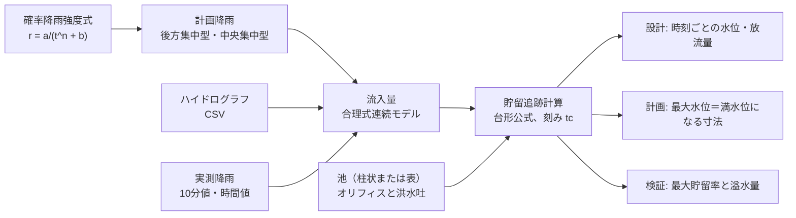
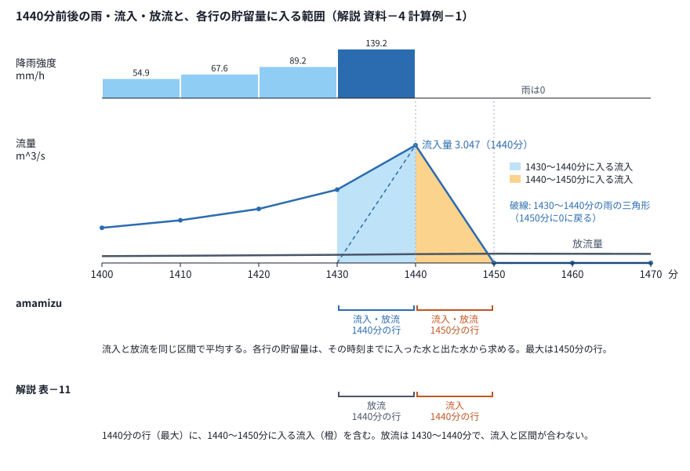

# 厳密計算の手順

貯留施設の**厳密計算**（貯留追跡計算）の手順と、その実行方法、手引の早見表による検証を説明する。
計算は千葉県の手引（宅地開発等に伴う雨水排水・貯留浸透計画策定の手引、平成18年9月）の第5条・第6条、資料－1、資料－2 に沿う。
強度式の係数と放流の係数は、study.json の `guideline` で選んだ手引の定数のファイル（`studies/_guideline/`）の値か、手引を使用しない検討では study.json に書いた値を使う（[条件設定](条件設定.md#手引を使用しない検討)）。
条件の書き方は [条件設定](条件設定.md)、入力ファイルと実測降雨の用意は [データの整理](データの整理.md) に記載している。

## 全体の流れ

厳密計算は、降雨を流入量に変え、池と放流施設の連続式を洪水到達時間 tc ごとに解く。
使い方は次の3つで、中心は設計である。ほかの2つは、検証の例（`studies/`）で使う。

- **設計**（`kind: design`）：実際の調整池の池と放流施設を与えて追跡する。最大放流量が目標値になるオリフィスの寸法も求められる。流入は計画降雨、実測降雨（10分値・時間値）、ハイドログラフのどれか。
- **モデル施設の計画**：手引どおり、計画降雨の最大水位がちょうど満水位になる池の面積とオリフィスを求める（貯留施設の検証と早見表の照合で使う）。貯留施設の検証では、これを安全側に丸める（[条件設定](条件設定.md#池の条件)）。
- **貯留施設の検証**（`kind: storage`）：モデル施設に実測の降雨を観測どおりの順序で与え、溢れるかを確かめる。流入量と追跡の計算は、設計の検討と同じである。



| 段階 | 手引 | コード |
| --- | --- | --- |
| 確率降雨強度式 | 資料－1 | `domain/intensity.py` |
| 計画降雨 | 図5－1 | `domain/design_storm.py`（`rear_loaded`、`center_loaded`） |
| 流入量 | 図5－3、表5－1 | `domain/runoff.py` の `rational_inflow` |
| 放流施設 | 第6条 | `domain/outlet.py`（`RectOrifice`、`CircleOrifice`、`Spillway`、`SquareOrifice`、`PumpTable`、`Outlets`） |
| 池 | 第6条 | `domain/pond.py`（`PrismaticPond`、`TablePond`） |
| 貯留追跡計算 | 第6条 | `domain/pond.py` の `route` |
| 寸法を求める | 第6条、資料－2 | `domain/design.py` |
| 設計の検討 | | `usecases/design_study.py` |
| 手引との照合 | 資料－1、資料－2 | `usecases/guideline_check.py`、`amamizu verify` |

## 1 確率降雨強度式

手引 資料－1 の式はすべてクリーブランド型である。

```
r = a / (t^n + b)      r: 平均降雨強度 mm/hr、t: 継続時間 分
R = r × t / 60         R: 継続時間 t の雨量 mm
```

係数は7地区×6確率年（5, 10, 30, 50, 100, 200年）の42式を `studies/_guideline/chiba_2006.json` に転記してある。
指数 n は手引の表記どおり分数（`"3/5"` など）で持ち、読み込むときに小数へ直す。

設計の検討と `amamizu rain` では、次の5方式から選んで係数を直接書くこともできる（`domain/intensity.py` の `formula_of`）。
どれも r＝a/(t^n＋b) の形で計算する。

| 種類（`type`） | 名前 | 式 | 書く係数 |
| --- | --- | --- | --- |
| `talbot` | タルボット | a/(t＋b) | a、b |
| `sherman` | シャーマン | a/t^n | a、n |
| `kuno_ishiguro` | 久野・石黒 | a/(t^0.5＋b) | a、b |
| `cleveland` | クリーブランド | a/(t^n＋b) | a、b、n |
| `kuno_ishiguro_n` | 久野・石黒（任意の n） | a/(t^n＋b) | a、b、n |

その方式で使わない係数（タルボットと久野・石黒の n、シャーマンの b）を書くと、エラーで止まる。
b が負で、分母 t^n＋b が0以下になる継続時間があるときもエラーで止まる。

## 2 洪水到達時間 tc と計算の刻み

合理式連続モデルでは、降雨を洪水到達時間 **tc** ごとに区切る。
tc は、計画降雨の区切り、流入量の三角形の底辺（2·tc）、貯留追跡計算の刻み Δt のすべてに使う。
既定は10分で、study.json の `tc_min` で変えられる。

| 検討 | 使える tc |
| --- | --- |
| 設計（`kind: design`） | 計画降雨の継続時間（既定24時間）を割り切る値。5・10・15・20・30・60分など。実測降雨のときは10の倍数。ハイドログラフのときはハイドログラフの時刻の刻みと同じ値 |
| 貯留施設の検証（`kind: storage`） | 10・20・30・60分。10分値を tc ごとに合計して使う（時間値は1時間の雨量を10分ずつ均等に配分してから、tc ごとに合計） |
| 早見表の照合 | 早見表の条件の10分（`chiba_2006.json` の `hayami_conditions`） |

tc を変えても、計画降雨の総雨量と流入量の総量（f×雨量×面積）は変わらない。

## 3 計画降雨（後方集中型、中央集中型）

計画降雨を tc ごとの区間に並べる。
継続時間は study.json の `rain.hours`（`amamizu rain` の `--hours`）で、既定は24時間である（24時間・tc＝10分なら144区間）。
継続時間が0以下か、tc で割り切れなければ、エラーで止まる。
区間の雨量の求め方は、どちらの波形も同じである。

1. 強度式から t＝tc, 2tc, 3tc … 継続時間（24時間なら1440分）の累加雨量 R(tc), R(2tc) … を求める。
2. 差分 R(tc), R(2tc)-R(tc), R(3tc)-R(2tc) … が、強い順に1番目、2番目、3番目 … の区間の雨量になる。
3. 各区間の雨量を 60/tc 倍して強度 mm/hr にする。

並べ方は波形で違う（study.json の `rain.shape`、`amamizu rain` の `--shape`）。

- **後方集中型**（`rear`、手引 図5－1）：弱い順に並べる。最後の区間が1番目。終わりから数えた tc の倍数の継続時間の雨量が、強度式のその継続時間の雨量と一致する。
- **中央集中型**（`center`）：1番目を中央（区間が N 個なら先頭から (N-1)//2 番目。24時間・10分なら 11:50〜12:00）に置き、2・4・6 … 番目をその後ろへ、3・5・7 … 番目をその前へ、中央に近いほど強くなるように並べる。

計画降雨だけを作るときは `amamizu rain` を使う。区間ごとの降雨強度と雨量の CSV と、図（PNG）を出力する。

```powershell
uv run amamizu rain --type cleveland --a 1914 --b 12.3 --n 3/4 --shape center --output rain.csv
uv run amamizu rain --guideline chiba_2006 --district 千葉 --return-period 50 --shape rear --tc 10 --output rain.csv
```

CSV の列は、区間（0:00〜0:10 など）、時、分（0〜10 など）、降雨強度(mm/h)、雨量(mm) である。
手引の式（`--district`、`--return-period`（既定 50）、`--guideline`）と、式の種類と係数（`--type`、`--a`、`--b`、`--n`）は、どちらか一方だけを指定する。
両方を指定するとエラーで止まる。

区間の降雨強度（mm/h）は、指定すれば丸められる（study.json の `rain.round_digits`、`amamizu rain` の `--round`）。
小数点以下の指定の桁で四捨五入し（Excel の ROUND と同じ。2.675 は 2.68）、丸めた値で流入量を計算する。
指定しなければ丸めない。

## 4 流入量（合理式連続モデル）

手引 図5－3 のモデルである。
各区間の降雨は、底辺が 2·tc の三角形のハイドログラフを作る。
三角形の頂点はその区間の終わりにあり、流量は合理式で求める。

```
Q = f × r × A / 360     Q: m3/s、f: 流出係数、r: mm/hr、A: 面積 ha
```

節点（tc ごとの時刻）での流入量は、その節点で終わる区間の Q になり、節点の間は直線でつながる。
先頭に0の節点を1つ、末尾にも0の節点を1つ足して、最後の三角形が0に戻るまでを含める。
流入量の総量は f × 雨量 × 面積 に一致する。

設計の検討では、流出係数の違う区域（浸透なし、浸透ありなど）ごとに流入量を求めて合計できる。
流入量をハイドログラフの CSV で与えることもできる（形式は [データの整理](データの整理.md#設計の検討の入力ファイル)）。
計画降雨の代わりに、実測降雨（`studies/_jma/` に取得した気象庁の10分値・時間値）を観測どおりの順序で区域に降らせることもできる（`observed_rain`。[データの整理](データの整理.md#設計の検討の実測降雨)）。
10分値を tc ごとに合計した強度（時間値は1時間の雨量を10分ずつ均等に配分してから、tc ごとに合計）を、計画降雨と同じ式で流入量にする。貯留施設の検証（`kind: storage`）と同じ計算である。

## 5 放流施設

自然放流のオリフィスと洪水吐を使う。
係数（越流係数 C_w、流量係数 C_o）と重力加速度 g は、study.json の `guideline` で選んだ手引の定数のファイルの `hydraulics` の値を使う（千葉県は C_w＝1.8、C_o＝0.6、g＝9.8）。
`guideline` が null の検討では、study.json に `hydraulics` を書く（[条件設定](条件設定.md#手引を使用しない検討)）。書かなければエラーで止まる。手引の定数を選んだ検討に書いても、エラーで止まる。
係数か g が0以下のとき、また 1.8D の放流量が 1.2D の放流量より小さくなる係数のときも、エラーで止まる。

**オリフィス**（`RectOrifice`）は、敷高 HL、幅 B、高さ D の長方形である。
敷高からの水深 y に応じて、次の式で放流量を求める。

| 敷高からの水深 | 式 |
| --- | --- |
| y ≦ 1.2D | 越流 Q = C_w × B × y^1.5 |
| y ≧ 1.8D | オリフィス Q = C_o × B × D × sqrt(2g(y-D/2)) |
| 1.2D ＜ y ＜ 1.8D | 両端の値（1.2D の越流の式と 1.8D のオリフィスの式）を直線で補間 |

**円形のオリフィス**（`CircleOrifice`）は、敷高 HL（円の下端）、直径 D のオリフィスである。

| 敷高からの水深 | 式 |
| --- | --- |
| y ≦ 1.2D | 越流 Q = (3/2) × C_w × ∫ b(z)·sqrt(y-z) dz（b(z) は高さ z での円の幅 2sqrt(z(D-z))） |
| y ≧ 1.8D | オリフィス Q = C_o × (πD^2/4) × sqrt(2g(y-D/2)) |
| 1.2D ＜ y ＜ 1.8D | 両端の値を直線で補間 |

越流の式は、水面より下のオリフィスの幅を高さ方向に積分したものである。
幅が一定（長方形）なら、積分は (2/3)·B·y^1.5 になり、長方形の越流の式 C_w × B × y^1.5 に一致する。
円より上の幅は0として積分しないので、水面が円の上端を超えると（D ＜ y ≦ 1.2D）、円全体の積分になる。
積分は、円の中心角で変数を置き換えてから64点のガウス・ルジャンドル積分で求める。
細かく分けた積分との差は相対 1e-10 程度で、水位が低いときは近似式 (3/2)·C_w·(π/4)·sqrt(D)·y^2 に一致する。

オリフィスは2つ以上書ける（`orifices`。2段のオリフィスなど）。放流量は各オリフィスの放流量の和で、上のオリフィスは水位がその敷高を超えてから流れる。

**ポンプ**（`PumpTable`）は、水位と排水量の表を線形補間する。
表の最初の水位より下は0、最後の水位より上は最後の排水量とする。
排水量が水位とともに減る表は、追跡の水位が一つに決まらないのでエラーにする。
最初の排水量が正なら、最初の水位で排水量が0から段になる。その段の上に連続式の解がある節点では、水位を段（最初の水位）に置き、
排水量を連続式が成り立つ値（0〜最初の排水量の間。間欠運転にあたる）にする（`route`）。池底で排水する表（最初の水位が池底以下で排水量が正）はエラーにする。

**洪水吐**（`Spillway`）は、敷高 HU、幅 BU の越流である。
水位が HU を超えた分に Q = C_w × BU × (H-HU)^1.5 を求め、オリフィスの放流量に足す。

モデル施設のオリフィス（`SquareOrifice`）は、下端を池底に置いた正方形のオリフィス（B＝D）である。
オリフィスの寸法は、満水位（HWL）で許容放流量ちょうどになる D を二分法で求める（`SquareOrifice.sized_for`）。
探す範囲は D ≦ HWL/1.8 なので、満水位では必ずオリフィスの式の範囲にある。
許容放流量は、許容放流比流量 qc（m^3/s/ha）×開発面積（ha）である。

## 6 池

**柱状の池**（`PrismaticPond`）は、面積が深さによらず一定の池である。
水位は池底からの水深で表す。

**表の池**（`TablePond`）は、水位・面積・容量の表で表す池である。
段のある池（底の狭い部分の上に広い部分があるなど）も表せる。
水位と容量、水位と面積の間は、表の行の間を線形補間する。
水位は標高など任意の基準の高さでよく、オリフィスと洪水吐の敷高も同じ基準で書く（[高さの基準](#高さの基準と池底とオリフィスの高さ関係)）。
表の最初の行の容量は0とし、水位と容量は下の行ほど大きくする（守られていなければエラー）。
容量を省いた表は、面積から平均断面法（隣り合う行の面積の平均 × 水位の差 の累計）で容量を求める（`TablePond.from_areas`）。
面積を省いた表では、水面積を出力しない。表より上は、最後の区間の容量の増え方（水位 1 m あたりの容量）のまま立ち上がるものとして扱う。
計算の基準は容量なので、面積の列があってもなくても同じに延ばす（面積の列は水面積の表示にだけ使う）。
表より上の水面積はこの容量の増え方で、最上段の面積と一致しないことがある（溢水として数える計算では、表より上の水位は結果に出ない）。

### 高さの基準と、池底とオリフィスの高さ関係

study.json と池の表に書く高さは、次のとおりである。

| 高さ | 表の池（`pond.table`） | 柱状の池（`pond.prismatic`） |
| --- | --- | --- |
| 池の表の水位（`水位_m`）、満水位（`pond.table.hwl_m`） | 利用者が決めた基準の高さ | （表はない） |
| 満水位（`pond.prismatic.hwl_m`） | （書かない） | 池底からの深さ |
| オリフィスの敷高（`orifice.sill_m`）、洪水吐の敷高（`spillway.crest_m`）、ポンプの水位（`pump.levels_m`） | 池の表の水位と同じ基準の高さ | 池底からの高さ |
| 池底 | 表の最初の行の水位 | 0 |

表の池では、基準を絶対標高（T.P. など）にしても、相対標高（池底を0とする高さ、任意の仮の高さ）にしてもよい。
計算に使うのは、池底・敷高・満水位の高さの差だけである。
そのため、すべての高さを同じ基準で書けば、放流量・貯留量・溢水量・判定は基準によらず同じになり、水位だけが基準の差の分ずれて出る。
計画図の高さと照らし合わせるなら、図面と同じ絶対標高で書くと水位の結果をそのまま図面と比べられる。
池の表だけ絶対標高にして敷高を池底からの高さで書く、のように基準を混ぜると、エラーにならずに誤った高さ関係で計算することがある
（敷高が池底より低くなるなど、[条件設定](条件設定.md#設計の検討kind-design)でエラーにあたる高さ関係なら止まる）。

柱状の池は、池底を0とする高さで書く。絶対標高で書くには、池の表（同じ面積の2行。例: 池底 T.P. 10.0 m と満水位 T.P. 12.0 m、どちらも 600 m^2）にする。

追跡は、池が空の状態（水位＝池底、貯留量0）から始める。
池底がオリフィスの敷高より低い池では、敷高までの容量が放流なしで先にたまり、この容量も雨水を貯める容量として計算する。
容量・最大貯留量・最大貯留率も池底から数える。
敷高より下が降雨の始めに空の池なら、そのまま池底から書けばよい。
堆砂のための容量や常に水がたまっている部分のように、降雨の始めに空でない部分があるなら、池の表をその部分の上端（常時の水位など）の行から始める。
その部分を池底から書くと、雨水を貯められない容量を貯める容量として数え、最大水位を低く、余裕を大きく見積もる。

## 7 貯留追跡計算

池の連続式を台形公式で解く。
刻み Δt は tc×60 秒で、流入量の節点と同じである。

```
V(n) + Δt/2 × O(n) = V(n-1) + Δt/2 × (I(n-1) + I(n) - O(n-1))
```

V は貯留量、I は流入量、O は放流量である。
右辺はすべて前の節点までで決まる。
左辺は水位の単調増加関数になるので、各節点で水位を一意に求める。
Illinois 法（はさみうち法の改良）で区間を狭め、最後に二分法で隣り合う浮動小数点数まで詰める。
求める水位は「左辺 ≦ 右辺 ＜ 次の浮動小数点数での左辺」となる水位で、二分法だけで詰めた場合と同じ値になる。
探す区間は、池底から「左辺が右辺を超える水位」までで、区間が解を挟むことを確かめてから詰める（挟まなければ計算を止める）。
区間の上端は容量から逆算した水位とし、丸めで左辺が右辺に届かないときは、刻みを倍にしながら届くまで上げる。
逆算した水位が浮動小数点数の範囲を超えるときは、満水位から刻みを倍にしながら上げる。水位そのものが範囲を超えるときはエラーにする。
満水位で溢れるかどうかは、右辺と満水位での左辺を比べて先に決め、溢れないときは満水位も上端の候補にする（低い方を使う）。
池底で放流量が正になる放流施設（池底より低いオリフィス、池底で排水するポンプ）はエラーで止まる。オリフィスの敷高とポンプの最初の水位を池底以上にする。
流入量に数でない値（NaN）か無限大があるとき、右辺が浮動小数点数の範囲を超えるときもエラーにする。
右辺が負になる節点は、池が1刻みの中で空になる節点である（右辺の Δt/2 × O(n-1) が、池にあった水と流入の和を超える）。
池にない水は放流できないので、その節点の水位を池底、放流量を0とし、その刻みの放流量を池にあった水と流入の和 V(n-1) ＋ Δt/2 × (I(n-1) ＋ I(n)) にする。
前後の節点の放流量の平均から求める Δt/2 × O(n-1) との差は放流しない。空になった時刻は注意で知らせる
（例: 池底の面積 79 m^2・tc 20分の池で、540〜560 分に空になり、放流量は 13.6 m^3。平均からは 23.1 m^3 で、池にない 9.5 m^3 は放流しない）。
そのため、この刻みの放流量は、route.csv の放流量の列を台形公式で足した値より少ない。

満水位を超える水位になった節点では、次のように扱う（`route` の `capped=True`）。

- 水位を満水位で止める。
- 左辺と右辺の差（満水位で収まらなかった水量）を**溢水量**として足し上げる。
- 溢れた水は池へ戻らない。

モデル施設の計画では、水位を止めず、最大水位が満水位を超えたかどうかを寸法の探索に使う。
満水位より上は、池の表の最後の区間の容量の増え方で池を延ばして計算する。

**最大貯留率**は、最大貯留量÷容量である。
溢れた降雨では1.000になる。

### 時刻の扱い

`route.csv` の時刻 t の行は、時刻 t の状態である。
降雨強度は t-tc〜t の区間の強度、流入量と放流量は時刻 t の値、水位と貯留量は時刻 t までに入った水と出た水から求めた値である。
連続式は、同じ区間（t-tc〜t）の始めと終わりの流入と放流をそれぞれ平均する形なので、時刻 t の貯留量に t より後の流入は入らない。

t-tc〜t の区間の雨は、三角形のハイドログラフ（[4 流入量](#4-流入量合理式連続モデル)）で、t-tc〜t に増えながら、t〜t+tc に減りながら池に入る。
そのため、雨が止んだ後の tc の間も池に水が入り、流入が放流を上回る間は水位が上がり続ける。
解説 資料－4 の計算例－1（後方集中型、tc 10分）では、最も強い区間（1430〜1440分）の後、雨が0の 1450分に水位と貯留量が最大になる。
同じ理由で、最初の区間の雨も、時刻 tc の行に増える側の水が入っている（計算例－1 の10分の行で 9.33 m^3）。



土木学会 水理公式集例題集の例題2.9「貯水池の洪水調節計算（穴あきダムによる流量変化）」のプログラム
（<https://github.com/ESEHH-CHHE-JSCE/2-9-ReservoirControl> の `runge.f90`）も、同じ時刻の扱いである。
dS/dt = 流入 - 放流 を4次のルンゲ・クッタ法で解き、区間の終わりの時刻の貯留量を、その区間までの流入（区間の中で一定）から求めている。
解説の表－11 の時刻の扱いはこれと異なる（[10 手引との照合](#10-手引との照合)）。

## 8 寸法を求める

| 関数 | 固定するもの | 求めるもの | 使う場面 |
| --- | --- | --- | --- |
| `size_orifice_for_peak` | 池、オリフィスの敷高、洪水吐 | 最大放流量が目標値になる正方形のオリフィスの一辺、または円形のオリフィスの直径 | 設計の検討（`mode: size_orifice`） |
| `required_pond_scale` | 池の水深（満水位）、オリフィスの敷高、洪水吐 | 溢れなくなる最小の面積の倍率と、そのときのオリフィス | 設計の検討で池の容量が足りないとき |
| `design_for_depth` | 満水位（池の深さ） | 池の面積（10〜100,000 m^2 の範囲） | 貯留施設の検証のモデル施設 |
| `design_for_area` | 池の面積 | 満水位（0.05〜50 m の範囲） | 手引の早見表の再現 |

`size_orifice_for_peak` は、オリフィスの寸法（一辺または直径）を二分法で変えて追跡計算を繰り返す。
見つけたオリフィスで最大放流量が目標値と一致しなければ、エラーで止まる。
そのオリフィスで池が溢れる場合、設計の検討（`mode: size_orifice`）はエラーで止めず、`required_pond_scale` で池の容量の不足を示す。
溢れるかどうかの境目の池では、最大水位がちょうど満水位になり、そのときの放流量が目標値になる。
そこでオリフィスを「満水位での放流量（洪水吐なども含む）が目標値になる寸法」に決め（倍率を変えても満水位は変わらないので、池の大きさによらない）、そのオリフィスで溢れない最小の面積の倍率を等比の二分法で求める。
表の池は面積と容量に同じ倍率を掛け、水位は変えない（`scaled`）。
要約の「池の容量の不足」に倍率・必要な容量・不足量を書き、判定（溢水・総合）は N.G にする。オリフィスと追跡の結果は、面積を広げた池のものを示す。

`design_for_depth` と `design_for_area` は、計画降雨の最大水位がちょうど満水位になる寸法を、等比の二分法で探す。
探索の範囲に解がなく範囲の端で止まった場合や、満水位で許容放流量になるオリフィスが作れない場合は、エラーで止まる。
**計画容量**は、決まった施設の満水位までの容量である（計画降雨の最大水位がちょうど満水位なので、計画降雨での最大貯留量と同じ）。
二分法は、隣り合う浮動小数点数まで詰めたところで打ち切る（それ以上は区間が変わらない）。

## 9 設計の厳密計算を行う

WebGUI（`amamizu gui`）で条件を入力して計算できる（[WebGUI](WebGUI.md)）。
一覧の「貯留追跡計算を行う」で検討フォルダ `studies/<年-月>_<題名>/` と study.json を作り、条件を入力して「保存して出力」を押す。
ハイドログラフを使うときは、先にそのファイルを `input/` に置いておく（形式は [データの整理](データの整理.md#設計の検討の入力ファイル)）。
実測降雨を使うときは、先に `amamizu fetch` でその地点・期間の10分値か時間値を `studies/_jma/` に取得しておく（[データの整理](データの整理.md#設計の検討の実測降雨)）。
池の表も WebGUI で入力でき、保存すると `input/` に CSV が作成される。

WebGUI を使わないときは、次のとおりにする。

1. 検討フォルダ `studies/<年-月>_<題名>/` を作る。
2. 池の表、ハイドログラフのファイルを `input/` に置く。実測降雨は `studies/_jma/` に取得しておく。
3. `study.json` に `kind: design`、`guideline`（手引の定数の名前か .json のパス。使用しないときは null と、放流の係数 `hydraulics`）、流入・池・放流施設・計算の種類を書く（項目は [条件設定](条件設定.md#設計の検討kind-design)）。
4. `uv run amamizu study studies\<検討>` を実行する。

計画降雨で寸法を決めてから実測降雨で確かめるまでの通しの例は [手順例](手順例.md) にある。

結果は検討フォルダの `out/` に出力される（WebGUI の「保存して出力」でも同じファイルが出力される）。
計算がエラーで止まったときは、out/ を変えない。
次の一式は、すべて出力できたときだけ残る。出力の途中でエラーになれば（グラフを出力できないときなど）、前の実行の同じ名前のファイルも含めて一式を削除する。
前の出力にあって今回の出力にないファイル（流入を降雨強度の列（`rain_col`）のないハイドログラフに変えたときの `rain.csv`）は、出力を終えたときも、出力の途中で失敗したときも削除する。削除するのは、前の出力のファイルとして `out/conditions.json` に記録したファイルだけである。

| ファイル | 内容 |
| --- | --- |
| `out/route.csv` | 時刻ごとの追跡の結果（解説 資料－4 の表－11 にあたる）。降雨強度（計画降雨・実測降雨のときと、ハイドログラフに降雨強度の列（`rain_col`）があるとき）、流入量（浸透があれば区域ごとの流入量と浸透後流入量も）、放流量、水位、水面積（池の表に面積があるとき）、貯留量。列名に単位 |
| `out/inflow.csv` | 流出量の計算結果（解説 資料－4 の表－9 にあたる）。区切りの終わりの時刻 `時刻_分`、`降雨強度_mmh`、区域ごとの流入量（区域が2つ以上か区域ごとの浸透のとき。浸透のある区域は浸透後も）、`浸透前流入量_m3s`（浸透のとき）、池への流入量 `流入量_m3s`。ハイドログラフの入力と同じ形なので、`inflow_csv` にそのまま使える（降雨強度も読むなら `rain_col` に `降雨強度_mmh`）。値は追跡に使った丸める前の値を小数6桁にしたもの |
| `out/rain.csv` | 降雨の表（計画降雨・実測降雨のときと、ハイドログラフに降雨強度の列（`rain_col`）があるとき。`amamizu rain` と同じ形式。実測降雨は先頭に区間の日時の列がある） |
| `out/design_summary.md` | 洪水到達時間 tc、流入（計画降雨は「計画降雨」（手引の地区・確率年と波形）と「降雨強度式」の行、実測降雨は「実測降雨」（地点・値の種類・期間）、「観測値」（`studies/_jma/<地点名>_<地点番号>`）、「時刻0分」、欠測の時間・取得していない時間の行、ハイドログラフは「流入ハイドログラフ」の行）、オリフィスの敷高と形・寸法、洪水吐の敷高と幅、ポンプ、浸透（区域ごとに、書き方・設計浸透量・空隙貯留量・浸透施設の内訳の行に分ける。区域ごとの浸透では区域の浸透前・浸透後の最大流入量も）、浸透処理面積率、浸透前の最大流入量、許容放流量、池の容量の不足（あるとき）、最大流入量・最大放流量・最大水位（時刻つき。実測降雨は日時も）、最大貯留量、容量、最大貯留率、溢水量、余裕量と余裕率、判定、グラフ |
| `out/hydrograph.png` | 降雨強度（上、下向きの棒。計画降雨・実測降雨のときと、ハイドログラフに降雨強度の列（`rain_col`）があるとき）と流入量・放流量の時間変化。許容放流量の線。water_level.png と幅・描画の領域の左右・横軸の範囲をそろえる（上下に並べて同じ時刻を読める） |
| `out/water_level.png` | 水位の時間変化。オリフィスの敷高・洪水吐の敷高・満水位の線 |
| `out/pond_curves.png` | 池と放流施設の特性（水位と容量、水位と放流量）。入力の池の表とオリフィス・洪水吐の確認に使う |
| `out/conditions.json` | 結果を作った条件（study.json の内容と池の表の行）と、出力したファイルの名前（`files`）。実測降雨のときは、計算に使った観測値の記録（「観測値」）も書く。WebGUI は今の条件と比べて、出力の後に変更した条件（実測降雨のときは、変わった観測値も）を表示する（[WebGUI](WebGUI.md#保存と保存して出力)） |
| `out/design_summary.pdf` | design_summary.md の表とグラフ3枚に、時刻ごとの追跡の結果の表（route.csv と同じ値。列ごとに桁をそろえる）を足して A4 に清書した PDF（日本語のフォントはグラフと同じものを埋め込む。作るたびに同じバイト） |

満水位を超えたときは、溢水量を要約に書き、実行の最後に「注意:」として表示する。
許容放流量（`allowable_q_m3s`、`size_orifice` では目標値）を最大放流量が超えたときも、「注意:」として表示する。

グラフは、文字が読めなくならないように次のように作る。

- 日本語のフォント（[README の「日本語のフォント」](../README.md#日本語のフォント)のどれか）がなければ、out/ に何も残さずにエラーで止まる。
- フォントにない文字（□ になる文字）が題名などにあれば、out/ に何も残さずにエラーで止まる。
- 凡例は、軸の目盛りと軸のラベルの下（図の外）に置く。凡例が描画の領域・ほかの文字・ほかの凡例に重なれば、エラーで止まる。
- 最大値は、線の上の印と凡例の文に書く（線の近くに浮いた注記は置かない）。長いタイトルは折り返す。

## 浸透（一定量差し引き）

追跡の前に流入量から浸透を差し引く（一定量差し引きモデル。`domain/infiltration.py`）。

1. 施設ごとの設計浸透量 m^3/h ＝ 比浸透量 K（m^2）× 飽和透水係数（m/h）× 数量 × 影響係数（目づまり × 地下水位 × 安全率 α）。全施設の和を 3600 で割って m^3/s にする。
2. 空隙貯留量 m^3 ＝ 1単位あたりの（体積 × 空隙率）の和 × 数量 の全施設の和。
3. 各時刻の流入量が設計浸透量より小さければ0。超えた分（× 刻みの秒数）は、まず空隙貯留を満たし、満ちるまでは流さない。満ちた時刻は残りを流量に直して流し、以後は超えた分をそのまま流す。

浸透は、区域全体で1つ（最上位の `infiltration`）か、区域ごと（`catchments` の各区域の `infiltration`）のどちらか一方に書く。
区域ごとに書くと、浸透を書いた区域（浸透処理区域）の流入から、その区域の設計浸透量と空隙貯留を 3 の手順で差し引き、浸透を書かない区域（無処理区域）の流入をそのまま足して池への流入にする（手引 第10条 図10－3）。
ある区域の施設の余りで、ほかの区域の水を浸透させることはない。
区域全体で1つに書くと、全区域の流入の合計から差し引く（区域が1つなら、区域ごとに書いても同じ値）。ハイドログラフ（`inflow_csv`）の流入は区域がないので、区域全体で1つに書く。
区域全体で1つに書くと、浸透処理面積率が100%未満のとき、無処理区域の水まで浸透させるので、必要な容量を小さく見積もる（手引 表10－2 の千葉地区 15 mm/h・20% で、表の 952 m^3/ha に対して約 870 m^3/ha）。

設計浸透量は、直接（`rate_m3s`）、設計浸透強度から（`intensity_mmh`）、浸透施設から（`facilities`）のどれかで書く。
設計浸透強度からは、設計浸透量 m^3/h ＝ 設計浸透強度 mm/h × 浸透処理面積 ha × 10 で求める（手引 第10条(5) の「設計浸透強度 ＝ 設計浸透量 ／（浸透処理面積 × 10）」の逆。`design_rate_m3s`）。
浸透処理面積は、区域ごとなら区域の面積、区域全体で1つなら区域の合計の面積。ハイドログラフの流入では面積がないので、浸透強度では書けない。

比浸透量 K は、施設の種類と設計水頭 H・幅 W・直径 D・延長 L の式で求める。

| 種類（`kind`） | 施設 | 寸法 | 適用範囲 |
| --- | --- | --- | --- |
| `pavement` | 透水性舗装（浸透池） | H | H ≦ 1.5 m |
| `trench` | 浸透側溝および浸透トレンチ | H、W | H ≦ 1.5 m、W ≦ 1.5 m |
| `circle_side_bottom` | 円筒ます（側面および底面） | H、D | H ≦ 5 m（1.5 m を超えると静水圧指標で比例配分）、0.2 ≦ D ≦ 10 m |
| `circle_bottom` | 円筒ます（底面） | H、D | 0.3 ≦ D ≦ 1 m で H ≦ 5 m、1 ＜ D ≦ 10 m で H ≦ 1.5 m |
| `square_side_bottom` | 正方形ますおよび空隙貯留浸透施設（側面および底面） | H、W | H ≦ 5 m（W ≦ 1 m で 1.5 m を超えると比例配分）、W ≦ 80 m |
| `square_bottom` | 正方形ます（底面） | H、W | H ≦ 5 m、W ≦ 80 m |
| `rect_side_bottom` | 矩形のますおよび空隙貯留浸透施設（側面および底面） | H、W、L | H ≦ 5 m、W ≦ 4 m、L ≦ 200 m |
| `large_side_bottom` | 大型貯留浸透槽（側面および底面） | H、W、L | 0.5 ＜ H ≦ 5 m、5 ≦ W ≦ 50 m、1 ≦ L/W ≦ 5（W の表の間は K を線形補間） |
| `large_bottom` | 大型貯留浸透槽（底面） | H、W、L | 同上 |

適用範囲の外は計算しない（エラーで止まる）。

## 10 手引との照合

`uv run amamizu verify` で、計算が手引の値を再現するかを確かめる。

- **強度式**：転記した42式で t＝10分・60分・1440分の強度を求め、資料－1 の表の値の小数の桁数（`formula_table_conditions` の `digits`、1桁）に丸めて比べる。ずれは0件。
- **早見表**：資料－2 の必要洪水調節容量早見表（1/50、浸透なし、7地区×流出率5段×許容放流比流量4列の140マス）を、早見表の条件（池の面積は開発面積の5%、洪水到達時間10分）で `design_for_area` により計算する。140マスが ±0.7% 以内で一致する。

このうち我孫子地区、流出率0.90、許容放流比流量0.040 のマスは、手引の表の値を訂正して収録している。
手引の表は981 m^3/ha で、計算の928 m^3/ha と5.4%違う。
981 は同じ行と同じ列の並びから外れているので（同じ列の流出率0.85 は845 で、ほかの列・地区と同じ増え方なら930 前後になる）、表の誤記とみて、`chiba_2006.json` の `hayami` には表の条件で計算した928 を書いた。
このマスの照合は計算した値どうしの比較になるので、手引の値と比べているのは残りの139マスである。

- **浸透ありの容量の表**：第10条 表10－2（1/50、開発面積 1.0 ha、流出率0.8、7地区×浸透なしと設計浸透強度 5・10・15 mm/h×浸透処理面積率 20〜100% の112マス）を計算する。
  表に書かれていない条件は、池の面積を早見表と同じ開発面積の5%、浸透処理区域の流出率を0.8 とし、浸透処理区域の流入だけから設計浸透量を差し引く。112マスが ±0.7% 以内（最大 -0.55%）で一致する。

手引の解説 資料－4 の計算例－1（A開発地区 9.45 ha、千葉地区、浸透処理区域 4.329 ha・流出率1.0・設計浸透強度 13.05 mm/h、無処理区域 5.121 ha・流出率0.773、G調整池）も、区域ごとの浸透（浸透処理区域に `intensity_mmh`）で、試験（`tests/test_kaisetsu.py`）により再現を確かめている。

- 表－9 の流出量は、全144行が小数3桁の表示の範囲で一致する。浸透なしは流出率0.877（本文の0.88 は丸めた値）で計算してある。
- 表－11 の貯留追跡の時刻の扱いには疑義がある。表の値は、20分以降のすべての行で次の式に合う（差は丸めの範囲の 0.4 m^3 以下）。

  ```
  V(t) = V(t-10) + [(I(t) + I(t+10))/2 - (O(t-10) + O(t))/2] × 600
  ```

  流入は t〜t+10、放流は t-10〜t の区間の平均で、流入と放流の区間が合っていない。
  このため、時刻 t の貯留量に、t より後（t〜t+10）に入る水が入っている（[時刻の扱い](#時刻の扱い)の図の橙の部分）。
  1440分の行の 7,612.5 m^3 は、1440〜1450分に入る水を含む（6,837.3 + [(3.047 + 0)/2 - (0.227 + 0.236)/2] × 600 = 7,612.5）。
  10分の行の 27.8 m^3 も 0〜20分の流入を含み、ここの計算の20分の 27.7 m^3 とほぼ同じである。
  表－9 の流出量は時刻が一致するので、ずれは貯留追跡の連続式で生じている。
  ここでは流入と放流の区間をそろえた連続式（[7 貯留追跡計算](#時刻の扱い)）で計算し、ここの時刻 t+10 を解説の時刻 t と比べている。
  容量の差は最大 39.7 m^3（1750分）、最大貯留量は 7,612.5 に対して 7,598 m^3（14.5 m^3、0.2% 小さい）である。
- 解説の池水深は、3 m を超えると図－10 の水位容量表と合わない曲線で求めてある。そのため、水深は比べない。
- 表－10 のオリフィスの口径（許容放流量 0.236 m^3/s を満たす正方形）は、浸透施設併用で 0.211 m に対して 0.2096 m、調整池単独で 0.195 m に対して 0.1956 m になる。洪水調節容量は、7,613 に対して 7,628 m^3、11,344 に対して 11,354 m^3 になる。

## 継続時間ごとの雨量

実測降雨が計画のどの継続時間で1/50を超えたかを見るため、継続時間（1, 3, 6, 12, 24時間）ごとの最大雨量を強度式の雨量と比べる（`domain/rainfall.py` の `duration_depths`）。
求め方は [データの整理](データの整理.md#継続時間ごとの雨量) にある。
この比較は判定の説明に使うもので、溢れたかどうかは追跡計算だけで決まる。

## 再現期間（降雨強度の検証）

降雨強度の検証（`kind: return_period`）では、追跡計算を使わず、年最大10分間降水量にグンベル分布を当てはめる（`domain/frequency.py`）。
当てはめはモーメント法で、標本の平均 m と標準偏差 s（不偏）から求める。

```
beta = s × sqrt(6) / π            規模パラメータ
mu   = m - 0.5772157 × beta  位置パラメータ
F(x) = exp(-exp(-(x-mu)/beta))   非超過確率
T    = 1 / (1 - F(x))       再現期間 年
```

基準の値は、県の10年確率式の t＝10分の強度（mm/hr）を6で割って mm/10分 にしたものである。
再現期間は丸めない強度で求め、レポートの表示だけ小数1桁にする。
標本の作り方は [データの整理](データの整理.md#年最大値系列の標本) にある。
