# 県の手引きによる貯留施設の検証

この検討の計算を、モデル施設・計画降雨・地点・降雨ごとに示す。

計算に使った気象庁の観測値には準正常値（`)`）が 80 個、公表値との照合に使った年ごとの値には資料不足値（`]`）が 45 個含まれる。

## 1 モデル施設

開発面積1ha、柱状の貯留施設（深さ2.0m）、自然放流（正方形のオリフィス、下端は池底）、浸透施設なし、流出係数 f＝0.8（不浸透面積率50%）。許容放流比流量は手引き 第5条(3) の下限値。
池の面積とオリフィスの寸法は、地区の1/50計画降雨（後方集中型24時間、10分ブロック）で、最大水位が満水位（HWL＝2.0m）にちょうど達する寸法を求め、溢れない向きに丸めた（オリフィスは1mm単位で切り捨て、池の面積はそのオリフィスで求め直して1m²単位で切り上げ）。
早見表の列は、同じ計算を早見表の条件（池の面積を開発面積の5%、深さを必要容量に合わせる）で行い、手引き 資料－2 の値（不浸透面積率50%、流出率0.80、設計浸透強度0mm/h）と比べたもの。

| 地区 | Qc m3/s/ha | 計画容量 m3 | 池の面積 m² | オリフィス m | 早見表の条件での計算 m3/ha | 早見表 m3/ha |
| --- | ---: | ---: | ---: | ---: | ---: | ---: |
| 我孫子 | 0.025 | 1054 | 527 | 0.082 | 1052 | 1052 |
| 横利根 | 0.025 | 1402 | 701 | 0.082 | 1392 | 1391 |
| 銚子 | 0.025 | 1526 | 763 | 0.082 | 1514 | 1514 |
| 松戸 | 0.025 | 1502 | 751 | 0.082 | 1490 | 1490 |
| 千葉 | 0.025 | 1152 | 576 | 0.082 | 1147 | 1147 |
| 勝浦 | 0.035 | 1752 | 876 | 0.097 | 1729 | 1732 |
| 館山 | 0.035 | 1500 | 750 | 0.097 | 1484 | 1487 |

手法を確認するため、f＝0.9 の行も含めた14件すべてで早見表と照合し、±0.3% 以内を確認した。

## 2 計画降雨（1/50、後方集中型24時間）

手引き 図5－1 の方法で作成した。資料－1 の1/50の式から t＝10, 20 … 1440分の累加雨量を求め、その差分を小さい順に並べる（10分ブロック×144個）。単位は mm/hr。
縦に開始からの時刻を表し、横方向に分を表す。1行で1時間（6ブロック）を記載した。

### 我孫子地区 r＝817/(t^(3/5)+1.3)

24時間雨量 245.6 mm、最後の10分 154.7 mm/hr。

| 時 | 0〜10分 | 10〜20 | 20〜30 | 30〜40 | 40〜50 | 50〜60 |
| ---: | ---: | ---: | ---: | ---: | ---: | ---: |
| 0 | 4.203 | 4.221 | 4.239 | 4.257 | 4.275 | 4.294 |
| 1 | 4.313 | 4.332 | 4.351 | 4.370 | 4.390 | 4.410 |
| 2 | 4.430 | 4.451 | 4.472 | 4.493 | 4.514 | 4.536 |
| 3 | 4.557 | 4.579 | 4.602 | 4.625 | 4.648 | 4.671 |
| 4 | 4.694 | 4.718 | 4.743 | 4.767 | 4.792 | 4.817 |
| 5 | 4.843 | 4.869 | 4.895 | 4.922 | 4.949 | 4.977 |
| 6 | 5.005 | 5.033 | 5.062 | 5.091 | 5.121 | 5.151 |
| 7 | 5.182 | 5.213 | 5.244 | 5.277 | 5.309 | 5.343 |
| 8 | 5.376 | 5.411 | 5.446 | 5.481 | 5.517 | 5.554 |
| 9 | 5.592 | 5.630 | 5.669 | 5.708 | 5.749 | 5.790 |
| 10 | 5.832 | 5.874 | 5.918 | 5.962 | 6.008 | 6.054 |
| 11 | 6.101 | 6.149 | 6.199 | 6.249 | 6.300 | 6.353 |
| 12 | 6.406 | 6.461 | 6.518 | 6.575 | 6.634 | 6.694 |
| 13 | 6.756 | 6.819 | 6.884 | 6.951 | 7.019 | 7.089 |
| 14 | 7.161 | 7.235 | 7.311 | 7.390 | 7.470 | 7.553 |
| 15 | 7.638 | 7.726 | 7.817 | 7.911 | 8.007 | 8.107 |
| 16 | 8.211 | 8.317 | 8.428 | 8.542 | 8.661 | 8.784 |
| 17 | 8.913 | 9.046 | 9.184 | 9.328 | 9.479 | 9.636 |
| 18 | 9.800 | 9.972 | 10.152 | 10.341 | 10.540 | 10.749 |
| 19 | 10.969 | 11.202 | 11.448 | 11.709 | 11.987 | 12.283 |
| 20 | 12.599 | 12.937 | 13.301 | 13.693 | 14.117 | 14.578 |
| 21 | 15.081 | 15.633 | 16.241 | 16.917 | 17.672 | 18.523 |
| 22 | 19.492 | 20.608 | 21.909 | 23.453 | 25.321 | 27.641 |
| 23 | 30.620 | 34.626 | 40.394 | 49.658 | 68.089 | 154.703 |

### 横利根地区 r＝3845/(t^(4/5)+15.7)

24時間雨量 262.2 mm、最後の10分 174.7 mm/hr。

| 時 | 0〜10分 | 10〜20 | 20〜30 | 30〜40 | 40〜50 | 50〜60 |
| ---: | ---: | ---: | ---: | ---: | ---: | ---: |
| 0 | 2.583 | 2.599 | 2.615 | 2.631 | 2.648 | 2.665 |
| 1 | 2.682 | 2.699 | 2.717 | 2.734 | 2.752 | 2.771 |
| 2 | 2.789 | 2.808 | 2.827 | 2.847 | 2.867 | 2.887 |
| 3 | 2.907 | 2.928 | 2.949 | 2.970 | 2.992 | 3.014 |
| 4 | 3.036 | 3.059 | 3.082 | 3.106 | 3.130 | 3.154 |
| 5 | 3.179 | 3.204 | 3.229 | 3.255 | 3.282 | 3.309 |
| 6 | 3.336 | 3.364 | 3.393 | 3.422 | 3.451 | 3.482 |
| 7 | 3.512 | 3.543 | 3.575 | 3.608 | 3.641 | 3.675 |
| 8 | 3.710 | 3.745 | 3.781 | 3.818 | 3.855 | 3.893 |
| 9 | 3.933 | 3.973 | 4.014 | 4.055 | 4.098 | 4.142 |
| 10 | 4.187 | 4.233 | 4.280 | 4.328 | 4.377 | 4.428 |
| 11 | 4.480 | 4.533 | 4.587 | 4.643 | 4.701 | 4.760 |
| 12 | 4.820 | 4.882 | 4.947 | 5.012 | 5.080 | 5.150 |
| 13 | 5.222 | 5.296 | 5.372 | 5.451 | 5.532 | 5.616 |
| 14 | 5.703 | 5.792 | 5.885 | 5.980 | 6.080 | 6.182 |
| 15 | 6.289 | 6.399 | 6.514 | 6.633 | 6.757 | 6.886 |
| 16 | 7.020 | 7.160 | 7.306 | 7.458 | 7.617 | 7.784 |
| 17 | 7.958 | 8.141 | 8.332 | 8.534 | 8.746 | 8.969 |
| 18 | 9.205 | 9.453 | 9.717 | 9.996 | 10.292 | 10.607 |
| 19 | 10.943 | 11.302 | 11.686 | 12.098 | 12.541 | 13.019 |
| 20 | 13.535 | 14.096 | 14.706 | 15.373 | 16.105 | 16.911 |
| 21 | 17.804 | 18.797 | 19.910 | 21.163 | 22.587 | 24.216 |
| 22 | 26.100 | 28.300 | 30.903 | 34.028 | 37.849 | 42.623 |
| 23 | 48.750 | 56.895 | 68.248 | 85.193 | 113.474 | 174.697 |

### 銚子地区 r＝1654/(t^(2/3)+4.3)

24時間雨量 301.1 mm、最後の10分 185.0 mm/hr。

| 時 | 0〜10分 | 10〜20 | 20〜30 | 30〜40 | 40〜50 | 50〜60 |
| ---: | ---: | ---: | ---: | ---: | ---: | ---: |
| 0 | 4.466 | 4.487 | 4.509 | 4.531 | 4.553 | 4.576 |
| 1 | 4.599 | 4.622 | 4.645 | 4.669 | 4.692 | 4.717 |
| 2 | 4.741 | 4.766 | 4.791 | 4.817 | 4.843 | 4.869 |
| 3 | 4.895 | 4.922 | 4.950 | 4.977 | 5.005 | 5.034 |
| 4 | 5.063 | 5.092 | 5.122 | 5.152 | 5.182 | 5.214 |
| 5 | 5.245 | 5.277 | 5.309 | 5.342 | 5.376 | 5.410 |
| 6 | 5.444 | 5.479 | 5.515 | 5.551 | 5.588 | 5.626 |
| 7 | 5.664 | 5.702 | 5.742 | 5.782 | 5.822 | 5.864 |
| 8 | 5.906 | 5.949 | 5.993 | 6.037 | 6.083 | 6.129 |
| 9 | 6.176 | 6.224 | 6.273 | 6.323 | 6.374 | 6.426 |
| 10 | 6.479 | 6.533 | 6.588 | 6.644 | 6.702 | 6.761 |
| 11 | 6.821 | 6.882 | 6.945 | 7.009 | 7.075 | 7.142 |
| 12 | 7.211 | 7.282 | 7.354 | 7.428 | 7.504 | 7.582 |
| 13 | 7.662 | 7.744 | 7.828 | 7.915 | 8.004 | 8.095 |
| 14 | 8.189 | 8.286 | 8.386 | 8.488 | 8.594 | 8.703 |
| 15 | 8.816 | 8.932 | 9.052 | 9.176 | 9.305 | 9.437 |
| 16 | 9.575 | 9.718 | 9.866 | 10.020 | 10.179 | 10.346 |
| 17 | 10.519 | 10.699 | 10.887 | 11.083 | 11.289 | 11.503 |
| 18 | 11.729 | 11.965 | 12.213 | 12.474 | 12.750 | 13.040 |
| 19 | 13.348 | 13.674 | 14.020 | 14.388 | 14.780 | 15.200 |
| 20 | 15.650 | 16.134 | 16.656 | 17.221 | 17.835 | 18.505 |
| 21 | 19.240 | 20.049 | 20.947 | 21.948 | 23.073 | 24.347 |
| 22 | 25.807 | 27.496 | 29.478 | 31.841 | 34.715 | 38.300 |
| 23 | 42.918 | 49.131 | 58.027 | 72.065 | 98.531 | 184.978 |

### 松戸地区 r＝1745/(t^(2/3)+9.6)

24時間雨量 305.4 mm、最後の10分 122.5 mm/hr。

| 時 | 0〜10分 | 10〜20 | 20〜30 | 30〜40 | 40〜50 | 50〜60 |
| ---: | ---: | ---: | ---: | ---: | ---: | ---: |
| 0 | 4.848 | 4.871 | 4.895 | 4.920 | 4.944 | 4.969 |
| 1 | 4.994 | 5.020 | 5.045 | 5.071 | 5.098 | 5.125 |
| 2 | 5.152 | 5.179 | 5.207 | 5.235 | 5.264 | 5.293 |
| 3 | 5.322 | 5.352 | 5.382 | 5.413 | 5.444 | 5.475 |
| 4 | 5.507 | 5.540 | 5.573 | 5.606 | 5.640 | 5.674 |
| 5 | 5.709 | 5.744 | 5.780 | 5.817 | 5.854 | 5.891 |
| 6 | 5.930 | 5.968 | 6.008 | 6.048 | 6.089 | 6.130 |
| 7 | 6.172 | 6.215 | 6.259 | 6.303 | 6.348 | 6.394 |
| 8 | 6.441 | 6.489 | 6.537 | 6.586 | 6.637 | 6.688 |
| 9 | 6.740 | 6.793 | 6.847 | 6.903 | 6.959 | 7.017 |
| 10 | 7.075 | 7.135 | 7.196 | 7.259 | 7.323 | 7.388 |
| 11 | 7.454 | 7.523 | 7.592 | 7.663 | 7.736 | 7.811 |
| 12 | 7.887 | 7.965 | 8.045 | 8.128 | 8.212 | 8.298 |
| 13 | 8.386 | 8.477 | 8.571 | 8.666 | 8.765 | 8.866 |
| 14 | 8.970 | 9.077 | 9.188 | 9.301 | 9.418 | 9.539 |
| 15 | 9.663 | 9.792 | 9.924 | 10.061 | 10.203 | 10.350 |
| 16 | 10.502 | 10.659 | 10.822 | 10.992 | 11.168 | 11.350 |
| 17 | 11.541 | 11.739 | 11.945 | 12.161 | 12.386 | 12.621 |
| 18 | 12.867 | 13.126 | 13.397 | 13.682 | 13.982 | 14.298 |
| 19 | 14.631 | 14.985 | 15.359 | 15.756 | 16.179 | 16.630 |
| 20 | 17.113 | 17.630 | 18.186 | 18.786 | 19.435 | 20.140 |
| 21 | 20.910 | 21.753 | 22.682 | 23.711 | 24.859 | 26.147 |
| 22 | 27.606 | 29.274 | 31.203 | 33.464 | 36.157 | 39.430 |
| 23 | 43.510 | 48.771 | 55.881 | 66.198 | 83.152 | 122.528 |

### 千葉地区 r＝2439/(t^(3/4)+11.9)

24時間雨量 238.3 mm、最後の10分 139.2 mm/hr。

| 時 | 0〜10分 | 10〜20 | 20〜30 | 30〜40 | 40〜50 | 50〜60 |
| ---: | ---: | ---: | ---: | ---: | ---: | ---: |
| 0 | 2.851 | 2.867 | 2.883 | 2.900 | 2.916 | 2.933 |
| 1 | 2.950 | 2.968 | 2.985 | 3.003 | 3.022 | 3.040 |
| 2 | 3.059 | 3.077 | 3.097 | 3.116 | 3.136 | 3.156 |
| 3 | 3.176 | 3.197 | 3.218 | 3.239 | 3.260 | 3.282 |
| 4 | 3.304 | 3.327 | 3.350 | 3.373 | 3.397 | 3.421 |
| 5 | 3.445 | 3.470 | 3.495 | 3.521 | 3.547 | 3.573 |
| 6 | 3.600 | 3.628 | 3.656 | 3.684 | 3.713 | 3.743 |
| 7 | 3.773 | 3.803 | 3.834 | 3.866 | 3.898 | 3.931 |
| 8 | 3.965 | 3.999 | 4.034 | 4.069 | 4.105 | 4.142 |
| 9 | 4.180 | 4.219 | 4.258 | 4.298 | 4.340 | 4.382 |
| 10 | 4.424 | 4.468 | 4.513 | 4.559 | 4.606 | 4.654 |
| 11 | 4.704 | 4.754 | 4.806 | 4.859 | 4.913 | 4.969 |
| 12 | 5.026 | 5.084 | 5.145 | 5.206 | 5.270 | 5.335 |
| 13 | 5.402 | 5.471 | 5.542 | 5.616 | 5.691 | 5.769 |
| 14 | 5.849 | 5.931 | 6.017 | 6.105 | 6.196 | 6.290 |
| 15 | 6.387 | 6.488 | 6.593 | 6.701 | 6.813 | 6.930 |
| 16 | 7.051 | 7.177 | 7.308 | 7.445 | 7.587 | 7.735 |
| 17 | 7.890 | 8.053 | 8.222 | 8.400 | 8.587 | 8.783 |
| 18 | 8.989 | 9.206 | 9.435 | 9.678 | 9.934 | 10.205 |
| 19 | 10.494 | 10.800 | 11.128 | 11.477 | 11.852 | 12.254 |
| 20 | 12.688 | 13.156 | 13.664 | 14.216 | 14.818 | 15.479 |
| 21 | 16.207 | 17.013 | 17.910 | 18.916 | 20.051 | 21.342 |
| 22 | 22.825 | 24.547 | 26.570 | 28.983 | 31.913 | 35.549 |
| 23 | 40.189 | 46.325 | 54.855 | 67.613 | 89.213 | 139.185 |

### 勝浦地区 r＝5193/(t^(4/5)+23.6)

24時間雨量 346.3 mm、最後の10分 173.6 mm/hr。

| 時 | 0〜10分 | 10〜20 | 20〜30 | 30〜40 | 40〜50 | 50〜60 |
| ---: | ---: | ---: | ---: | ---: | ---: | ---: |
| 0 | 3.655 | 3.678 | 3.701 | 3.725 | 3.749 | 3.774 |
| 1 | 3.798 | 3.824 | 3.849 | 3.875 | 3.901 | 3.928 |
| 2 | 3.955 | 3.983 | 4.010 | 4.039 | 4.068 | 4.097 |
| 3 | 4.126 | 4.157 | 4.187 | 4.218 | 4.250 | 4.282 |
| 4 | 4.315 | 4.348 | 4.381 | 4.416 | 4.451 | 4.486 |
| 5 | 4.522 | 4.559 | 4.596 | 4.634 | 4.673 | 4.712 |
| 6 | 4.752 | 4.793 | 4.835 | 4.877 | 4.920 | 4.964 |
| 7 | 5.009 | 5.055 | 5.102 | 5.149 | 5.198 | 5.247 |
| 8 | 5.298 | 5.349 | 5.402 | 5.456 | 5.511 | 5.567 |
| 9 | 5.624 | 5.683 | 5.743 | 5.804 | 5.866 | 5.931 |
| 10 | 5.996 | 6.063 | 6.132 | 6.203 | 6.275 | 6.349 |
| 11 | 6.425 | 6.503 | 6.583 | 6.665 | 6.749 | 6.835 |
| 12 | 6.924 | 7.015 | 7.109 | 7.205 | 7.305 | 7.407 |
| 13 | 7.512 | 7.621 | 7.732 | 7.848 | 7.967 | 8.089 |
| 14 | 8.216 | 8.347 | 8.483 | 8.623 | 8.768 | 8.918 |
| 15 | 9.074 | 9.235 | 9.403 | 9.577 | 9.758 | 9.946 |
| 16 | 10.141 | 10.345 | 10.558 | 10.779 | 11.011 | 11.253 |
| 17 | 11.506 | 11.771 | 12.049 | 12.341 | 12.648 | 12.971 |
| 18 | 13.311 | 13.670 | 14.049 | 14.450 | 14.875 | 15.327 |
| 19 | 15.807 | 16.319 | 16.865 | 17.450 | 18.077 | 18.752 |
| 20 | 19.478 | 20.264 | 21.117 | 22.044 | 23.056 | 24.166 |
| 21 | 25.387 | 26.738 | 28.239 | 29.918 | 31.807 | 33.946 |
| 22 | 36.390 | 39.208 | 42.490 | 46.361 | 50.994 | 56.637 |
| 23 | 63.661 | 72.649 | 84.582 | 101.275 | 126.675 | 173.623 |

### 館山地区 r＝3498/(t^(3/4)+20.9)

24時間雨量 329.7 mm、最後の10分 131.9 mm/hr。

| 時 | 0〜10分 | 10〜20 | 20〜30 | 30〜40 | 40〜50 | 50〜60 |
| ---: | ---: | ---: | ---: | ---: | ---: | ---: |
| 0 | 4.292 | 4.317 | 4.342 | 4.367 | 4.393 | 4.419 |
| 1 | 4.446 | 4.473 | 4.500 | 4.527 | 4.555 | 4.584 |
| 2 | 4.613 | 4.642 | 4.671 | 4.701 | 4.732 | 4.763 |
| 3 | 4.794 | 4.826 | 4.858 | 4.891 | 4.925 | 4.958 |
| 4 | 4.993 | 5.028 | 5.063 | 5.099 | 5.136 | 5.173 |
| 5 | 5.211 | 5.249 | 5.288 | 5.328 | 5.368 | 5.409 |
| 6 | 5.451 | 5.494 | 5.537 | 5.581 | 5.626 | 5.671 |
| 7 | 5.718 | 5.765 | 5.813 | 5.862 | 5.912 | 5.963 |
| 8 | 6.015 | 6.068 | 6.122 | 6.177 | 6.233 | 6.291 |
| 9 | 6.349 | 6.409 | 6.470 | 6.532 | 6.596 | 6.661 |
| 10 | 6.728 | 6.796 | 6.865 | 6.936 | 7.009 | 7.084 |
| 11 | 7.160 | 7.238 | 7.318 | 7.400 | 7.484 | 7.570 |
| 12 | 7.658 | 7.749 | 7.842 | 7.938 | 8.036 | 8.137 |
| 13 | 8.240 | 8.347 | 8.457 | 8.570 | 8.686 | 8.806 |
| 14 | 8.929 | 9.057 | 9.188 | 9.324 | 9.464 | 9.609 |
| 15 | 9.758 | 9.913 | 10.073 | 10.240 | 10.412 | 10.590 |
| 16 | 10.776 | 10.968 | 11.168 | 11.377 | 11.594 | 11.820 |
| 17 | 12.056 | 12.302 | 12.559 | 12.829 | 13.111 | 13.407 |
| 18 | 13.717 | 14.044 | 14.387 | 14.750 | 15.132 | 15.537 |
| 19 | 15.965 | 16.419 | 16.902 | 17.416 | 17.965 | 18.553 |
| 20 | 19.182 | 19.859 | 20.589 | 21.379 | 22.235 | 23.168 |
| 21 | 24.187 | 25.307 | 26.541 | 27.911 | 29.439 | 31.155 |
| 22 | 33.096 | 35.312 | 37.866 | 40.844 | 44.366 | 48.600 |
| 23 | 53.800 | 60.359 | 68.939 | 80.768 | 98.571 | 131.883 |

## 3 千葉豪雨（2026年8月13〜15日）18地点

18地点の10分値を用いて、それぞれの地区のモデル施設で厳密計算を行った。
継続時間ごとの雨量は「実測 / 1/50」（mm）と表記した。1/50 は、その地点が属する地区の1/50の降雨強度式から求めた、同じ継続時間の雨量である。
1時間は、日別値表の最大1時間降水量（公表値）と、毎正時で区切った1時間雨量の最大の、大きいほう。6〜24時間は毎正時で区切った1時間雨量の連続和の最大。
欠測の時間は、期間内の10分値のもの。欠測は0mm として計算した。

| 地点 | 地区 | 3日合計 mm | 1時間 | 6時間 | 12時間 | 24時間 | 計画容量 m3 | 最大貯留率 | 溢水量 m3 | 欠測の時間 |
| --- | --- | ---: | ---: | ---: | ---: | ---: | ---: | ---: | ---: | --- |
| 佐倉 | 千葉 | 311.5 | 97.0 / 72.9 | 211.0 / 154.8 | 233.5 / 194.0 | 273.5 / 238.3 | 1152 | **溢水** | 288 |  |
| 千葉 | 千葉 | 387.0 | 115.0 / 72.9 | 284.0 / 154.8 | 347.0 / 194.0 | 367.0 / 238.3 | 1152 | **溢水** | 963 |  |
| 茂原 | 横利根 | 252.0 | 57.0 / 91.2 | 194.0 / 182.2 | 227.0 / 220.9 | 245.5 / 262.2 | 1402 | 98% | 0 |  |
| 船橋 | 千葉 | 235.5 | 62.0 / 72.9 | 167.0 / 154.8 | 192.0 / 194.0 | 210.0 / 238.3 | 1152 | 94% | 0 |  |
| 我孫子 | 我孫子 | 217.5 | 61.0 / 63.0 | 159.5 / 138.2 | 193.5 / 184.6 | 213.0 / 245.6 | 1054 | 93% | 0 |  |
| 牛久 | 千葉 | 241.5 | 49.0 / 72.9 | 152.5 / 154.8 | 189.0 / 194.0 | 233.0 / 238.3 | 1152 | 89% | 0 |  |
| 館山 | 館山 | 224.0 | 94.5 / 82.4 | 203.5 / 202.7 | 207.5 / 262.5 | 211.0 / 329.7 | 1500 | 88% | 0 |  |
| 大多喜 | 勝浦 | 268.0 | 56.5 / 103.7 | 168.0 / 231.6 | 181.0 / 287.5 | 211.0 / 346.3 | 1752 | 63% | 0 |  |
| 坂畑 | 館山 | 192.0 | 46.0 / 82.4 | 118.5 / 202.7 | 131.0 / 262.5 | 149.0 / 329.7 | 1500 | 46% | 0 |  |
| 鋸南 | 館山 | 134.5 | 41.0 / 82.4 | 93.0 / 202.7 | 105.0 / 262.5 | 117.0 / 329.7 | 1500 | 37% | 0 |  |
| 木更津 | 千葉 | 164.5 | 39.0 / 72.9 | 51.5 / 154.8 | 78.5 / 194.0 | 121.0 / 238.3 | 1152 | 30% | 0 |  |
| 勝浦 | 勝浦 | 119.5 | 38.5 / 103.7 | 75.0 / 231.6 | 84.5 / 287.5 | 101.5 / 346.3 | 1752 | 25% | 0 |  |
| 横芝光 | 横利根 | 97.5 | 23.5 / 91.2 | 51.0 / 182.2 | 70.5 / 220.9 | 82.5 / 262.2 | 1402 | 23% | 0 |  |
| 鴨川 | 館山 | 77.5 | 21.5 / 82.4 | 54.0 / 202.7 | 60.5 / 262.5 | 69.0 / 329.7 | 1500 | 21% | 0 |  |
| 成田 | 我孫子 | 68.0 | 19.5 / 63.0 | 24.5 / 138.2 | 41.5 / 184.6 | 65.0 / 245.6 | 1054 | 13% | 0 |  |
| 香取 | 横利根 | 32.0 | 17.0 / 91.2 | 17.0 / 182.2 | 23.5 / 220.9 | 25.0 / 262.2 | 1402 | 10% | 0 |  |
| 東庄 | 銚子 | 40.0 | 17.0 / 84.3 | 20.0 / 180.7 | 26.5 / 234.5 | 30.0 / 301.1 | 1526 | 10% | 0 |  |
| 銚子 | 銚子 | 51.0 | 19.5 / 84.3 | 21.5 / 180.7 | 35.5 / 234.5 | 42.5 / 301.1 | 1526 | 10% | 0 |  |

## 4 台風25号（2026年9月20〜22日）18地点

18地点の10分値を用いて、それぞれの地区のモデル施設で厳密計算を行った。
継続時間ごとの雨量は「実測 / 1/50」（mm）と表記した。1/50 は、その地点が属する地区の1/50の降雨強度式から求めた、同じ継続時間の雨量である。
1時間は、日別値表の最大1時間降水量（公表値）と、毎正時で区切った1時間雨量の最大の、大きいほう。6〜24時間は毎正時で区切った1時間雨量の連続和の最大。
欠測の時間は、期間内の10分値のもの。欠測は0mm として計算した。

| 地点 | 地区 | 3日合計 mm | 1時間 | 6時間 | 12時間 | 24時間 | 計画容量 m3 | 最大貯留率 | 溢水量 m3 | 欠測の時間 |
| --- | --- | ---: | ---: | ---: | ---: | ---: | ---: | ---: | ---: | --- |
| 佐倉 | 千葉 | 377.5 | 50.5 / 72.9 | 161.5 / 154.8 | 179.5 / 194.0 | 316.0 / 238.3 | 1152 | **溢水** | 55 |  |
| 千葉 | 千葉 | 419.0 | 43.5 / 72.9 | 176.5 / 154.8 | 204.5 / 194.0 | 351.5 / 238.3 | 1152 | **溢水** | 284 |  |
| 茂原 | 横利根 | 465.0 | 54.0 / 91.2 | 163.5 / 182.2 | 217.5 / 220.9 | 365.5 / 262.2 | 1402 | **溢水** | 229 |  |
| 木更津 | 千葉 | 400.5 | 40.0 / 72.9 | 162.0 / 154.8 | 207.5 / 194.0 | 317.5 / 238.3 | 1152 | **溢水** | 171 |  |
| 船橋 | 千葉 | 393.5 | 37.5 / 72.9 | 153.0 / 154.8 | 181.0 / 194.0 | 342.5 / 238.3 | 1152 | **溢水** | 134 |  |
| 牛久 | 千葉 | 487.0 | 50.0 / 72.9 | 180.0 / 154.8 | 253.0 / 194.0 | 392.0 / 238.3 | 1152 | **溢水** | 618 |  |
| 成田 | 我孫子 | 327.0 | 51.5 / 63.0 | 161.0 / 138.2 | 180.5 / 184.6 | 258.0 / 245.6 | 1054 | 98% | 0 |  |
| 我孫子 | 我孫子 | 327.5 | 42.0 / 63.0 | 133.5 / 138.2 | 153.5 / 184.6 | 293.0 / 245.6 | 1054 | 93% | 0 |  |
| 坂畑 | 館山 | 476.5 | 50.5※ / 82.4 | 139.5 / 202.7 | 195.5 / 262.5 | 375.0 / 329.7 | 1500 | 87% | 0 | 9/21 18:40〜9/22 24:00 |
| 香取 | 横利根 | 310.0 | 61.0 / 91.2 | 175.0 / 182.2 | 201.0 / 220.9 | 249.5 / 262.2 | 1402 | 85% | 0 |  |
| 大多喜 | 勝浦 | 488.5 | 50.0※ / 103.7 | 158.0 / 231.6 | 217.5 / 287.5 | 362.0 / 346.3 | 1752 | 81% | 0 | 9/21 20:10〜9/22 24:00 |
| 横芝光 | 横利根 | 305.0 | 53.0 / 91.2 | 148.0 / 182.2 | 188.0 / 220.9 | 229.5 / 262.2 | 1402 | 79% | 0 |  |
| 東庄 | 銚子 | 289.0 | 50.5 / 84.3 | 159.5 / 180.7 | 204.5 / 234.5 | 224.5 / 301.1 | 1526 | 78% | 0 |  |
| 鋸南 | 館山 | 417.5 | 37.0 / 82.4 | 136.5 / 202.7 | 210.5 / 262.5 | 330.5 / 329.7 | 1500 | 75% | 0 |  |
| 館山 | 館山 | 434.5 | 44.0 / 82.4 | 146.0 / 202.7 | 207.5 / 262.5 | 331.0 / 329.7 | 1500 | 73% | 0 |  |
| 鴨川 | 館山 | 371.5 | 47.0 / 82.4 | 122.0 / 202.7 | 158.0 / 262.5 | 271.5 / 329.7 | 1500 | 63% | 0 | 9/21 20:10〜9/22 16:30 |
| 銚子 | 銚子 | 265.5 | 37.0 / 84.3 | 122.5 / 180.7 | 154.0 / 234.5 | 177.0 / 301.1 | 1526 | 59% | 0 |  |
| 勝浦 | 勝浦 | 386.0 | 37.0 / 103.7 | 133.5 / 231.6 | 174.0 / 287.5 | 229.0 / 346.3 | 1752 | 53% | 0 |  |

※ は、降雨の日に1時間の公表値のない日を含む降雨。1時間は、公表値のある日の公表値と、毎正時で区切った1時間雨量の最大の、大きいほう（公表値のない日の最大1時間は含まない）。

## 5 台風25号で溢れた6地点の貯留施設の水位

4の表で溢れた地点の、貯留施設の水位の推移を示す。
6地点とも、最初の24時間の雨で水位は0.56〜0.90 mまで上がり、その後も0.46〜0.81 mを下回らないまま、9/21 17:10〜19:50（41〜44時間目）の雨で満水位（2.0 m）に達した。降り始めから降り終わりまでは39〜43時間だった。

満水の時間は、水位が満水位にあった時間の合計。

| 地点 | 満水位に達した時刻 | 満水の時間 h | 溢水量 m3 |
| --- | --- | ---: | ---: |
| 牛久 | 9/21 18:00（42.0時間目） | 2.8 | 618 |
| 千葉 | 9/21 17:10（41.2時間目） | 3.2 | 284 |
| 茂原 | 9/21 19:10（43.2時間目） | 2.0 | 229 |
| 木更津 | 9/21 17:10（41.2時間目） | 2.2 | 171 |
| 船橋 | 9/21 17:50（41.8時間目） | 2.0 | 134 |
| 佐倉 | 9/21 19:50（43.8時間目） | 0.7 | 55 |

図は地点ごとに、上が1時間ごとの雨量、下が水位（1時間ごとの最大）。水位の赤は実測、青は参考として1/50計画降雨を与えたときの水位、灰は満水位。横軸は降雨の開始（9/20 0時）からの時間で、どの地点も96時間。水位は満水位で頭打ち（超えた分は溢水）。

### 牛久（千葉地区）

```mermaid
%%{init: {"xyChart": {"width": 900, "height": 300}, "themeVariables": {"xyChart": {"plotColorPalette": "#d03b3b, #ffffff", "backgroundColor": "#ffffff"}}}}%%
xychart-beta
    title "牛久 1時間ごとの雨量"
    x-axis "開始からの時間 h" ["​", "​​", "​​​", "​​​​", "​​​​​", "6", "​​​​​​​", "​​​​​​​​", "​​​​​​​​​", "​​​​​​​​​​", "​​​​​​​​​​​", "12", "​​​​​​​​​​​​​", "​​​​​​​​​​​​​​", "​​​​​​​​​​​​​​​", "​​​​​​​​​​​​​​​​", "​​​​​​​​​​​​​​​​​", "18", "​​​​​​​​​​​​​​​​​​​", "​​​​​​​​​​​​​​​​​​​​", "​​​​​​​​​​​​​​​​​​​​​", "​​​​​​​​​​​​​​​​​​​​​​", "​​​​​​​​​​​​​​​​​​​​​​​", "24", "​​​​​​​​​​​​​​​​​​​​​​​​​", "​​​​​​​​​​​​​​​​​​​​​​​​​​", "​​​​​​​​​​​​​​​​​​​​​​​​​​​", "​​​​​​​​​​​​​​​​​​​​​​​​​​​​", "​​​​​​​​​​​​​​​​​​​​​​​​​​​​​", "30", "​​​​​​​​​​​​​​​​​​​​​​​​​​​​​​​", "​​​​​​​​​​​​​​​​​​​​​​​​​​​​​​​​", "​​​​​​​​​​​​​​​​​​​​​​​​​​​​​​​​​", "​​​​​​​​​​​​​​​​​​​​​​​​​​​​​​​​​​", "​​​​​​​​​​​​​​​​​​​​​​​​​​​​​​​​​​​", "36", "​​​​​​​​​​​​​​​​​​​​​​​​​​​​​​​​​​​​​", "​​​​​​​​​​​​​​​​​​​​​​​​​​​​​​​​​​​​​​", "​​​​​​​​​​​​​​​​​​​​​​​​​​​​​​​​​​​​​​​", "​​​​​​​​​​​​​​​​​​​​​​​​​​​​​​​​​​​​​​​​", "​​​​​​​​​​​​​​​​​​​​​​​​​​​​​​​​​​​​​​​​​", "42", "​​​​​​​​​​​​​​​​​​​​​​​​​​​​​​​​​​​​​​​​​​​", "​​​​​​​​​​​​​​​​​​​​​​​​​​​​​​​​​​​​​​​​​​​​", "​​​​​​​​​​​​​​​​​​​​​​​​​​​​​​​​​​​​​​​​​​​​​", "​​​​​​​​​​​​​​​​​​​​​​​​​​​​​​​​​​​​​​​​​​​​​​", "​​​​​​​​​​​​​​​​​​​​​​​​​​​​​​​​​​​​​​​​​​​​​​​", "48", "​​​​​​​​​​​​​​​​​​​​​​​​​​​​​​​​​​​​​​​​​​​​​​​​​", "​​​​​​​​​​​​​​​​​​​​​​​​​​​​​​​​​​​​​​​​​​​​​​​​​​", "​​​​​​​​​​​​​​​​​​​​​​​​​​​​​​​​​​​​​​​​​​​​​​​​​​​", "​​​​​​​​​​​​​​​​​​​​​​​​​​​​​​​​​​​​​​​​​​​​​​​​​​​​", "​​​​​​​​​​​​​​​​​​​​​​​​​​​​​​​​​​​​​​​​​​​​​​​​​​​​​", "54", "​​​​​​​​​​​​​​​​​​​​​​​​​​​​​​​​​​​​​​​​​​​​​​​​​​​​​​​", "​​​​​​​​​​​​​​​​​​​​​​​​​​​​​​​​​​​​​​​​​​​​​​​​​​​​​​​​", "​​​​​​​​​​​​​​​​​​​​​​​​​​​​​​​​​​​​​​​​​​​​​​​​​​​​​​​​​", "​​​​​​​​​​​​​​​​​​​​​​​​​​​​​​​​​​​​​​​​​​​​​​​​​​​​​​​​​​", "​​​​​​​​​​​​​​​​​​​​​​​​​​​​​​​​​​​​​​​​​​​​​​​​​​​​​​​​​​​", "60", "​​​​​​​​​​​​​​​​​​​​​​​​​​​​​​​​​​​​​​​​​​​​​​​​​​​​​​​​​​​​​", "​​​​​​​​​​​​​​​​​​​​​​​​​​​​​​​​​​​​​​​​​​​​​​​​​​​​​​​​​​​​​​", "​​​​​​​​​​​​​​​​​​​​​​​​​​​​​​​​​​​​​​​​​​​​​​​​​​​​​​​​​​​​​​​", "​​​​​​​​​​​​​​​​​​​​​​​​​​​​​​​​​​​​​​​​​​​​​​​​​​​​​​​​​​​​​​​​", "​​​​​​​​​​​​​​​​​​​​​​​​​​​​​​​​​​​​​​​​​​​​​​​​​​​​​​​​​​​​​​​​​", "66", "​​​​​​​​​​​​​​​​​​​​​​​​​​​​​​​​​​​​​​​​​​​​​​​​​​​​​​​​​​​​​​​​​​​", "​​​​​​​​​​​​​​​​​​​​​​​​​​​​​​​​​​​​​​​​​​​​​​​​​​​​​​​​​​​​​​​​​​​​", "​​​​​​​​​​​​​​​​​​​​​​​​​​​​​​​​​​​​​​​​​​​​​​​​​​​​​​​​​​​​​​​​​​​​​", "​​​​​​​​​​​​​​​​​​​​​​​​​​​​​​​​​​​​​​​​​​​​​​​​​​​​​​​​​​​​​​​​​​​​​​", "​​​​​​​​​​​​​​​​​​​​​​​​​​​​​​​​​​​​​​​​​​​​​​​​​​​​​​​​​​​​​​​​​​​​​​​", "72", "​​​​​​​​​​​​​​​​​​​​​​​​​​​​​​​​​​​​​​​​​​​​​​​​​​​​​​​​​​​​​​​​​​​​​​​​​", "​​​​​​​​​​​​​​​​​​​​​​​​​​​​​​​​​​​​​​​​​​​​​​​​​​​​​​​​​​​​​​​​​​​​​​​​​​", "​​​​​​​​​​​​​​​​​​​​​​​​​​​​​​​​​​​​​​​​​​​​​​​​​​​​​​​​​​​​​​​​​​​​​​​​​​​", "​​​​​​​​​​​​​​​​​​​​​​​​​​​​​​​​​​​​​​​​​​​​​​​​​​​​​​​​​​​​​​​​​​​​​​​​​​​​", "​​​​​​​​​​​​​​​​​​​​​​​​​​​​​​​​​​​​​​​​​​​​​​​​​​​​​​​​​​​​​​​​​​​​​​​​​​​​​", "78", "​​​​​​​​​​​​​​​​​​​​​​​​​​​​​​​​​​​​​​​​​​​​​​​​​​​​​​​​​​​​​​​​​​​​​​​​​​​​​​​", "​​​​​​​​​​​​​​​​​​​​​​​​​​​​​​​​​​​​​​​​​​​​​​​​​​​​​​​​​​​​​​​​​​​​​​​​​​​​​​​​", "​​​​​​​​​​​​​​​​​​​​​​​​​​​​​​​​​​​​​​​​​​​​​​​​​​​​​​​​​​​​​​​​​​​​​​​​​​​​​​​​​", "​​​​​​​​​​​​​​​​​​​​​​​​​​​​​​​​​​​​​​​​​​​​​​​​​​​​​​​​​​​​​​​​​​​​​​​​​​​​​​​​​​", "​​​​​​​​​​​​​​​​​​​​​​​​​​​​​​​​​​​​​​​​​​​​​​​​​​​​​​​​​​​​​​​​​​​​​​​​​​​​​​​​​​​", "84", "​​​​​​​​​​​​​​​​​​​​​​​​​​​​​​​​​​​​​​​​​​​​​​​​​​​​​​​​​​​​​​​​​​​​​​​​​​​​​​​​​​​​​", "​​​​​​​​​​​​​​​​​​​​​​​​​​​​​​​​​​​​​​​​​​​​​​​​​​​​​​​​​​​​​​​​​​​​​​​​​​​​​​​​​​​​​​", "​​​​​​​​​​​​​​​​​​​​​​​​​​​​​​​​​​​​​​​​​​​​​​​​​​​​​​​​​​​​​​​​​​​​​​​​​​​​​​​​​​​​​​​", "​​​​​​​​​​​​​​​​​​​​​​​​​​​​​​​​​​​​​​​​​​​​​​​​​​​​​​​​​​​​​​​​​​​​​​​​​​​​​​​​​​​​​​​​", "​​​​​​​​​​​​​​​​​​​​​​​​​​​​​​​​​​​​​​​​​​​​​​​​​​​​​​​​​​​​​​​​​​​​​​​​​​​​​​​​​​​​​​​​​", "90", "​​​​​​​​​​​​​​​​​​​​​​​​​​​​​​​​​​​​​​​​​​​​​​​​​​​​​​​​​​​​​​​​​​​​​​​​​​​​​​​​​​​​​​​​​​​", "​​​​​​​​​​​​​​​​​​​​​​​​​​​​​​​​​​​​​​​​​​​​​​​​​​​​​​​​​​​​​​​​​​​​​​​​​​​​​​​​​​​​​​​​​​​​", "​​​​​​​​​​​​​​​​​​​​​​​​​​​​​​​​​​​​​​​​​​​​​​​​​​​​​​​​​​​​​​​​​​​​​​​​​​​​​​​​​​​​​​​​​​​​​", "​​​​​​​​​​​​​​​​​​​​​​​​​​​​​​​​​​​​​​​​​​​​​​​​​​​​​​​​​​​​​​​​​​​​​​​​​​​​​​​​​​​​​​​​​​​​​​", "​​​​​​​​​​​​​​​​​​​​​​​​​​​​​​​​​​​​​​​​​​​​​​​​​​​​​​​​​​​​​​​​​​​​​​​​​​​​​​​​​​​​​​​​​​​​​​​", "96"]
    y-axis "mm" 0 --> 60
    bar [0.0, 0.0, 0.5, 0.0, 0.5, 1.0, 3.5, 8.0, 10.0, 15.5, 9.5, 2.5, 3.0, 7.0, 2.5, 2.5, 3.5, 5.0, 10.0, 1.5, 7.5, 6.0, 18.5, 28.0, 29.0, 5.0, 7.5, 2.0, 6.5, 10.0, 8.5, 11.5, 6.5, 2.5, 2.5, 0.0, 6.5, 44.0, 19.0, 6.0, 33.0, 34.5, 39.5, 48.0, 17.5, 1.5, 0.0, 0.0, 0.0, 0.0, 0.0, 0.0, 0.0, 0.0, 0.0, 0.0, 0.0, 0.0, 0.0, 0.0, 0.0, 0.0, 0.0, 0.0, 0.0, 0.0, 0.0, 0.0, 0.0, 0.0, 0.0, 0.0, 0.0, 0.0, 0.0, 0.0, 0.0, 0.0, 0.0, 0.0, 0.0, 0.0, 0.0, 0.0, 0.0, 0.0, 0.0, 0.0, 0.0, 0.0, 0.0, 0.0, 0.0, 0.0, 0.0, 0.0]
    bar [0, 0, 0, 0, 0, 0, 0, 0, 0, 0, 0, 0, 0, 0, 0, 0, 0, 0, 0, 0, 0, 0, 0, 0, 0, 0, 0, 0, 0, 0, 0, 0, 0, 0, 0, 0, 0, 0, 0, 0, 0, 0, 0, 0, 0, 0, 0, 0, 0, 0, 0, 0, 0, 0, 0, 0, 0, 0, 0, 0, 0, 0, 0, 0, 0, 0, 0, 0, 0, 0, 0, 0, 0, 0, 0, 0, 0, 0, 0, 0, 0, 0, 0, 0, 0, 0, 0, 0, 0, 0, 0, 0, 0, 0, 0, 0]
```

```mermaid
%%{init: {"xyChart": {"width": 900, "height": 300}, "themeVariables": {"xyChart": {"plotColorPalette": "#d03b3b, #1a4f8f, #7a7a7a"}}}}%%
xychart-beta
    title "牛久 貯留施設の水位"
    x-axis "開始からの時間 h" ["​", "​​", "​​​", "​​​​", "​​​​​", "6", "​​​​​​​", "​​​​​​​​", "​​​​​​​​​", "​​​​​​​​​​", "​​​​​​​​​​​", "12", "​​​​​​​​​​​​​", "​​​​​​​​​​​​​​", "​​​​​​​​​​​​​​​", "​​​​​​​​​​​​​​​​", "​​​​​​​​​​​​​​​​​", "18", "​​​​​​​​​​​​​​​​​​​", "​​​​​​​​​​​​​​​​​​​​", "​​​​​​​​​​​​​​​​​​​​​", "​​​​​​​​​​​​​​​​​​​​​​", "​​​​​​​​​​​​​​​​​​​​​​​", "24", "​​​​​​​​​​​​​​​​​​​​​​​​​", "​​​​​​​​​​​​​​​​​​​​​​​​​​", "​​​​​​​​​​​​​​​​​​​​​​​​​​​", "​​​​​​​​​​​​​​​​​​​​​​​​​​​​", "​​​​​​​​​​​​​​​​​​​​​​​​​​​​​", "30", "​​​​​​​​​​​​​​​​​​​​​​​​​​​​​​​", "​​​​​​​​​​​​​​​​​​​​​​​​​​​​​​​​", "​​​​​​​​​​​​​​​​​​​​​​​​​​​​​​​​​", "​​​​​​​​​​​​​​​​​​​​​​​​​​​​​​​​​​", "​​​​​​​​​​​​​​​​​​​​​​​​​​​​​​​​​​​", "36", "​​​​​​​​​​​​​​​​​​​​​​​​​​​​​​​​​​​​​", "​​​​​​​​​​​​​​​​​​​​​​​​​​​​​​​​​​​​​​", "​​​​​​​​​​​​​​​​​​​​​​​​​​​​​​​​​​​​​​​", "​​​​​​​​​​​​​​​​​​​​​​​​​​​​​​​​​​​​​​​​", "​​​​​​​​​​​​​​​​​​​​​​​​​​​​​​​​​​​​​​​​​", "42", "​​​​​​​​​​​​​​​​​​​​​​​​​​​​​​​​​​​​​​​​​​​", "​​​​​​​​​​​​​​​​​​​​​​​​​​​​​​​​​​​​​​​​​​​​", "​​​​​​​​​​​​​​​​​​​​​​​​​​​​​​​​​​​​​​​​​​​​​", "​​​​​​​​​​​​​​​​​​​​​​​​​​​​​​​​​​​​​​​​​​​​​​", "​​​​​​​​​​​​​​​​​​​​​​​​​​​​​​​​​​​​​​​​​​​​​​​", "48", "​​​​​​​​​​​​​​​​​​​​​​​​​​​​​​​​​​​​​​​​​​​​​​​​​", "​​​​​​​​​​​​​​​​​​​​​​​​​​​​​​​​​​​​​​​​​​​​​​​​​​", "​​​​​​​​​​​​​​​​​​​​​​​​​​​​​​​​​​​​​​​​​​​​​​​​​​​", "​​​​​​​​​​​​​​​​​​​​​​​​​​​​​​​​​​​​​​​​​​​​​​​​​​​​", "​​​​​​​​​​​​​​​​​​​​​​​​​​​​​​​​​​​​​​​​​​​​​​​​​​​​​", "54", "​​​​​​​​​​​​​​​​​​​​​​​​​​​​​​​​​​​​​​​​​​​​​​​​​​​​​​​", "​​​​​​​​​​​​​​​​​​​​​​​​​​​​​​​​​​​​​​​​​​​​​​​​​​​​​​​​", "​​​​​​​​​​​​​​​​​​​​​​​​​​​​​​​​​​​​​​​​​​​​​​​​​​​​​​​​​", "​​​​​​​​​​​​​​​​​​​​​​​​​​​​​​​​​​​​​​​​​​​​​​​​​​​​​​​​​​", "​​​​​​​​​​​​​​​​​​​​​​​​​​​​​​​​​​​​​​​​​​​​​​​​​​​​​​​​​​​", "60", "​​​​​​​​​​​​​​​​​​​​​​​​​​​​​​​​​​​​​​​​​​​​​​​​​​​​​​​​​​​​​", "​​​​​​​​​​​​​​​​​​​​​​​​​​​​​​​​​​​​​​​​​​​​​​​​​​​​​​​​​​​​​​", "​​​​​​​​​​​​​​​​​​​​​​​​​​​​​​​​​​​​​​​​​​​​​​​​​​​​​​​​​​​​​​​", "​​​​​​​​​​​​​​​​​​​​​​​​​​​​​​​​​​​​​​​​​​​​​​​​​​​​​​​​​​​​​​​​", "​​​​​​​​​​​​​​​​​​​​​​​​​​​​​​​​​​​​​​​​​​​​​​​​​​​​​​​​​​​​​​​​​", "66", "​​​​​​​​​​​​​​​​​​​​​​​​​​​​​​​​​​​​​​​​​​​​​​​​​​​​​​​​​​​​​​​​​​​", "​​​​​​​​​​​​​​​​​​​​​​​​​​​​​​​​​​​​​​​​​​​​​​​​​​​​​​​​​​​​​​​​​​​​", "​​​​​​​​​​​​​​​​​​​​​​​​​​​​​​​​​​​​​​​​​​​​​​​​​​​​​​​​​​​​​​​​​​​​​", "​​​​​​​​​​​​​​​​​​​​​​​​​​​​​​​​​​​​​​​​​​​​​​​​​​​​​​​​​​​​​​​​​​​​​​", "​​​​​​​​​​​​​​​​​​​​​​​​​​​​​​​​​​​​​​​​​​​​​​​​​​​​​​​​​​​​​​​​​​​​​​​", "72", "​​​​​​​​​​​​​​​​​​​​​​​​​​​​​​​​​​​​​​​​​​​​​​​​​​​​​​​​​​​​​​​​​​​​​​​​​", "​​​​​​​​​​​​​​​​​​​​​​​​​​​​​​​​​​​​​​​​​​​​​​​​​​​​​​​​​​​​​​​​​​​​​​​​​​", "​​​​​​​​​​​​​​​​​​​​​​​​​​​​​​​​​​​​​​​​​​​​​​​​​​​​​​​​​​​​​​​​​​​​​​​​​​​", "​​​​​​​​​​​​​​​​​​​​​​​​​​​​​​​​​​​​​​​​​​​​​​​​​​​​​​​​​​​​​​​​​​​​​​​​​​​​", "​​​​​​​​​​​​​​​​​​​​​​​​​​​​​​​​​​​​​​​​​​​​​​​​​​​​​​​​​​​​​​​​​​​​​​​​​​​​​", "78", "​​​​​​​​​​​​​​​​​​​​​​​​​​​​​​​​​​​​​​​​​​​​​​​​​​​​​​​​​​​​​​​​​​​​​​​​​​​​​​​", "​​​​​​​​​​​​​​​​​​​​​​​​​​​​​​​​​​​​​​​​​​​​​​​​​​​​​​​​​​​​​​​​​​​​​​​​​​​​​​​​", "​​​​​​​​​​​​​​​​​​​​​​​​​​​​​​​​​​​​​​​​​​​​​​​​​​​​​​​​​​​​​​​​​​​​​​​​​​​​​​​​​", "​​​​​​​​​​​​​​​​​​​​​​​​​​​​​​​​​​​​​​​​​​​​​​​​​​​​​​​​​​​​​​​​​​​​​​​​​​​​​​​​​​", "​​​​​​​​​​​​​​​​​​​​​​​​​​​​​​​​​​​​​​​​​​​​​​​​​​​​​​​​​​​​​​​​​​​​​​​​​​​​​​​​​​​", "84", "​​​​​​​​​​​​​​​​​​​​​​​​​​​​​​​​​​​​​​​​​​​​​​​​​​​​​​​​​​​​​​​​​​​​​​​​​​​​​​​​​​​​​", "​​​​​​​​​​​​​​​​​​​​​​​​​​​​​​​​​​​​​​​​​​​​​​​​​​​​​​​​​​​​​​​​​​​​​​​​​​​​​​​​​​​​​​", "​​​​​​​​​​​​​​​​​​​​​​​​​​​​​​​​​​​​​​​​​​​​​​​​​​​​​​​​​​​​​​​​​​​​​​​​​​​​​​​​​​​​​​​", "​​​​​​​​​​​​​​​​​​​​​​​​​​​​​​​​​​​​​​​​​​​​​​​​​​​​​​​​​​​​​​​​​​​​​​​​​​​​​​​​​​​​​​​​", "​​​​​​​​​​​​​​​​​​​​​​​​​​​​​​​​​​​​​​​​​​​​​​​​​​​​​​​​​​​​​​​​​​​​​​​​​​​​​​​​​​​​​​​​​", "90", "​​​​​​​​​​​​​​​​​​​​​​​​​​​​​​​​​​​​​​​​​​​​​​​​​​​​​​​​​​​​​​​​​​​​​​​​​​​​​​​​​​​​​​​​​​​", "​​​​​​​​​​​​​​​​​​​​​​​​​​​​​​​​​​​​​​​​​​​​​​​​​​​​​​​​​​​​​​​​​​​​​​​​​​​​​​​​​​​​​​​​​​​​", "​​​​​​​​​​​​​​​​​​​​​​​​​​​​​​​​​​​​​​​​​​​​​​​​​​​​​​​​​​​​​​​​​​​​​​​​​​​​​​​​​​​​​​​​​​​​​", "​​​​​​​​​​​​​​​​​​​​​​​​​​​​​​​​​​​​​​​​​​​​​​​​​​​​​​​​​​​​​​​​​​​​​​​​​​​​​​​​​​​​​​​​​​​​​​", "​​​​​​​​​​​​​​​​​​​​​​​​​​​​​​​​​​​​​​​​​​​​​​​​​​​​​​​​​​​​​​​​​​​​​​​​​​​​​​​​​​​​​​​​​​​​​​​", "96"]
    y-axis "水位 m" 0 --> 2.4
    line [0.000, 0.000, 0.007, 0.007, 0.013, 0.024, 0.057, 0.139, 0.239, 0.393, 0.472, 0.455, 0.419, 0.439, 0.425, 0.392, 0.359, 0.363, 0.430, 0.429, 0.425, 0.434, 0.569, 0.902, 1.216, 1.197, 1.166, 1.127, 1.054, 1.035, 1.086, 1.107, 1.134, 1.073, 1.010, 0.924, 0.825, 1.299, 1.454, 1.450, 1.713, 2.000, 2.000, 2.000, 2.000, 1.957, 1.826, 1.680, 1.540, 1.406, 1.279, 1.158, 1.043, 0.935, 0.832, 0.736, 0.646, 0.562, 0.485, 0.414, 0.349, 0.290, 0.237, 0.191, 0.151, 0.117, 0.088, 0.068, 0.054, 0.044, 0.037, 0.031, 0.027, 0.023, 0.020, 0.018, 0.016, 0.014, 0.013, 0.011, 0.010, 0.009, 0.009, 0.008, 0.007, 0.007, 0.006, 0.006, 0.005, 0.005, 0.005, 0.005, 0.004, 0.004, 0.004, 0.004]
    line [0.035, 0.065, 0.088, 0.106, 0.121, 0.136, 0.151, 0.166, 0.182, 0.198, 0.215, 0.234, 0.255, 0.279, 0.307, 0.339, 0.378, 0.425, 0.485, 0.563, 0.669, 0.827, 1.099, 1.862, 1.997, 1.844, 1.698, 1.557, 1.423, 1.295, 1.173, 1.057, 0.948, 0.845, 0.748, 0.657, 0.572, 0.494, 0.422, 0.356, 0.297, 0.243, 0.196, 0.155, 0.121, 0.091, 0.070, 0.056, 0.045, 0.038, 0.032, 0.027, 0.023, 0.020, 0.018, 0.016, 0.014, 0.013, 0.012, 0.010, 0.010, 0.009, 0.008, 0.007, 0.007, 0.006, 0.006, 0.006, 0.005, 0.005, 0.005, 0.004, 0.004, 0.004, 0.004, 0.003, 0.003, 0.003, 0.003, 0.003, 0.003, 0.003, 0.002, 0.002, 0.002, 0.002, 0.002, 0.002, 0.002, 0.002, 0.002, 0.002, 0.002, 0.002, 0.001, 0.001]
    line [2.000, 2.000, 2.000, 2.000, 2.000, 2.000, 2.000, 2.000, 2.000, 2.000, 2.000, 2.000, 2.000, 2.000, 2.000, 2.000, 2.000, 2.000, 2.000, 2.000, 2.000, 2.000, 2.000, 2.000, 2.000, 2.000, 2.000, 2.000, 2.000, 2.000, 2.000, 2.000, 2.000, 2.000, 2.000, 2.000, 2.000, 2.000, 2.000, 2.000, 2.000, 2.000, 2.000, 2.000, 2.000, 2.000, 2.000, 2.000, 2.000, 2.000, 2.000, 2.000, 2.000, 2.000, 2.000, 2.000, 2.000, 2.000, 2.000, 2.000, 2.000, 2.000, 2.000, 2.000, 2.000, 2.000, 2.000, 2.000, 2.000, 2.000, 2.000, 2.000, 2.000, 2.000, 2.000, 2.000, 2.000, 2.000, 2.000, 2.000, 2.000, 2.000, 2.000, 2.000, 2.000, 2.000, 2.000, 2.000, 2.000, 2.000, 2.000, 2.000, 2.000, 2.000, 2.000, 2.000]
```

### 千葉（千葉地区）

```mermaid
%%{init: {"xyChart": {"width": 900, "height": 300}, "themeVariables": {"xyChart": {"plotColorPalette": "#d03b3b, #ffffff", "backgroundColor": "#ffffff"}}}}%%
xychart-beta
    title "千葉 1時間ごとの雨量"
    x-axis "開始からの時間 h" ["​", "​​", "​​​", "​​​​", "​​​​​", "6", "​​​​​​​", "​​​​​​​​", "​​​​​​​​​", "​​​​​​​​​​", "​​​​​​​​​​​", "12", "​​​​​​​​​​​​​", "​​​​​​​​​​​​​​", "​​​​​​​​​​​​​​​", "​​​​​​​​​​​​​​​​", "​​​​​​​​​​​​​​​​​", "18", "​​​​​​​​​​​​​​​​​​​", "​​​​​​​​​​​​​​​​​​​​", "​​​​​​​​​​​​​​​​​​​​​", "​​​​​​​​​​​​​​​​​​​​​​", "​​​​​​​​​​​​​​​​​​​​​​​", "24", "​​​​​​​​​​​​​​​​​​​​​​​​​", "​​​​​​​​​​​​​​​​​​​​​​​​​​", "​​​​​​​​​​​​​​​​​​​​​​​​​​​", "​​​​​​​​​​​​​​​​​​​​​​​​​​​​", "​​​​​​​​​​​​​​​​​​​​​​​​​​​​​", "30", "​​​​​​​​​​​​​​​​​​​​​​​​​​​​​​​", "​​​​​​​​​​​​​​​​​​​​​​​​​​​​​​​​", "​​​​​​​​​​​​​​​​​​​​​​​​​​​​​​​​​", "​​​​​​​​​​​​​​​​​​​​​​​​​​​​​​​​​​", "​​​​​​​​​​​​​​​​​​​​​​​​​​​​​​​​​​​", "36", "​​​​​​​​​​​​​​​​​​​​​​​​​​​​​​​​​​​​​", "​​​​​​​​​​​​​​​​​​​​​​​​​​​​​​​​​​​​​​", "​​​​​​​​​​​​​​​​​​​​​​​​​​​​​​​​​​​​​​​", "​​​​​​​​​​​​​​​​​​​​​​​​​​​​​​​​​​​​​​​​", "​​​​​​​​​​​​​​​​​​​​​​​​​​​​​​​​​​​​​​​​​", "42", "​​​​​​​​​​​​​​​​​​​​​​​​​​​​​​​​​​​​​​​​​​​", "​​​​​​​​​​​​​​​​​​​​​​​​​​​​​​​​​​​​​​​​​​​​", "​​​​​​​​​​​​​​​​​​​​​​​​​​​​​​​​​​​​​​​​​​​​​", "​​​​​​​​​​​​​​​​​​​​​​​​​​​​​​​​​​​​​​​​​​​​​​", "​​​​​​​​​​​​​​​​​​​​​​​​​​​​​​​​​​​​​​​​​​​​​​​", "48", "​​​​​​​​​​​​​​​​​​​​​​​​​​​​​​​​​​​​​​​​​​​​​​​​​", "​​​​​​​​​​​​​​​​​​​​​​​​​​​​​​​​​​​​​​​​​​​​​​​​​​", "​​​​​​​​​​​​​​​​​​​​​​​​​​​​​​​​​​​​​​​​​​​​​​​​​​​", "​​​​​​​​​​​​​​​​​​​​​​​​​​​​​​​​​​​​​​​​​​​​​​​​​​​​", "​​​​​​​​​​​​​​​​​​​​​​​​​​​​​​​​​​​​​​​​​​​​​​​​​​​​​", "54", "​​​​​​​​​​​​​​​​​​​​​​​​​​​​​​​​​​​​​​​​​​​​​​​​​​​​​​​", "​​​​​​​​​​​​​​​​​​​​​​​​​​​​​​​​​​​​​​​​​​​​​​​​​​​​​​​​", "​​​​​​​​​​​​​​​​​​​​​​​​​​​​​​​​​​​​​​​​​​​​​​​​​​​​​​​​​", "​​​​​​​​​​​​​​​​​​​​​​​​​​​​​​​​​​​​​​​​​​​​​​​​​​​​​​​​​​", "​​​​​​​​​​​​​​​​​​​​​​​​​​​​​​​​​​​​​​​​​​​​​​​​​​​​​​​​​​​", "60", "​​​​​​​​​​​​​​​​​​​​​​​​​​​​​​​​​​​​​​​​​​​​​​​​​​​​​​​​​​​​​", "​​​​​​​​​​​​​​​​​​​​​​​​​​​​​​​​​​​​​​​​​​​​​​​​​​​​​​​​​​​​​​", "​​​​​​​​​​​​​​​​​​​​​​​​​​​​​​​​​​​​​​​​​​​​​​​​​​​​​​​​​​​​​​​", "​​​​​​​​​​​​​​​​​​​​​​​​​​​​​​​​​​​​​​​​​​​​​​​​​​​​​​​​​​​​​​​​", "​​​​​​​​​​​​​​​​​​​​​​​​​​​​​​​​​​​​​​​​​​​​​​​​​​​​​​​​​​​​​​​​​", "66", "​​​​​​​​​​​​​​​​​​​​​​​​​​​​​​​​​​​​​​​​​​​​​​​​​​​​​​​​​​​​​​​​​​​", "​​​​​​​​​​​​​​​​​​​​​​​​​​​​​​​​​​​​​​​​​​​​​​​​​​​​​​​​​​​​​​​​​​​​", "​​​​​​​​​​​​​​​​​​​​​​​​​​​​​​​​​​​​​​​​​​​​​​​​​​​​​​​​​​​​​​​​​​​​​", "​​​​​​​​​​​​​​​​​​​​​​​​​​​​​​​​​​​​​​​​​​​​​​​​​​​​​​​​​​​​​​​​​​​​​​", "​​​​​​​​​​​​​​​​​​​​​​​​​​​​​​​​​​​​​​​​​​​​​​​​​​​​​​​​​​​​​​​​​​​​​​​", "72", "​​​​​​​​​​​​​​​​​​​​​​​​​​​​​​​​​​​​​​​​​​​​​​​​​​​​​​​​​​​​​​​​​​​​​​​​​", "​​​​​​​​​​​​​​​​​​​​​​​​​​​​​​​​​​​​​​​​​​​​​​​​​​​​​​​​​​​​​​​​​​​​​​​​​​", "​​​​​​​​​​​​​​​​​​​​​​​​​​​​​​​​​​​​​​​​​​​​​​​​​​​​​​​​​​​​​​​​​​​​​​​​​​​", "​​​​​​​​​​​​​​​​​​​​​​​​​​​​​​​​​​​​​​​​​​​​​​​​​​​​​​​​​​​​​​​​​​​​​​​​​​​​", "​​​​​​​​​​​​​​​​​​​​​​​​​​​​​​​​​​​​​​​​​​​​​​​​​​​​​​​​​​​​​​​​​​​​​​​​​​​​​", "78", "​​​​​​​​​​​​​​​​​​​​​​​​​​​​​​​​​​​​​​​​​​​​​​​​​​​​​​​​​​​​​​​​​​​​​​​​​​​​​​​", "​​​​​​​​​​​​​​​​​​​​​​​​​​​​​​​​​​​​​​​​​​​​​​​​​​​​​​​​​​​​​​​​​​​​​​​​​​​​​​​​", "​​​​​​​​​​​​​​​​​​​​​​​​​​​​​​​​​​​​​​​​​​​​​​​​​​​​​​​​​​​​​​​​​​​​​​​​​​​​​​​​​", "​​​​​​​​​​​​​​​​​​​​​​​​​​​​​​​​​​​​​​​​​​​​​​​​​​​​​​​​​​​​​​​​​​​​​​​​​​​​​​​​​​", "​​​​​​​​​​​​​​​​​​​​​​​​​​​​​​​​​​​​​​​​​​​​​​​​​​​​​​​​​​​​​​​​​​​​​​​​​​​​​​​​​​​", "84", "​​​​​​​​​​​​​​​​​​​​​​​​​​​​​​​​​​​​​​​​​​​​​​​​​​​​​​​​​​​​​​​​​​​​​​​​​​​​​​​​​​​​​", "​​​​​​​​​​​​​​​​​​​​​​​​​​​​​​​​​​​​​​​​​​​​​​​​​​​​​​​​​​​​​​​​​​​​​​​​​​​​​​​​​​​​​​", "​​​​​​​​​​​​​​​​​​​​​​​​​​​​​​​​​​​​​​​​​​​​​​​​​​​​​​​​​​​​​​​​​​​​​​​​​​​​​​​​​​​​​​​", "​​​​​​​​​​​​​​​​​​​​​​​​​​​​​​​​​​​​​​​​​​​​​​​​​​​​​​​​​​​​​​​​​​​​​​​​​​​​​​​​​​​​​​​​", "​​​​​​​​​​​​​​​​​​​​​​​​​​​​​​​​​​​​​​​​​​​​​​​​​​​​​​​​​​​​​​​​​​​​​​​​​​​​​​​​​​​​​​​​​", "90", "​​​​​​​​​​​​​​​​​​​​​​​​​​​​​​​​​​​​​​​​​​​​​​​​​​​​​​​​​​​​​​​​​​​​​​​​​​​​​​​​​​​​​​​​​​​", "​​​​​​​​​​​​​​​​​​​​​​​​​​​​​​​​​​​​​​​​​​​​​​​​​​​​​​​​​​​​​​​​​​​​​​​​​​​​​​​​​​​​​​​​​​​​", "​​​​​​​​​​​​​​​​​​​​​​​​​​​​​​​​​​​​​​​​​​​​​​​​​​​​​​​​​​​​​​​​​​​​​​​​​​​​​​​​​​​​​​​​​​​​​", "​​​​​​​​​​​​​​​​​​​​​​​​​​​​​​​​​​​​​​​​​​​​​​​​​​​​​​​​​​​​​​​​​​​​​​​​​​​​​​​​​​​​​​​​​​​​​​", "​​​​​​​​​​​​​​​​​​​​​​​​​​​​​​​​​​​​​​​​​​​​​​​​​​​​​​​​​​​​​​​​​​​​​​​​​​​​​​​​​​​​​​​​​​​​​​​", "96"]
    y-axis "mm" 0 --> 50
    bar [0.0, 0.0, 0.0, 0.0, 0.0, 1.5, 0.5, 4.0, 7.0, 9.5, 5.5, 2.0, 0.0, 5.5, 1.0, 2.5, 2.5, 4.0, 6.0, 9.5, 6.5, 6.0, 18.0, 18.0, 35.0, 19.5, 5.5, 1.5, 3.0, 3.5, 22.0, 8.5, 9.0, 0.0, 0.5, 0.0, 3.0, 15.5, 41.0, 27.0, 36.0, 26.5, 25.0, 21.0, 6.5, 0.0, 0.0, 0.0, 0.0, 0.0, 0.0, 0.0, 0.0, 0.0, 0.0, 0.0, 0.0, 0.0, 0.0, 0.0, 0.0, 0.0, 0.0, 0.0, 0.0, 0.0, 0.0, 0.0, 0.0, 0.0, 0.0, 0.0, 0.0, 0.0, 0.0, 0.0, 0.0, 0.0, 0.0, 0.0, 0.0, 0.0, 0.0, 0.0, 0.0, 0.0, 0.0, 0.0, 0.0, 0.0, 0.0, 0.0, 0.0, 0.0, 0.0, 0.0]
    bar [0, 0, 0, 0, 0, 0, 0, 0, 0, 0, 0, 0, 0, 0, 0, 0, 0, 0, 0, 0, 0, 0, 0, 0, 0, 0, 0, 0, 0, 0, 0, 0, 0, 0, 0, 0, 0, 0, 0, 0, 0, 0, 0, 0, 0, 0, 0, 0, 0, 0, 0, 0, 0, 0, 0, 0, 0, 0, 0, 0, 0, 0, 0, 0, 0, 0, 0, 0, 0, 0, 0, 0, 0, 0, 0, 0, 0, 0, 0, 0, 0, 0, 0, 0, 0, 0, 0, 0, 0, 0, 0, 0, 0, 0, 0, 0]
```


### 茂原（横利根地区）

```mermaid
%%{init: {"xyChart": {"width": 900, "height": 300}, "themeVariables": {"xyChart": {"plotColorPalette": "#d03b3b, #ffffff", "backgroundColor": "#ffffff"}}}}%%
xychart-beta
    title "茂原 1時間ごとの雨量"
    x-axis "開始からの時間 h" ["​", "​​", "​​​", "​​​​", "​​​​​", "6", "​​​​​​​", "​​​​​​​​", "​​​​​​​​​", "​​​​​​​​​​", "​​​​​​​​​​​", "12", "​​​​​​​​​​​​​", "​​​​​​​​​​​​​​", "​​​​​​​​​​​​​​​", "​​​​​​​​​​​​​​​​", "​​​​​​​​​​​​​​​​​", "18", "​​​​​​​​​​​​​​​​​​​", "​​​​​​​​​​​​​​​​​​​​", "​​​​​​​​​​​​​​​​​​​​​", "​​​​​​​​​​​​​​​​​​​​​​", "​​​​​​​​​​​​​​​​​​​​​​​", "24", "​​​​​​​​​​​​​​​​​​​​​​​​​", "​​​​​​​​​​​​​​​​​​​​​​​​​​", "​​​​​​​​​​​​​​​​​​​​​​​​​​​", "​​​​​​​​​​​​​​​​​​​​​​​​​​​​", "​​​​​​​​​​​​​​​​​​​​​​​​​​​​​", "30", "​​​​​​​​​​​​​​​​​​​​​​​​​​​​​​​", "​​​​​​​​​​​​​​​​​​​​​​​​​​​​​​​​", "​​​​​​​​​​​​​​​​​​​​​​​​​​​​​​​​​", "​​​​​​​​​​​​​​​​​​​​​​​​​​​​​​​​​​", "​​​​​​​​​​​​​​​​​​​​​​​​​​​​​​​​​​​", "36", "​​​​​​​​​​​​​​​​​​​​​​​​​​​​​​​​​​​​​", "​​​​​​​​​​​​​​​​​​​​​​​​​​​​​​​​​​​​​​", "​​​​​​​​​​​​​​​​​​​​​​​​​​​​​​​​​​​​​​​", "​​​​​​​​​​​​​​​​​​​​​​​​​​​​​​​​​​​​​​​​", "​​​​​​​​​​​​​​​​​​​​​​​​​​​​​​​​​​​​​​​​​", "42", "​​​​​​​​​​​​​​​​​​​​​​​​​​​​​​​​​​​​​​​​​​​", "​​​​​​​​​​​​​​​​​​​​​​​​​​​​​​​​​​​​​​​​​​​​", "​​​​​​​​​​​​​​​​​​​​​​​​​​​​​​​​​​​​​​​​​​​​​", "​​​​​​​​​​​​​​​​​​​​​​​​​​​​​​​​​​​​​​​​​​​​​​", "​​​​​​​​​​​​​​​​​​​​​​​​​​​​​​​​​​​​​​​​​​​​​​​", "48", "​​​​​​​​​​​​​​​​​​​​​​​​​​​​​​​​​​​​​​​​​​​​​​​​​", "​​​​​​​​​​​​​​​​​​​​​​​​​​​​​​​​​​​​​​​​​​​​​​​​​​", "​​​​​​​​​​​​​​​​​​​​​​​​​​​​​​​​​​​​​​​​​​​​​​​​​​​", "​​​​​​​​​​​​​​​​​​​​​​​​​​​​​​​​​​​​​​​​​​​​​​​​​​​​", "​​​​​​​​​​​​​​​​​​​​​​​​​​​​​​​​​​​​​​​​​​​​​​​​​​​​​", "54", "​​​​​​​​​​​​​​​​​​​​​​​​​​​​​​​​​​​​​​​​​​​​​​​​​​​​​​​", "​​​​​​​​​​​​​​​​​​​​​​​​​​​​​​​​​​​​​​​​​​​​​​​​​​​​​​​​", "​​​​​​​​​​​​​​​​​​​​​​​​​​​​​​​​​​​​​​​​​​​​​​​​​​​​​​​​​", "​​​​​​​​​​​​​​​​​​​​​​​​​​​​​​​​​​​​​​​​​​​​​​​​​​​​​​​​​​", "​​​​​​​​​​​​​​​​​​​​​​​​​​​​​​​​​​​​​​​​​​​​​​​​​​​​​​​​​​​", "60", "​​​​​​​​​​​​​​​​​​​​​​​​​​​​​​​​​​​​​​​​​​​​​​​​​​​​​​​​​​​​​", "​​​​​​​​​​​​​​​​​​​​​​​​​​​​​​​​​​​​​​​​​​​​​​​​​​​​​​​​​​​​​​", "​​​​​​​​​​​​​​​​​​​​​​​​​​​​​​​​​​​​​​​​​​​​​​​​​​​​​​​​​​​​​​​", "​​​​​​​​​​​​​​​​​​​​​​​​​​​​​​​​​​​​​​​​​​​​​​​​​​​​​​​​​​​​​​​​", "​​​​​​​​​​​​​​​​​​​​​​​​​​​​​​​​​​​​​​​​​​​​​​​​​​​​​​​​​​​​​​​​​", "66", "​​​​​​​​​​​​​​​​​​​​​​​​​​​​​​​​​​​​​​​​​​​​​​​​​​​​​​​​​​​​​​​​​​​", "​​​​​​​​​​​​​​​​​​​​​​​​​​​​​​​​​​​​​​​​​​​​​​​​​​​​​​​​​​​​​​​​​​​​", "​​​​​​​​​​​​​​​​​​​​​​​​​​​​​​​​​​​​​​​​​​​​​​​​​​​​​​​​​​​​​​​​​​​​​", "​​​​​​​​​​​​​​​​​​​​​​​​​​​​​​​​​​​​​​​​​​​​​​​​​​​​​​​​​​​​​​​​​​​​​​", "​​​​​​​​​​​​​​​​​​​​​​​​​​​​​​​​​​​​​​​​​​​​​​​​​​​​​​​​​​​​​​​​​​​​​​​", "72", "​​​​​​​​​​​​​​​​​​​​​​​​​​​​​​​​​​​​​​​​​​​​​​​​​​​​​​​​​​​​​​​​​​​​​​​​​", "​​​​​​​​​​​​​​​​​​​​​​​​​​​​​​​​​​​​​​​​​​​​​​​​​​​​​​​​​​​​​​​​​​​​​​​​​​", "​​​​​​​​​​​​​​​​​​​​​​​​​​​​​​​​​​​​​​​​​​​​​​​​​​​​​​​​​​​​​​​​​​​​​​​​​​​", "​​​​​​​​​​​​​​​​​​​​​​​​​​​​​​​​​​​​​​​​​​​​​​​​​​​​​​​​​​​​​​​​​​​​​​​​​​​​", "​​​​​​​​​​​​​​​​​​​​​​​​​​​​​​​​​​​​​​​​​​​​​​​​​​​​​​​​​​​​​​​​​​​​​​​​​​​​​", "78", "​​​​​​​​​​​​​​​​​​​​​​​​​​​​​​​​​​​​​​​​​​​​​​​​​​​​​​​​​​​​​​​​​​​​​​​​​​​​​​​", "​​​​​​​​​​​​​​​​​​​​​​​​​​​​​​​​​​​​​​​​​​​​​​​​​​​​​​​​​​​​​​​​​​​​​​​​​​​​​​​​", "​​​​​​​​​​​​​​​​​​​​​​​​​​​​​​​​​​​​​​​​​​​​​​​​​​​​​​​​​​​​​​​​​​​​​​​​​​​​​​​​​", "​​​​​​​​​​​​​​​​​​​​​​​​​​​​​​​​​​​​​​​​​​​​​​​​​​​​​​​​​​​​​​​​​​​​​​​​​​​​​​​​​​", "​​​​​​​​​​​​​​​​​​​​​​​​​​​​​​​​​​​​​​​​​​​​​​​​​​​​​​​​​​​​​​​​​​​​​​​​​​​​​​​​​​​", "84", "​​​​​​​​​​​​​​​​​​​​​​​​​​​​​​​​​​​​​​​​​​​​​​​​​​​​​​​​​​​​​​​​​​​​​​​​​​​​​​​​​​​​​", "​​​​​​​​​​​​​​​​​​​​​​​​​​​​​​​​​​​​​​​​​​​​​​​​​​​​​​​​​​​​​​​​​​​​​​​​​​​​​​​​​​​​​​", "​​​​​​​​​​​​​​​​​​​​​​​​​​​​​​​​​​​​​​​​​​​​​​​​​​​​​​​​​​​​​​​​​​​​​​​​​​​​​​​​​​​​​​​", "​​​​​​​​​​​​​​​​​​​​​​​​​​​​​​​​​​​​​​​​​​​​​​​​​​​​​​​​​​​​​​​​​​​​​​​​​​​​​​​​​​​​​​​​", "​​​​​​​​​​​​​​​​​​​​​​​​​​​​​​​​​​​​​​​​​​​​​​​​​​​​​​​​​​​​​​​​​​​​​​​​​​​​​​​​​​​​​​​​​", "90", "​​​​​​​​​​​​​​​​​​​​​​​​​​​​​​​​​​​​​​​​​​​​​​​​​​​​​​​​​​​​​​​​​​​​​​​​​​​​​​​​​​​​​​​​​​​", "​​​​​​​​​​​​​​​​​​​​​​​​​​​​​​​​​​​​​​​​​​​​​​​​​​​​​​​​​​​​​​​​​​​​​​​​​​​​​​​​​​​​​​​​​​​​", "​​​​​​​​​​​​​​​​​​​​​​​​​​​​​​​​​​​​​​​​​​​​​​​​​​​​​​​​​​​​​​​​​​​​​​​​​​​​​​​​​​​​​​​​​​​​​", "​​​​​​​​​​​​​​​​​​​​​​​​​​​​​​​​​​​​​​​​​​​​​​​​​​​​​​​​​​​​​​​​​​​​​​​​​​​​​​​​​​​​​​​​​​​​​​", "​​​​​​​​​​​​​​​​​​​​​​​​​​​​​​​​​​​​​​​​​​​​​​​​​​​​​​​​​​​​​​​​​​​​​​​​​​​​​​​​​​​​​​​​​​​​​​​", "96"]
    y-axis "mm" 0 --> 60
    bar [0.0, 0.0, 0.0, 0.0, 0.5, 1.0, 2.5, 8.5, 14.5, 7.5, 4.0, 4.5, 4.5, 8.5, 4.5, 2.0, 2.5, 4.5, 7.5, 1.5, 18.5, 19.5, 20.5, 18.5, 50.0, 9.0, 4.0, 4.0, 2.5, 6.5, 9.0, 4.5, 2.0, 0.5, 0.0, 0.0, 6.5, 36.5, 8.5, 6.0, 21.5, 34.5, 54.0, 29.0, 18.5, 1.0, 1.5, 0.0, 0.0, 0.0, 0.0, 0.0, 0.0, 0.0, 0.0, 0.0, 0.0, 0.0, 0.0, 0.0, 0.0, 0.0, 0.0, 0.0, 0.0, 0.0, 0.0, 0.0, 0.0, 0.0, 0.0, 0.0, 0.0, 0.0, 0.0, 0.0, 0.0, 0.0, 0.0, 0.0, 0.0, 0.0, 0.0, 0.0, 0.0, 0.0, 0.0, 0.0, 0.0, 0.0, 0.0, 0.0, 0.0, 0.0, 0.0, 0.0]
    bar [0, 0, 0, 0, 0, 0, 0, 0, 0, 0, 0, 0, 0, 0, 0, 0, 0, 0, 0, 0, 0, 0, 0, 0, 0, 0, 0, 0, 0, 0, 0, 0, 0, 0, 0, 0, 0, 0, 0, 0, 0, 0, 0, 0, 0, 0, 0, 0, 0, 0, 0, 0, 0, 0, 0, 0, 0, 0, 0, 0, 0, 0, 0, 0, 0, 0, 0, 0, 0, 0, 0, 0, 0, 0, 0, 0, 0, 0, 0, 0, 0, 0, 0, 0, 0, 0, 0, 0, 0, 0, 0, 0, 0, 0, 0, 0]
```

```mermaid
%%{init: {"xyChart": {"width": 900, "height": 300}, "themeVariables": {"xyChart": {"plotColorPalette": "#d03b3b, #1a4f8f, #7a7a7a"}}}}%%
xychart-beta
    title "茂原 貯留施設の水位"
    x-axis "開始からの時間 h" ["​", "​​", "​​​", "​​​​", "​​​​​", "6", "​​​​​​​", "​​​​​​​​", "​​​​​​​​​", "​​​​​​​​​​", "​​​​​​​​​​​", "12", "​​​​​​​​​​​​​", "​​​​​​​​​​​​​​", "​​​​​​​​​​​​​​​", "​​​​​​​​​​​​​​​​", "​​​​​​​​​​​​​​​​​", "18", "​​​​​​​​​​​​​​​​​​​", "​​​​​​​​​​​​​​​​​​​​", "​​​​​​​​​​​​​​​​​​​​​", "​​​​​​​​​​​​​​​​​​​​​​", "​​​​​​​​​​​​​​​​​​​​​​​", "24", "​​​​​​​​​​​​​​​​​​​​​​​​​", "​​​​​​​​​​​​​​​​​​​​​​​​​​", "​​​​​​​​​​​​​​​​​​​​​​​​​​​", "​​​​​​​​​​​​​​​​​​​​​​​​​​​​", "​​​​​​​​​​​​​​​​​​​​​​​​​​​​​", "30", "​​​​​​​​​​​​​​​​​​​​​​​​​​​​​​​", "​​​​​​​​​​​​​​​​​​​​​​​​​​​​​​​​", "​​​​​​​​​​​​​​​​​​​​​​​​​​​​​​​​​", "​​​​​​​​​​​​​​​​​​​​​​​​​​​​​​​​​​", "​​​​​​​​​​​​​​​​​​​​​​​​​​​​​​​​​​​", "36", "​​​​​​​​​​​​​​​​​​​​​​​​​​​​​​​​​​​​​", "​​​​​​​​​​​​​​​​​​​​​​​​​​​​​​​​​​​​​​", "​​​​​​​​​​​​​​​​​​​​​​​​​​​​​​​​​​​​​​​", "​​​​​​​​​​​​​​​​​​​​​​​​​​​​​​​​​​​​​​​​", "​​​​​​​​​​​​​​​​​​​​​​​​​​​​​​​​​​​​​​​​​", "42", "​​​​​​​​​​​​​​​​​​​​​​​​​​​​​​​​​​​​​​​​​​​", "​​​​​​​​​​​​​​​​​​​​​​​​​​​​​​​​​​​​​​​​​​​​", "​​​​​​​​​​​​​​​​​​​​​​​​​​​​​​​​​​​​​​​​​​​​​", "​​​​​​​​​​​​​​​​​​​​​​​​​​​​​​​​​​​​​​​​​​​​​​", "​​​​​​​​​​​​​​​​​​​​​​​​​​​​​​​​​​​​​​​​​​​​​​​", "48", "​​​​​​​​​​​​​​​​​​​​​​​​​​​​​​​​​​​​​​​​​​​​​​​​​", "​​​​​​​​​​​​​​​​​​​​​​​​​​​​​​​​​​​​​​​​​​​​​​​​​​", "​​​​​​​​​​​​​​​​​​​​​​​​​​​​​​​​​​​​​​​​​​​​​​​​​​​", "​​​​​​​​​​​​​​​​​​​​​​​​​​​​​​​​​​​​​​​​​​​​​​​​​​​​", "​​​​​​​​​​​​​​​​​​​​​​​​​​​​​​​​​​​​​​​​​​​​​​​​​​​​​", "54", "​​​​​​​​​​​​​​​​​​​​​​​​​​​​​​​​​​​​​​​​​​​​​​​​​​​​​​​", "​​​​​​​​​​​​​​​​​​​​​​​​​​​​​​​​​​​​​​​​​​​​​​​​​​​​​​​​", "​​​​​​​​​​​​​​​​​​​​​​​​​​​​​​​​​​​​​​​​​​​​​​​​​​​​​​​​​", "​​​​​​​​​​​​​​​​​​​​​​​​​​​​​​​​​​​​​​​​​​​​​​​​​​​​​​​​​​", "​​​​​​​​​​​​​​​​​​​​​​​​​​​​​​​​​​​​​​​​​​​​​​​​​​​​​​​​​​​", "60", "​​​​​​​​​​​​​​​​​​​​​​​​​​​​​​​​​​​​​​​​​​​​​​​​​​​​​​​​​​​​​", "​​​​​​​​​​​​​​​​​​​​​​​​​​​​​​​​​​​​​​​​​​​​​​​​​​​​​​​​​​​​​​", "​​​​​​​​​​​​​​​​​​​​​​​​​​​​​​​​​​​​​​​​​​​​​​​​​​​​​​​​​​​​​​​", "​​​​​​​​​​​​​​​​​​​​​​​​​​​​​​​​​​​​​​​​​​​​​​​​​​​​​​​​​​​​​​​​", "​​​​​​​​​​​​​​​​​​​​​​​​​​​​​​​​​​​​​​​​​​​​​​​​​​​​​​​​​​​​​​​​​", "66", "​​​​​​​​​​​​​​​​​​​​​​​​​​​​​​​​​​​​​​​​​​​​​​​​​​​​​​​​​​​​​​​​​​​", "​​​​​​​​​​​​​​​​​​​​​​​​​​​​​​​​​​​​​​​​​​​​​​​​​​​​​​​​​​​​​​​​​​​​", "​​​​​​​​​​​​​​​​​​​​​​​​​​​​​​​​​​​​​​​​​​​​​​​​​​​​​​​​​​​​​​​​​​​​​", "​​​​​​​​​​​​​​​​​​​​​​​​​​​​​​​​​​​​​​​​​​​​​​​​​​​​​​​​​​​​​​​​​​​​​​", "​​​​​​​​​​​​​​​​​​​​​​​​​​​​​​​​​​​​​​​​​​​​​​​​​​​​​​​​​​​​​​​​​​​​​​​", "72", "​​​​​​​​​​​​​​​​​​​​​​​​​​​​​​​​​​​​​​​​​​​​​​​​​​​​​​​​​​​​​​​​​​​​​​​​​", "​​​​​​​​​​​​​​​​​​​​​​​​​​​​​​​​​​​​​​​​​​​​​​​​​​​​​​​​​​​​​​​​​​​​​​​​​​", "​​​​​​​​​​​​​​​​​​​​​​​​​​​​​​​​​​​​​​​​​​​​​​​​​​​​​​​​​​​​​​​​​​​​​​​​​​​", "​​​​​​​​​​​​​​​​​​​​​​​​​​​​​​​​​​​​​​​​​​​​​​​​​​​​​​​​​​​​​​​​​​​​​​​​​​​​", "​​​​​​​​​​​​​​​​​​​​​​​​​​​​​​​​​​​​​​​​​​​​​​​​​​​​​​​​​​​​​​​​​​​​​​​​​​​​​", "78", "​​​​​​​​​​​​​​​​​​​​​​​​​​​​​​​​​​​​​​​​​​​​​​​​​​​​​​​​​​​​​​​​​​​​​​​​​​​​​​​", "​​​​​​​​​​​​​​​​​​​​​​​​​​​​​​​​​​​​​​​​​​​​​​​​​​​​​​​​​​​​​​​​​​​​​​​​​​​​​​​​", "​​​​​​​​​​​​​​​​​​​​​​​​​​​​​​​​​​​​​​​​​​​​​​​​​​​​​​​​​​​​​​​​​​​​​​​​​​​​​​​​​", "​​​​​​​​​​​​​​​​​​​​​​​​​​​​​​​​​​​​​​​​​​​​​​​​​​​​​​​​​​​​​​​​​​​​​​​​​​​​​​​​​​", "​​​​​​​​​​​​​​​​​​​​​​​​​​​​​​​​​​​​​​​​​​​​​​​​​​​​​​​​​​​​​​​​​​​​​​​​​​​​​​​​​​​", "84", "​​​​​​​​​​​​​​​​​​​​​​​​​​​​​​​​​​​​​​​​​​​​​​​​​​​​​​​​​​​​​​​​​​​​​​​​​​​​​​​​​​​​​", "​​​​​​​​​​​​​​​​​​​​​​​​​​​​​​​​​​​​​​​​​​​​​​​​​​​​​​​​​​​​​​​​​​​​​​​​​​​​​​​​​​​​​​", "​​​​​​​​​​​​​​​​​​​​​​​​​​​​​​​​​​​​​​​​​​​​​​​​​​​​​​​​​​​​​​​​​​​​​​​​​​​​​​​​​​​​​​​", "​​​​​​​​​​​​​​​​​​​​​​​​​​​​​​​​​​​​​​​​​​​​​​​​​​​​​​​​​​​​​​​​​​​​​​​​​​​​​​​​​​​​​​​​", "​​​​​​​​​​​​​​​​​​​​​​​​​​​​​​​​​​​​​​​​​​​​​​​​​​​​​​​​​​​​​​​​​​​​​​​​​​​​​​​​​​​​​​​​​", "90", "​​​​​​​​​​​​​​​​​​​​​​​​​​​​​​​​​​​​​​​​​​​​​​​​​​​​​​​​​​​​​​​​​​​​​​​​​​​​​​​​​​​​​​​​​​​", "​​​​​​​​​​​​​​​​​​​​​​​​​​​​​​​​​​​​​​​​​​​​​​​​​​​​​​​​​​​​​​​​​​​​​​​​​​​​​​​​​​​​​​​​​​​​", "​​​​​​​​​​​​​​​​​​​​​​​​​​​​​​​​​​​​​​​​​​​​​​​​​​​​​​​​​​​​​​​​​​​​​​​​​​​​​​​​​​​​​​​​​​​​​", "​​​​​​​​​​​​​​​​​​​​​​​​​​​​​​​​​​​​​​​​​​​​​​​​​​​​​​​​​​​​​​​​​​​​​​​​​​​​​​​​​​​​​​​​​​​​​​", "​​​​​​​​​​​​​​​​​​​​​​​​​​​​​​​​​​​​​​​​​​​​​​​​​​​​​​​​​​​​​​​​​​​​​​​​​​​​​​​​​​​​​​​​​​​​​​​", "96"]
    y-axis "水位 m" 0 --> 2.4
    line [0.000, 0.000, 0.000, 0.000, 0.006, 0.016, 0.036, 0.116, 0.247, 0.291, 0.292, 0.316, 0.294, 0.349, 0.363, 0.349, 0.319, 0.307, 0.347, 0.341, 0.449, 0.619, 0.784, 0.899, 1.380, 1.402, 1.384, 1.316, 1.262, 1.206, 1.219, 1.168, 1.123, 1.051, 0.967, 0.881, 0.802, 1.123, 1.159, 1.122, 1.240, 1.514, 1.987, 2.000, 2.000, 1.984, 1.870, 1.762, 1.644, 1.530, 1.420, 1.314, 1.213, 1.116, 1.023, 0.934, 0.849, 0.769, 0.693, 0.621, 0.553, 0.489, 0.430, 0.375, 0.324, 0.277, 0.235, 0.197, 0.163, 0.133, 0.106, 0.085, 0.069, 0.057, 0.048, 0.041, 0.035, 0.031, 0.027, 0.024, 0.021, 0.019, 0.017, 0.016, 0.014, 0.013, 0.012, 0.011, 0.010, 0.009, 0.009, 0.008, 0.008, 0.007, 0.007, 0.006]
    line [0.026, 0.051, 0.072, 0.088, 0.101, 0.114, 0.126, 0.139, 0.152, 0.167, 0.182, 0.199, 0.218, 0.240, 0.265, 0.294, 0.330, 0.374, 0.430, 0.505, 0.608, 0.764, 1.043, 1.853, 1.999, 1.872, 1.750, 1.632, 1.519, 1.409, 1.304, 1.203, 1.106, 1.014, 0.926, 0.841, 0.761, 0.686, 0.614, 0.547, 0.484, 0.425, 0.370, 0.319, 0.273, 0.231, 0.193, 0.160, 0.130, 0.104, 0.083, 0.067, 0.056, 0.047, 0.040, 0.035, 0.030, 0.027, 0.024, 0.021, 0.019, 0.017, 0.016, 0.014, 0.013, 0.012, 0.011, 0.010, 0.009, 0.009, 0.008, 0.008, 0.007, 0.007, 0.006, 0.006, 0.006, 0.005, 0.005, 0.005, 0.005, 0.004, 0.004, 0.004, 0.004, 0.004, 0.003, 0.003, 0.003, 0.003, 0.003, 0.003, 0.003, 0.003, 0.002, 0.002]
    line [2.000, 2.000, 2.000, 2.000, 2.000, 2.000, 2.000, 2.000, 2.000, 2.000, 2.000, 2.000, 2.000, 2.000, 2.000, 2.000, 2.000, 2.000, 2.000, 2.000, 2.000, 2.000, 2.000, 2.000, 2.000, 2.000, 2.000, 2.000, 2.000, 2.000, 2.000, 2.000, 2.000, 2.000, 2.000, 2.000, 2.000, 2.000, 2.000, 2.000, 2.000, 2.000, 2.000, 2.000, 2.000, 2.000, 2.000, 2.000, 2.000, 2.000, 2.000, 2.000, 2.000, 2.000, 2.000, 2.000, 2.000, 2.000, 2.000, 2.000, 2.000, 2.000, 2.000, 2.000, 2.000, 2.000, 2.000, 2.000, 2.000, 2.000, 2.000, 2.000, 2.000, 2.000, 2.000, 2.000, 2.000, 2.000, 2.000, 2.000, 2.000, 2.000, 2.000, 2.000, 2.000, 2.000, 2.000, 2.000, 2.000, 2.000, 2.000, 2.000, 2.000, 2.000, 2.000, 2.000]
```

### 木更津（千葉地区）

```mermaid
%%{init: {"xyChart": {"width": 900, "height": 300}, "themeVariables": {"xyChart": {"plotColorPalette": "#d03b3b, #ffffff", "backgroundColor": "#ffffff"}}}}%%
xychart-beta
    title "木更津 1時間ごとの雨量"
    x-axis "開始からの時間 h" ["​", "​​", "​​​", "​​​​", "​​​​​", "6", "​​​​​​​", "​​​​​​​​", "​​​​​​​​​", "​​​​​​​​​​", "​​​​​​​​​​​", "12", "​​​​​​​​​​​​​", "​​​​​​​​​​​​​​", "​​​​​​​​​​​​​​​", "​​​​​​​​​​​​​​​​", "​​​​​​​​​​​​​​​​​", "18", "​​​​​​​​​​​​​​​​​​​", "​​​​​​​​​​​​​​​​​​​​", "​​​​​​​​​​​​​​​​​​​​​", "​​​​​​​​​​​​​​​​​​​​​​", "​​​​​​​​​​​​​​​​​​​​​​​", "24", "​​​​​​​​​​​​​​​​​​​​​​​​​", "​​​​​​​​​​​​​​​​​​​​​​​​​​", "​​​​​​​​​​​​​​​​​​​​​​​​​​​", "​​​​​​​​​​​​​​​​​​​​​​​​​​​​", "​​​​​​​​​​​​​​​​​​​​​​​​​​​​​", "30", "​​​​​​​​​​​​​​​​​​​​​​​​​​​​​​​", "​​​​​​​​​​​​​​​​​​​​​​​​​​​​​​​​", "​​​​​​​​​​​​​​​​​​​​​​​​​​​​​​​​​", "​​​​​​​​​​​​​​​​​​​​​​​​​​​​​​​​​​", "​​​​​​​​​​​​​​​​​​​​​​​​​​​​​​​​​​​", "36", "​​​​​​​​​​​​​​​​​​​​​​​​​​​​​​​​​​​​​", "​​​​​​​​​​​​​​​​​​​​​​​​​​​​​​​​​​​​​​", "​​​​​​​​​​​​​​​​​​​​​​​​​​​​​​​​​​​​​​​", "​​​​​​​​​​​​​​​​​​​​​​​​​​​​​​​​​​​​​​​​", "​​​​​​​​​​​​​​​​​​​​​​​​​​​​​​​​​​​​​​​​​", "42", "​​​​​​​​​​​​​​​​​​​​​​​​​​​​​​​​​​​​​​​​​​​", "​​​​​​​​​​​​​​​​​​​​​​​​​​​​​​​​​​​​​​​​​​​​", "​​​​​​​​​​​​​​​​​​​​​​​​​​​​​​​​​​​​​​​​​​​​​", "​​​​​​​​​​​​​​​​​​​​​​​​​​​​​​​​​​​​​​​​​​​​​​", "​​​​​​​​​​​​​​​​​​​​​​​​​​​​​​​​​​​​​​​​​​​​​​​", "48", "​​​​​​​​​​​​​​​​​​​​​​​​​​​​​​​​​​​​​​​​​​​​​​​​​", "​​​​​​​​​​​​​​​​​​​​​​​​​​​​​​​​​​​​​​​​​​​​​​​​​​", "​​​​​​​​​​​​​​​​​​​​​​​​​​​​​​​​​​​​​​​​​​​​​​​​​​​", "​​​​​​​​​​​​​​​​​​​​​​​​​​​​​​​​​​​​​​​​​​​​​​​​​​​​", "​​​​​​​​​​​​​​​​​​​​​​​​​​​​​​​​​​​​​​​​​​​​​​​​​​​​​", "54", "​​​​​​​​​​​​​​​​​​​​​​​​​​​​​​​​​​​​​​​​​​​​​​​​​​​​​​​", "​​​​​​​​​​​​​​​​​​​​​​​​​​​​​​​​​​​​​​​​​​​​​​​​​​​​​​​​", "​​​​​​​​​​​​​​​​​​​​​​​​​​​​​​​​​​​​​​​​​​​​​​​​​​​​​​​​​", "​​​​​​​​​​​​​​​​​​​​​​​​​​​​​​​​​​​​​​​​​​​​​​​​​​​​​​​​​​", "​​​​​​​​​​​​​​​​​​​​​​​​​​​​​​​​​​​​​​​​​​​​​​​​​​​​​​​​​​​", "60", "​​​​​​​​​​​​​​​​​​​​​​​​​​​​​​​​​​​​​​​​​​​​​​​​​​​​​​​​​​​​​", "​​​​​​​​​​​​​​​​​​​​​​​​​​​​​​​​​​​​​​​​​​​​​​​​​​​​​​​​​​​​​​", "​​​​​​​​​​​​​​​​​​​​​​​​​​​​​​​​​​​​​​​​​​​​​​​​​​​​​​​​​​​​​​​", "​​​​​​​​​​​​​​​​​​​​​​​​​​​​​​​​​​​​​​​​​​​​​​​​​​​​​​​​​​​​​​​​", "​​​​​​​​​​​​​​​​​​​​​​​​​​​​​​​​​​​​​​​​​​​​​​​​​​​​​​​​​​​​​​​​​", "66", "​​​​​​​​​​​​​​​​​​​​​​​​​​​​​​​​​​​​​​​​​​​​​​​​​​​​​​​​​​​​​​​​​​​", "​​​​​​​​​​​​​​​​​​​​​​​​​​​​​​​​​​​​​​​​​​​​​​​​​​​​​​​​​​​​​​​​​​​​", "​​​​​​​​​​​​​​​​​​​​​​​​​​​​​​​​​​​​​​​​​​​​​​​​​​​​​​​​​​​​​​​​​​​​​", "​​​​​​​​​​​​​​​​​​​​​​​​​​​​​​​​​​​​​​​​​​​​​​​​​​​​​​​​​​​​​​​​​​​​​​", "​​​​​​​​​​​​​​​​​​​​​​​​​​​​​​​​​​​​​​​​​​​​​​​​​​​​​​​​​​​​​​​​​​​​​​​", "72", "​​​​​​​​​​​​​​​​​​​​​​​​​​​​​​​​​​​​​​​​​​​​​​​​​​​​​​​​​​​​​​​​​​​​​​​​​", "​​​​​​​​​​​​​​​​​​​​​​​​​​​​​​​​​​​​​​​​​​​​​​​​​​​​​​​​​​​​​​​​​​​​​​​​​​", "​​​​​​​​​​​​​​​​​​​​​​​​​​​​​​​​​​​​​​​​​​​​​​​​​​​​​​​​​​​​​​​​​​​​​​​​​​​", "​​​​​​​​​​​​​​​​​​​​​​​​​​​​​​​​​​​​​​​​​​​​​​​​​​​​​​​​​​​​​​​​​​​​​​​​​​​​", "​​​​​​​​​​​​​​​​​​​​​​​​​​​​​​​​​​​​​​​​​​​​​​​​​​​​​​​​​​​​​​​​​​​​​​​​​​​​​", "78", "​​​​​​​​​​​​​​​​​​​​​​​​​​​​​​​​​​​​​​​​​​​​​​​​​​​​​​​​​​​​​​​​​​​​​​​​​​​​​​​", "​​​​​​​​​​​​​​​​​​​​​​​​​​​​​​​​​​​​​​​​​​​​​​​​​​​​​​​​​​​​​​​​​​​​​​​​​​​​​​​​", "​​​​​​​​​​​​​​​​​​​​​​​​​​​​​​​​​​​​​​​​​​​​​​​​​​​​​​​​​​​​​​​​​​​​​​​​​​​​​​​​​", "​​​​​​​​​​​​​​​​​​​​​​​​​​​​​​​​​​​​​​​​​​​​​​​​​​​​​​​​​​​​​​​​​​​​​​​​​​​​​​​​​​", "​​​​​​​​​​​​​​​​​​​​​​​​​​​​​​​​​​​​​​​​​​​​​​​​​​​​​​​​​​​​​​​​​​​​​​​​​​​​​​​​​​​", "84", "​​​​​​​​​​​​​​​​​​​​​​​​​​​​​​​​​​​​​​​​​​​​​​​​​​​​​​​​​​​​​​​​​​​​​​​​​​​​​​​​​​​​​", "​​​​​​​​​​​​​​​​​​​​​​​​​​​​​​​​​​​​​​​​​​​​​​​​​​​​​​​​​​​​​​​​​​​​​​​​​​​​​​​​​​​​​​", "​​​​​​​​​​​​​​​​​​​​​​​​​​​​​​​​​​​​​​​​​​​​​​​​​​​​​​​​​​​​​​​​​​​​​​​​​​​​​​​​​​​​​​​", "​​​​​​​​​​​​​​​​​​​​​​​​​​​​​​​​​​​​​​​​​​​​​​​​​​​​​​​​​​​​​​​​​​​​​​​​​​​​​​​​​​​​​​​​", "​​​​​​​​​​​​​​​​​​​​​​​​​​​​​​​​​​​​​​​​​​​​​​​​​​​​​​​​​​​​​​​​​​​​​​​​​​​​​​​​​​​​​​​​​", "90", "​​​​​​​​​​​​​​​​​​​​​​​​​​​​​​​​​​​​​​​​​​​​​​​​​​​​​​​​​​​​​​​​​​​​​​​​​​​​​​​​​​​​​​​​​​​", "​​​​​​​​​​​​​​​​​​​​​​​​​​​​​​​​​​​​​​​​​​​​​​​​​​​​​​​​​​​​​​​​​​​​​​​​​​​​​​​​​​​​​​​​​​​​", "​​​​​​​​​​​​​​​​​​​​​​​​​​​​​​​​​​​​​​​​​​​​​​​​​​​​​​​​​​​​​​​​​​​​​​​​​​​​​​​​​​​​​​​​​​​​​", "​​​​​​​​​​​​​​​​​​​​​​​​​​​​​​​​​​​​​​​​​​​​​​​​​​​​​​​​​​​​​​​​​​​​​​​​​​​​​​​​​​​​​​​​​​​​​​", "​​​​​​​​​​​​​​​​​​​​​​​​​​​​​​​​​​​​​​​​​​​​​​​​​​​​​​​​​​​​​​​​​​​​​​​​​​​​​​​​​​​​​​​​​​​​​​​", "96"]
    y-axis "mm" 0 --> 50
    bar [0.0, 0.0, 0.5, 0.5, 1.0, 1.5, 2.0, 9.5, 5.0, 13.0, 6.0, 1.5, 2.0, 6.5, 1.5, 4.5, 3.0, 4.5, 10.0, 11.5, 3.5, 4.0, 15.0, 3.0, 8.0, 4.0, 4.5, 2.5, 10.5, 30.5, 23.5, 17.0, 3.5, 2.0, 3.0, 1.5, 8.0, 39.0, 32.5, 18.0, 29.0, 22.5, 21.0, 5.5, 3.0, 2.0, 0.0, 0.0, 0.0, 0.0, 0.0, 0.0, 0.0, 0.0, 0.0, 0.0, 0.0, 0.0, 0.0, 0.0, 0.0, 0.0, 0.0, 0.0, 0.0, 0.0, 0.0, 0.0, 0.0, 0.0, 0.0, 0.0, 0.0, 0.0, 0.0, 0.0, 0.0, 0.0, 0.0, 0.0, 0.0, 0.0, 0.0, 0.0, 0.0, 0.0, 0.0, 0.0, 0.0, 0.0, 0.0, 0.0, 0.0, 0.0, 0.0, 0.0]
    bar [0, 0, 0, 0, 0, 0, 0, 0, 0, 0, 0, 0, 0, 0, 0, 0, 0, 0, 0, 0, 0, 0, 0, 0, 0, 0, 0, 0, 0, 0, 0, 0, 0, 0, 0, 0, 0, 0, 0, 0, 0, 0, 0, 0, 0, 0, 0, 0, 0, 0, 0, 0, 0, 0, 0, 0, 0, 0, 0, 0, 0, 0, 0, 0, 0, 0, 0, 0, 0, 0, 0, 0, 0, 0, 0, 0, 0, 0, 0, 0, 0, 0, 0, 0, 0, 0, 0, 0, 0, 0, 0, 0, 0, 0, 0, 0]
```

```mermaid
%%{init: {"xyChart": {"width": 900, "height": 300}, "themeVariables": {"xyChart": {"plotColorPalette": "#d03b3b, #1a4f8f, #7a7a7a"}}}}%%
xychart-beta
    title "木更津 貯留施設の水位"
    x-axis "開始からの時間 h" ["​", "​​", "​​​", "​​​​", "​​​​​", "6", "​​​​​​​", "​​​​​​​​", "​​​​​​​​​", "​​​​​​​​​​", "​​​​​​​​​​​", "12", "​​​​​​​​​​​​​", "​​​​​​​​​​​​​​", "​​​​​​​​​​​​​​​", "​​​​​​​​​​​​​​​​", "​​​​​​​​​​​​​​​​​", "18", "​​​​​​​​​​​​​​​​​​​", "​​​​​​​​​​​​​​​​​​​​", "​​​​​​​​​​​​​​​​​​​​​", "​​​​​​​​​​​​​​​​​​​​​​", "​​​​​​​​​​​​​​​​​​​​​​​", "24", "​​​​​​​​​​​​​​​​​​​​​​​​​", "​​​​​​​​​​​​​​​​​​​​​​​​​​", "​​​​​​​​​​​​​​​​​​​​​​​​​​​", "​​​​​​​​​​​​​​​​​​​​​​​​​​​​", "​​​​​​​​​​​​​​​​​​​​​​​​​​​​​", "30", "​​​​​​​​​​​​​​​​​​​​​​​​​​​​​​​", "​​​​​​​​​​​​​​​​​​​​​​​​​​​​​​​​", "​​​​​​​​​​​​​​​​​​​​​​​​​​​​​​​​​", "​​​​​​​​​​​​​​​​​​​​​​​​​​​​​​​​​​", "​​​​​​​​​​​​​​​​​​​​​​​​​​​​​​​​​​​", "36", "​​​​​​​​​​​​​​​​​​​​​​​​​​​​​​​​​​​​​", "​​​​​​​​​​​​​​​​​​​​​​​​​​​​​​​​​​​​​​", "​​​​​​​​​​​​​​​​​​​​​​​​​​​​​​​​​​​​​​​", "​​​​​​​​​​​​​​​​​​​​​​​​​​​​​​​​​​​​​​​​", "​​​​​​​​​​​​​​​​​​​​​​​​​​​​​​​​​​​​​​​​​", "42", "​​​​​​​​​​​​​​​​​​​​​​​​​​​​​​​​​​​​​​​​​​​", "​​​​​​​​​​​​​​​​​​​​​​​​​​​​​​​​​​​​​​​​​​​​", "​​​​​​​​​​​​​​​​​​​​​​​​​​​​​​​​​​​​​​​​​​​​​", "​​​​​​​​​​​​​​​​​​​​​​​​​​​​​​​​​​​​​​​​​​​​​​", "​​​​​​​​​​​​​​​​​​​​​​​​​​​​​​​​​​​​​​​​​​​​​​​", "48", "​​​​​​​​​​​​​​​​​​​​​​​​​​​​​​​​​​​​​​​​​​​​​​​​​", "​​​​​​​​​​​​​​​​​​​​​​​​​​​​​​​​​​​​​​​​​​​​​​​​​​", "​​​​​​​​​​​​​​​​​​​​​​​​​​​​​​​​​​​​​​​​​​​​​​​​​​​", "​​​​​​​​​​​​​​​​​​​​​​​​​​​​​​​​​​​​​​​​​​​​​​​​​​​​", "​​​​​​​​​​​​​​​​​​​​​​​​​​​​​​​​​​​​​​​​​​​​​​​​​​​​​", "54", "​​​​​​​​​​​​​​​​​​​​​​​​​​​​​​​​​​​​​​​​​​​​​​​​​​​​​​​", "​​​​​​​​​​​​​​​​​​​​​​​​​​​​​​​​​​​​​​​​​​​​​​​​​​​​​​​​", "​​​​​​​​​​​​​​​​​​​​​​​​​​​​​​​​​​​​​​​​​​​​​​​​​​​​​​​​​", "​​​​​​​​​​​​​​​​​​​​​​​​​​​​​​​​​​​​​​​​​​​​​​​​​​​​​​​​​​", "​​​​​​​​​​​​​​​​​​​​​​​​​​​​​​​​​​​​​​​​​​​​​​​​​​​​​​​​​​​", "60", "​​​​​​​​​​​​​​​​​​​​​​​​​​​​​​​​​​​​​​​​​​​​​​​​​​​​​​​​​​​​​", "​​​​​​​​​​​​​​​​​​​​​​​​​​​​​​​​​​​​​​​​​​​​​​​​​​​​​​​​​​​​​​", "​​​​​​​​​​​​​​​​​​​​​​​​​​​​​​​​​​​​​​​​​​​​​​​​​​​​​​​​​​​​​​​", "​​​​​​​​​​​​​​​​​​​​​​​​​​​​​​​​​​​​​​​​​​​​​​​​​​​​​​​​​​​​​​​​", "​​​​​​​​​​​​​​​​​​​​​​​​​​​​​​​​​​​​​​​​​​​​​​​​​​​​​​​​​​​​​​​​​", "66", "​​​​​​​​​​​​​​​​​​​​​​​​​​​​​​​​​​​​​​​​​​​​​​​​​​​​​​​​​​​​​​​​​​​", "​​​​​​​​​​​​​​​​​​​​​​​​​​​​​​​​​​​​​​​​​​​​​​​​​​​​​​​​​​​​​​​​​​​​", "​​​​​​​​​​​​​​​​​​​​​​​​​​​​​​​​​​​​​​​​​​​​​​​​​​​​​​​​​​​​​​​​​​​​​", "​​​​​​​​​​​​​​​​​​​​​​​​​​​​​​​​​​​​​​​​​​​​​​​​​​​​​​​​​​​​​​​​​​​​​​", "​​​​​​​​​​​​​​​​​​​​​​​​​​​​​​​​​​​​​​​​​​​​​​​​​​​​​​​​​​​​​​​​​​​​​​​", "72", "​​​​​​​​​​​​​​​​​​​​​​​​​​​​​​​​​​​​​​​​​​​​​​​​​​​​​​​​​​​​​​​​​​​​​​​​​", "​​​​​​​​​​​​​​​​​​​​​​​​​​​​​​​​​​​​​​​​​​​​​​​​​​​​​​​​​​​​​​​​​​​​​​​​​​", "​​​​​​​​​​​​​​​​​​​​​​​​​​​​​​​​​​​​​​​​​​​​​​​​​​​​​​​​​​​​​​​​​​​​​​​​​​​", "​​​​​​​​​​​​​​​​​​​​​​​​​​​​​​​​​​​​​​​​​​​​​​​​​​​​​​​​​​​​​​​​​​​​​​​​​​​​", "​​​​​​​​​​​​​​​​​​​​​​​​​​​​​​​​​​​​​​​​​​​​​​​​​​​​​​​​​​​​​​​​​​​​​​​​​​​​​", "78", "​​​​​​​​​​​​​​​​​​​​​​​​​​​​​​​​​​​​​​​​​​​​​​​​​​​​​​​​​​​​​​​​​​​​​​​​​​​​​​​", "​​​​​​​​​​​​​​​​​​​​​​​​​​​​​​​​​​​​​​​​​​​​​​​​​​​​​​​​​​​​​​​​​​​​​​​​​​​​​​​​", "​​​​​​​​​​​​​​​​​​​​​​​​​​​​​​​​​​​​​​​​​​​​​​​​​​​​​​​​​​​​​​​​​​​​​​​​​​​​​​​​​", "​​​​​​​​​​​​​​​​​​​​​​​​​​​​​​​​​​​​​​​​​​​​​​​​​​​​​​​​​​​​​​​​​​​​​​​​​​​​​​​​​​", "​​​​​​​​​​​​​​​​​​​​​​​​​​​​​​​​​​​​​​​​​​​​​​​​​​​​​​​​​​​​​​​​​​​​​​​​​​​​​​​​​​​", "84", "​​​​​​​​​​​​​​​​​​​​​​​​​​​​​​​​​​​​​​​​​​​​​​​​​​​​​​​​​​​​​​​​​​​​​​​​​​​​​​​​​​​​​", "​​​​​​​​​​​​​​​​​​​​​​​​​​​​​​​​​​​​​​​​​​​​​​​​​​​​​​​​​​​​​​​​​​​​​​​​​​​​​​​​​​​​​​", "​​​​​​​​​​​​​​​​​​​​​​​​​​​​​​​​​​​​​​​​​​​​​​​​​​​​​​​​​​​​​​​​​​​​​​​​​​​​​​​​​​​​​​​", "​​​​​​​​​​​​​​​​​​​​​​​​​​​​​​​​​​​​​​​​​​​​​​​​​​​​​​​​​​​​​​​​​​​​​​​​​​​​​​​​​​​​​​​​", "​​​​​​​​​​​​​​​​​​​​​​​​​​​​​​​​​​​​​​​​​​​​​​​​​​​​​​​​​​​​​​​​​​​​​​​​​​​​​​​​​​​​​​​​​", "90", "​​​​​​​​​​​​​​​​​​​​​​​​​​​​​​​​​​​​​​​​​​​​​​​​​​​​​​​​​​​​​​​​​​​​​​​​​​​​​​​​​​​​​​​​​​​", "​​​​​​​​​​​​​​​​​​​​​​​​​​​​​​​​​​​​​​​​​​​​​​​​​​​​​​​​​​​​​​​​​​​​​​​​​​​​​​​​​​​​​​​​​​​​", "​​​​​​​​​​​​​​​​​​​​​​​​​​​​​​​​​​​​​​​​​​​​​​​​​​​​​​​​​​​​​​​​​​​​​​​​​​​​​​​​​​​​​​​​​​​​​", "​​​​​​​​​​​​​​​​​​​​​​​​​​​​​​​​​​​​​​​​​​​​​​​​​​​​​​​​​​​​​​​​​​​​​​​​​​​​​​​​​​​​​​​​​​​​​​", "​​​​​​​​​​​​​​​​​​​​​​​​​​​​​​​​​​​​​​​​​​​​​​​​​​​​​​​​​​​​​​​​​​​​​​​​​​​​​​​​​​​​​​​​​​​​​​​", "96"]
    y-axis "水位 m" 0 --> 2.4
    line [0.000, 0.000, 0.007, 0.013, 0.025, 0.041, 0.052, 0.155, 0.184, 0.317, 0.362, 0.335, 0.297, 0.312, 0.307, 0.285, 0.280, 0.280, 0.352, 0.442, 0.458, 0.425, 0.548, 0.556, 0.541, 0.549, 0.521, 0.503, 0.534, 0.876, 1.106, 1.201, 1.202, 1.129, 1.040, 0.970, 0.891, 1.305, 1.640, 1.740, 2.000, 2.000, 2.000, 2.000, 1.911, 1.806, 1.681, 1.541, 1.407, 1.280, 1.159, 1.044, 0.935, 0.833, 0.737, 0.647, 0.563, 0.485, 0.414, 0.349, 0.290, 0.238, 0.191, 0.151, 0.117, 0.088, 0.068, 0.054, 0.044, 0.037, 0.031, 0.027, 0.023, 0.020, 0.018, 0.016, 0.014, 0.013, 0.011, 0.010, 0.009, 0.009, 0.008, 0.007, 0.007, 0.006, 0.006, 0.005, 0.005, 0.005, 0.005, 0.004, 0.004, 0.004, 0.004, 0.003]
    line [0.035, 0.065, 0.088, 0.106, 0.121, 0.136, 0.151, 0.166, 0.182, 0.198, 0.215, 0.234, 0.255, 0.279, 0.307, 0.339, 0.378, 0.425, 0.485, 0.563, 0.669, 0.827, 1.099, 1.862, 1.997, 1.844, 1.698, 1.557, 1.423, 1.295, 1.173, 1.057, 0.948, 0.845, 0.748, 0.657, 0.572, 0.494, 0.422, 0.356, 0.297, 0.243, 0.196, 0.155, 0.121, 0.091, 0.070, 0.056, 0.045, 0.038, 0.032, 0.027, 0.023, 0.020, 0.018, 0.016, 0.014, 0.013, 0.012, 0.010, 0.010, 0.009, 0.008, 0.007, 0.007, 0.006, 0.006, 0.006, 0.005, 0.005, 0.005, 0.004, 0.004, 0.004, 0.004, 0.003, 0.003, 0.003, 0.003, 0.003, 0.003, 0.003, 0.002, 0.002, 0.002, 0.002, 0.002, 0.002, 0.002, 0.002, 0.002, 0.002, 0.002, 0.002, 0.001, 0.001]
    line [2.000, 2.000, 2.000, 2.000, 2.000, 2.000, 2.000, 2.000, 2.000, 2.000, 2.000, 2.000, 2.000, 2.000, 2.000, 2.000, 2.000, 2.000, 2.000, 2.000, 2.000, 2.000, 2.000, 2.000, 2.000, 2.000, 2.000, 2.000, 2.000, 2.000, 2.000, 2.000, 2.000, 2.000, 2.000, 2.000, 2.000, 2.000, 2.000, 2.000, 2.000, 2.000, 2.000, 2.000, 2.000, 2.000, 2.000, 2.000, 2.000, 2.000, 2.000, 2.000, 2.000, 2.000, 2.000, 2.000, 2.000, 2.000, 2.000, 2.000, 2.000, 2.000, 2.000, 2.000, 2.000, 2.000, 2.000, 2.000, 2.000, 2.000, 2.000, 2.000, 2.000, 2.000, 2.000, 2.000, 2.000, 2.000, 2.000, 2.000, 2.000, 2.000, 2.000, 2.000, 2.000, 2.000, 2.000, 2.000, 2.000, 2.000, 2.000, 2.000, 2.000, 2.000, 2.000, 2.000]
```

### 船橋（千葉地区）

```mermaid
%%{init: {"xyChart": {"width": 900, "height": 300}, "themeVariables": {"xyChart": {"plotColorPalette": "#d03b3b, #ffffff", "backgroundColor": "#ffffff"}}}}%%
xychart-beta
    title "船橋 1時間ごとの雨量"
    x-axis "開始からの時間 h" ["​", "​​", "​​​", "​​​​", "​​​​​", "6", "​​​​​​​", "​​​​​​​​", "​​​​​​​​​", "​​​​​​​​​​", "​​​​​​​​​​​", "12", "​​​​​​​​​​​​​", "​​​​​​​​​​​​​​", "​​​​​​​​​​​​​​​", "​​​​​​​​​​​​​​​​", "​​​​​​​​​​​​​​​​​", "18", "​​​​​​​​​​​​​​​​​​​", "​​​​​​​​​​​​​​​​​​​​", "​​​​​​​​​​​​​​​​​​​​​", "​​​​​​​​​​​​​​​​​​​​​​", "​​​​​​​​​​​​​​​​​​​​​​​", "24", "​​​​​​​​​​​​​​​​​​​​​​​​​", "​​​​​​​​​​​​​​​​​​​​​​​​​​", "​​​​​​​​​​​​​​​​​​​​​​​​​​​", "​​​​​​​​​​​​​​​​​​​​​​​​​​​​", "​​​​​​​​​​​​​​​​​​​​​​​​​​​​​", "30", "​​​​​​​​​​​​​​​​​​​​​​​​​​​​​​​", "​​​​​​​​​​​​​​​​​​​​​​​​​​​​​​​​", "​​​​​​​​​​​​​​​​​​​​​​​​​​​​​​​​​", "​​​​​​​​​​​​​​​​​​​​​​​​​​​​​​​​​​", "​​​​​​​​​​​​​​​​​​​​​​​​​​​​​​​​​​​", "36", "​​​​​​​​​​​​​​​​​​​​​​​​​​​​​​​​​​​​​", "​​​​​​​​​​​​​​​​​​​​​​​​​​​​​​​​​​​​​​", "​​​​​​​​​​​​​​​​​​​​​​​​​​​​​​​​​​​​​​​", "​​​​​​​​​​​​​​​​​​​​​​​​​​​​​​​​​​​​​​​​", "​​​​​​​​​​​​​​​​​​​​​​​​​​​​​​​​​​​​​​​​​", "42", "​​​​​​​​​​​​​​​​​​​​​​​​​​​​​​​​​​​​​​​​​​​", "​​​​​​​​​​​​​​​​​​​​​​​​​​​​​​​​​​​​​​​​​​​​", "​​​​​​​​​​​​​​​​​​​​​​​​​​​​​​​​​​​​​​​​​​​​​", "​​​​​​​​​​​​​​​​​​​​​​​​​​​​​​​​​​​​​​​​​​​​​​", "​​​​​​​​​​​​​​​​​​​​​​​​​​​​​​​​​​​​​​​​​​​​​​​", "48", "​​​​​​​​​​​​​​​​​​​​​​​​​​​​​​​​​​​​​​​​​​​​​​​​​", "​​​​​​​​​​​​​​​​​​​​​​​​​​​​​​​​​​​​​​​​​​​​​​​​​​", "​​​​​​​​​​​​​​​​​​​​​​​​​​​​​​​​​​​​​​​​​​​​​​​​​​​", "​​​​​​​​​​​​​​​​​​​​​​​​​​​​​​​​​​​​​​​​​​​​​​​​​​​​", "​​​​​​​​​​​​​​​​​​​​​​​​​​​​​​​​​​​​​​​​​​​​​​​​​​​​​", "54", "​​​​​​​​​​​​​​​​​​​​​​​​​​​​​​​​​​​​​​​​​​​​​​​​​​​​​​​", "​​​​​​​​​​​​​​​​​​​​​​​​​​​​​​​​​​​​​​​​​​​​​​​​​​​​​​​​", "​​​​​​​​​​​​​​​​​​​​​​​​​​​​​​​​​​​​​​​​​​​​​​​​​​​​​​​​​", "​​​​​​​​​​​​​​​​​​​​​​​​​​​​​​​​​​​​​​​​​​​​​​​​​​​​​​​​​​", "​​​​​​​​​​​​​​​​​​​​​​​​​​​​​​​​​​​​​​​​​​​​​​​​​​​​​​​​​​​", "60", "​​​​​​​​​​​​​​​​​​​​​​​​​​​​​​​​​​​​​​​​​​​​​​​​​​​​​​​​​​​​​", "​​​​​​​​​​​​​​​​​​​​​​​​​​​​​​​​​​​​​​​​​​​​​​​​​​​​​​​​​​​​​​", "​​​​​​​​​​​​​​​​​​​​​​​​​​​​​​​​​​​​​​​​​​​​​​​​​​​​​​​​​​​​​​​", "​​​​​​​​​​​​​​​​​​​​​​​​​​​​​​​​​​​​​​​​​​​​​​​​​​​​​​​​​​​​​​​​", "​​​​​​​​​​​​​​​​​​​​​​​​​​​​​​​​​​​​​​​​​​​​​​​​​​​​​​​​​​​​​​​​​", "66", "​​​​​​​​​​​​​​​​​​​​​​​​​​​​​​​​​​​​​​​​​​​​​​​​​​​​​​​​​​​​​​​​​​​", "​​​​​​​​​​​​​​​​​​​​​​​​​​​​​​​​​​​​​​​​​​​​​​​​​​​​​​​​​​​​​​​​​​​​", "​​​​​​​​​​​​​​​​​​​​​​​​​​​​​​​​​​​​​​​​​​​​​​​​​​​​​​​​​​​​​​​​​​​​​", "​​​​​​​​​​​​​​​​​​​​​​​​​​​​​​​​​​​​​​​​​​​​​​​​​​​​​​​​​​​​​​​​​​​​​​", "​​​​​​​​​​​​​​​​​​​​​​​​​​​​​​​​​​​​​​​​​​​​​​​​​​​​​​​​​​​​​​​​​​​​​​​", "72", "​​​​​​​​​​​​​​​​​​​​​​​​​​​​​​​​​​​​​​​​​​​​​​​​​​​​​​​​​​​​​​​​​​​​​​​​​", "​​​​​​​​​​​​​​​​​​​​​​​​​​​​​​​​​​​​​​​​​​​​​​​​​​​​​​​​​​​​​​​​​​​​​​​​​​", "​​​​​​​​​​​​​​​​​​​​​​​​​​​​​​​​​​​​​​​​​​​​​​​​​​​​​​​​​​​​​​​​​​​​​​​​​​​", "​​​​​​​​​​​​​​​​​​​​​​​​​​​​​​​​​​​​​​​​​​​​​​​​​​​​​​​​​​​​​​​​​​​​​​​​​​​​", "​​​​​​​​​​​​​​​​​​​​​​​​​​​​​​​​​​​​​​​​​​​​​​​​​​​​​​​​​​​​​​​​​​​​​​​​​​​​​", "78", "​​​​​​​​​​​​​​​​​​​​​​​​​​​​​​​​​​​​​​​​​​​​​​​​​​​​​​​​​​​​​​​​​​​​​​​​​​​​​​​", "​​​​​​​​​​​​​​​​​​​​​​​​​​​​​​​​​​​​​​​​​​​​​​​​​​​​​​​​​​​​​​​​​​​​​​​​​​​​​​​​", "​​​​​​​​​​​​​​​​​​​​​​​​​​​​​​​​​​​​​​​​​​​​​​​​​​​​​​​​​​​​​​​​​​​​​​​​​​​​​​​​​", "​​​​​​​​​​​​​​​​​​​​​​​​​​​​​​​​​​​​​​​​​​​​​​​​​​​​​​​​​​​​​​​​​​​​​​​​​​​​​​​​​​", "​​​​​​​​​​​​​​​​​​​​​​​​​​​​​​​​​​​​​​​​​​​​​​​​​​​​​​​​​​​​​​​​​​​​​​​​​​​​​​​​​​​", "84", "​​​​​​​​​​​​​​​​​​​​​​​​​​​​​​​​​​​​​​​​​​​​​​​​​​​​​​​​​​​​​​​​​​​​​​​​​​​​​​​​​​​​​", "​​​​​​​​​​​​​​​​​​​​​​​​​​​​​​​​​​​​​​​​​​​​​​​​​​​​​​​​​​​​​​​​​​​​​​​​​​​​​​​​​​​​​​", "​​​​​​​​​​​​​​​​​​​​​​​​​​​​​​​​​​​​​​​​​​​​​​​​​​​​​​​​​​​​​​​​​​​​​​​​​​​​​​​​​​​​​​​", "​​​​​​​​​​​​​​​​​​​​​​​​​​​​​​​​​​​​​​​​​​​​​​​​​​​​​​​​​​​​​​​​​​​​​​​​​​​​​​​​​​​​​​​​", "​​​​​​​​​​​​​​​​​​​​​​​​​​​​​​​​​​​​​​​​​​​​​​​​​​​​​​​​​​​​​​​​​​​​​​​​​​​​​​​​​​​​​​​​​", "90", "​​​​​​​​​​​​​​​​​​​​​​​​​​​​​​​​​​​​​​​​​​​​​​​​​​​​​​​​​​​​​​​​​​​​​​​​​​​​​​​​​​​​​​​​​​​", "​​​​​​​​​​​​​​​​​​​​​​​​​​​​​​​​​​​​​​​​​​​​​​​​​​​​​​​​​​​​​​​​​​​​​​​​​​​​​​​​​​​​​​​​​​​​", "​​​​​​​​​​​​​​​​​​​​​​​​​​​​​​​​​​​​​​​​​​​​​​​​​​​​​​​​​​​​​​​​​​​​​​​​​​​​​​​​​​​​​​​​​​​​​", "​​​​​​​​​​​​​​​​​​​​​​​​​​​​​​​​​​​​​​​​​​​​​​​​​​​​​​​​​​​​​​​​​​​​​​​​​​​​​​​​​​​​​​​​​​​​​​", "​​​​​​​​​​​​​​​​​​​​​​​​​​​​​​​​​​​​​​​​​​​​​​​​​​​​​​​​​​​​​​​​​​​​​​​​​​​​​​​​​​​​​​​​​​​​​​​", "96"]
    y-axis "mm" 0 --> 40
    bar [0.0, 0.0, 0.0, 0.0, 0.0, 0.0, 1.5, 2.0, 5.5, 6.5, 4.5, 1.5, 1.0, 1.5, 1.5, 2.0, 3.0, 2.5, 3.5, 12.0, 16.5, 3.5, 16.0, 19.0, 29.5, 26.5, 12.5, 2.0, 3.0, 6.5, 14.5, 18.0, 9.5, 3.0, 3.5, 0.5, 1.0, 4.0, 28.0, 34.0, 29.5, 29.0, 21.0, 11.5, 2.5, 0.5, 0.0, 0.0, 0.0, 0.0, 0.0, 0.0, 0.0, 0.0, 0.0, 0.0, 0.0, 0.0, 0.0, 0.0, 0.0, 0.0, 0.0, 0.0, 0.0, 0.0, 0.0, 0.0, 0.0, 0.0, 0.0, 0.0, 0.0, 0.0, 0.0, 0.0, 0.0, 0.0, 0.0, 0.0, 0.0, 0.0, 0.0, 0.0, 0.0, 0.0, 0.0, 0.0, 0.0, 0.0, 0.0, 0.0, 0.0, 0.0, 0.0, 0.0]
    bar [0, 0, 0, 0, 0, 0, 0, 0, 0, 0, 0, 0, 0, 0, 0, 0, 0, 0, 0, 0, 0, 0, 0, 0, 0, 0, 0, 0, 0, 0, 0, 0, 0, 0, 0, 0, 0, 0, 0, 0, 0, 0, 0, 0, 0, 0, 0, 0, 0, 0, 0, 0, 0, 0, 0, 0, 0, 0, 0, 0, 0, 0, 0, 0, 0, 0, 0, 0, 0, 0, 0, 0, 0, 0, 0, 0, 0, 0, 0, 0, 0, 0, 0, 0, 0, 0, 0, 0, 0, 0, 0, 0, 0, 0, 0, 0]
```

```mermaid
%%{init: {"xyChart": {"width": 900, "height": 300}, "themeVariables": {"xyChart": {"plotColorPalette": "#d03b3b, #1a4f8f, #7a7a7a"}}}}%%
xychart-beta
    title "船橋 貯留施設の水位"
    x-axis "開始からの時間 h" ["​", "​​", "​​​", "​​​​", "​​​​​", "6", "​​​​​​​", "​​​​​​​​", "​​​​​​​​​", "​​​​​​​​​​", "​​​​​​​​​​​", "12", "​​​​​​​​​​​​​", "​​​​​​​​​​​​​​", "​​​​​​​​​​​​​​​", "​​​​​​​​​​​​​​​​", "​​​​​​​​​​​​​​​​​", "18", "​​​​​​​​​​​​​​​​​​​", "​​​​​​​​​​​​​​​​​​​​", "​​​​​​​​​​​​​​​​​​​​​", "​​​​​​​​​​​​​​​​​​​​​​", "​​​​​​​​​​​​​​​​​​​​​​​", "24", "​​​​​​​​​​​​​​​​​​​​​​​​​", "​​​​​​​​​​​​​​​​​​​​​​​​​​", "​​​​​​​​​​​​​​​​​​​​​​​​​​​", "​​​​​​​​​​​​​​​​​​​​​​​​​​​​", "​​​​​​​​​​​​​​​​​​​​​​​​​​​​​", "30", "​​​​​​​​​​​​​​​​​​​​​​​​​​​​​​​", "​​​​​​​​​​​​​​​​​​​​​​​​​​​​​​​​", "​​​​​​​​​​​​​​​​​​​​​​​​​​​​​​​​​", "​​​​​​​​​​​​​​​​​​​​​​​​​​​​​​​​​​", "​​​​​​​​​​​​​​​​​​​​​​​​​​​​​​​​​​​", "36", "​​​​​​​​​​​​​​​​​​​​​​​​​​​​​​​​​​​​​", "​​​​​​​​​​​​​​​​​​​​​​​​​​​​​​​​​​​​​​", "​​​​​​​​​​​​​​​​​​​​​​​​​​​​​​​​​​​​​​​", "​​​​​​​​​​​​​​​​​​​​​​​​​​​​​​​​​​​​​​​​", "​​​​​​​​​​​​​​​​​​​​​​​​​​​​​​​​​​​​​​​​​", "42", "​​​​​​​​​​​​​​​​​​​​​​​​​​​​​​​​​​​​​​​​​​​", "​​​​​​​​​​​​​​​​​​​​​​​​​​​​​​​​​​​​​​​​​​​​", "​​​​​​​​​​​​​​​​​​​​​​​​​​​​​​​​​​​​​​​​​​​​​", "​​​​​​​​​​​​​​​​​​​​​​​​​​​​​​​​​​​​​​​​​​​​​​", "​​​​​​​​​​​​​​​​​​​​​​​​​​​​​​​​​​​​​​​​​​​​​​​", "48", "​​​​​​​​​​​​​​​​​​​​​​​​​​​​​​​​​​​​​​​​​​​​​​​​​", "​​​​​​​​​​​​​​​​​​​​​​​​​​​​​​​​​​​​​​​​​​​​​​​​​​", "​​​​​​​​​​​​​​​​​​​​​​​​​​​​​​​​​​​​​​​​​​​​​​​​​​​", "​​​​​​​​​​​​​​​​​​​​​​​​​​​​​​​​​​​​​​​​​​​​​​​​​​​​", "​​​​​​​​​​​​​​​​​​​​​​​​​​​​​​​​​​​​​​​​​​​​​​​​​​​​​", "54", "​​​​​​​​​​​​​​​​​​​​​​​​​​​​​​​​​​​​​​​​​​​​​​​​​​​​​​​", "​​​​​​​​​​​​​​​​​​​​​​​​​​​​​​​​​​​​​​​​​​​​​​​​​​​​​​​​", "​​​​​​​​​​​​​​​​​​​​​​​​​​​​​​​​​​​​​​​​​​​​​​​​​​​​​​​​​", "​​​​​​​​​​​​​​​​​​​​​​​​​​​​​​​​​​​​​​​​​​​​​​​​​​​​​​​​​​", "​​​​​​​​​​​​​​​​​​​​​​​​​​​​​​​​​​​​​​​​​​​​​​​​​​​​​​​​​​​", "60", "​​​​​​​​​​​​​​​​​​​​​​​​​​​​​​​​​​​​​​​​​​​​​​​​​​​​​​​​​​​​​", "​​​​​​​​​​​​​​​​​​​​​​​​​​​​​​​​​​​​​​​​​​​​​​​​​​​​​​​​​​​​​​", "​​​​​​​​​​​​​​​​​​​​​​​​​​​​​​​​​​​​​​​​​​​​​​​​​​​​​​​​​​​​​​​", "​​​​​​​​​​​​​​​​​​​​​​​​​​​​​​​​​​​​​​​​​​​​​​​​​​​​​​​​​​​​​​​​", "​​​​​​​​​​​​​​​​​​​​​​​​​​​​​​​​​​​​​​​​​​​​​​​​​​​​​​​​​​​​​​​​​", "66", "​​​​​​​​​​​​​​​​​​​​​​​​​​​​​​​​​​​​​​​​​​​​​​​​​​​​​​​​​​​​​​​​​​​", "​​​​​​​​​​​​​​​​​​​​​​​​​​​​​​​​​​​​​​​​​​​​​​​​​​​​​​​​​​​​​​​​​​​​", "​​​​​​​​​​​​​​​​​​​​​​​​​​​​​​​​​​​​​​​​​​​​​​​​​​​​​​​​​​​​​​​​​​​​​", "​​​​​​​​​​​​​​​​​​​​​​​​​​​​​​​​​​​​​​​​​​​​​​​​​​​​​​​​​​​​​​​​​​​​​​", "​​​​​​​​​​​​​​​​​​​​​​​​​​​​​​​​​​​​​​​​​​​​​​​​​​​​​​​​​​​​​​​​​​​​​​​", "72", "​​​​​​​​​​​​​​​​​​​​​​​​​​​​​​​​​​​​​​​​​​​​​​​​​​​​​​​​​​​​​​​​​​​​​​​​​", "​​​​​​​​​​​​​​​​​​​​​​​​​​​​​​​​​​​​​​​​​​​​​​​​​​​​​​​​​​​​​​​​​​​​​​​​​​", "​​​​​​​​​​​​​​​​​​​​​​​​​​​​​​​​​​​​​​​​​​​​​​​​​​​​​​​​​​​​​​​​​​​​​​​​​​​", "​​​​​​​​​​​​​​​​​​​​​​​​​​​​​​​​​​​​​​​​​​​​​​​​​​​​​​​​​​​​​​​​​​​​​​​​​​​​", "​​​​​​​​​​​​​​​​​​​​​​​​​​​​​​​​​​​​​​​​​​​​​​​​​​​​​​​​​​​​​​​​​​​​​​​​​​​​​", "78", "​​​​​​​​​​​​​​​​​​​​​​​​​​​​​​​​​​​​​​​​​​​​​​​​​​​​​​​​​​​​​​​​​​​​​​​​​​​​​​​", "​​​​​​​​​​​​​​​​​​​​​​​​​​​​​​​​​​​​​​​​​​​​​​​​​​​​​​​​​​​​​​​​​​​​​​​​​​​​​​​​", "​​​​​​​​​​​​​​​​​​​​​​​​​​​​​​​​​​​​​​​​​​​​​​​​​​​​​​​​​​​​​​​​​​​​​​​​​​​​​​​​​", "​​​​​​​​​​​​​​​​​​​​​​​​​​​​​​​​​​​​​​​​​​​​​​​​​​​​​​​​​​​​​​​​​​​​​​​​​​​​​​​​​​", "​​​​​​​​​​​​​​​​​​​​​​​​​​​​​​​​​​​​​​​​​​​​​​​​​​​​​​​​​​​​​​​​​​​​​​​​​​​​​​​​​​​", "84", "​​​​​​​​​​​​​​​​​​​​​​​​​​​​​​​​​​​​​​​​​​​​​​​​​​​​​​​​​​​​​​​​​​​​​​​​​​​​​​​​​​​​​", "​​​​​​​​​​​​​​​​​​​​​​​​​​​​​​​​​​​​​​​​​​​​​​​​​​​​​​​​​​​​​​​​​​​​​​​​​​​​​​​​​​​​​​", "​​​​​​​​​​​​​​​​​​​​​​​​​​​​​​​​​​​​​​​​​​​​​​​​​​​​​​​​​​​​​​​​​​​​​​​​​​​​​​​​​​​​​​​", "​​​​​​​​​​​​​​​​​​​​​​​​​​​​​​​​​​​​​​​​​​​​​​​​​​​​​​​​​​​​​​​​​​​​​​​​​​​​​​​​​​​​​​​​", "​​​​​​​​​​​​​​​​​​​​​​​​​​​​​​​​​​​​​​​​​​​​​​​​​​​​​​​​​​​​​​​​​​​​​​​​​​​​​​​​​​​​​​​​​", "90", "​​​​​​​​​​​​​​​​​​​​​​​​​​​​​​​​​​​​​​​​​​​​​​​​​​​​​​​​​​​​​​​​​​​​​​​​​​​​​​​​​​​​​​​​​​​", "​​​​​​​​​​​​​​​​​​​​​​​​​​​​​​​​​​​​​​​​​​​​​​​​​​​​​​​​​​​​​​​​​​​​​​​​​​​​​​​​​​​​​​​​​​​​", "​​​​​​​​​​​​​​​​​​​​​​​​​​​​​​​​​​​​​​​​​​​​​​​​​​​​​​​​​​​​​​​​​​​​​​​​​​​​​​​​​​​​​​​​​​​​​", "​​​​​​​​​​​​​​​​​​​​​​​​​​​​​​​​​​​​​​​​​​​​​​​​​​​​​​​​​​​​​​​​​​​​​​​​​​​​​​​​​​​​​​​​​​​​​​", "​​​​​​​​​​​​​​​​​​​​​​​​​​​​​​​​​​​​​​​​​​​​​​​​​​​​​​​​​​​​​​​​​​​​​​​​​​​​​​​​​​​​​​​​​​​​​​​", "96"]
    y-axis "水位 m" 0 --> 2.4
    line [0.000, 0.000, 0.000, 0.000, 0.000, 0.000, 0.020, 0.040, 0.096, 0.151, 0.181, 0.181, 0.162, 0.135, 0.127, 0.116, 0.126, 0.126, 0.135, 0.254, 0.420, 0.430, 0.551, 0.731, 1.009, 1.279, 1.341, 1.333, 1.233, 1.165, 1.196, 1.335, 1.398, 1.351, 1.253, 1.181, 1.071, 0.982, 1.175, 1.509, 1.769, 2.000, 2.000, 2.000, 1.971, 1.846, 1.706, 1.565, 1.430, 1.302, 1.179, 1.063, 0.954, 0.850, 0.753, 0.662, 0.577, 0.498, 0.426, 0.360, 0.300, 0.246, 0.199, 0.158, 0.122, 0.093, 0.071, 0.056, 0.046, 0.038, 0.032, 0.027, 0.024, 0.021, 0.018, 0.016, 0.014, 0.013, 0.012, 0.011, 0.010, 0.009, 0.008, 0.007, 0.007, 0.006, 0.006, 0.006, 0.005, 0.005, 0.005, 0.004, 0.004, 0.004, 0.004, 0.003]
    line [0.035, 0.065, 0.088, 0.106, 0.121, 0.136, 0.151, 0.166, 0.182, 0.198, 0.215, 0.234, 0.255, 0.279, 0.307, 0.339, 0.378, 0.425, 0.485, 0.563, 0.669, 0.827, 1.099, 1.862, 1.997, 1.844, 1.698, 1.557, 1.423, 1.295, 1.173, 1.057, 0.948, 0.845, 0.748, 0.657, 0.572, 0.494, 0.422, 0.356, 0.297, 0.243, 0.196, 0.155, 0.121, 0.091, 0.070, 0.056, 0.045, 0.038, 0.032, 0.027, 0.023, 0.020, 0.018, 0.016, 0.014, 0.013, 0.012, 0.010, 0.010, 0.009, 0.008, 0.007, 0.007, 0.006, 0.006, 0.006, 0.005, 0.005, 0.005, 0.004, 0.004, 0.004, 0.004, 0.003, 0.003, 0.003, 0.003, 0.003, 0.003, 0.003, 0.002, 0.002, 0.002, 0.002, 0.002, 0.002, 0.002, 0.002, 0.002, 0.002, 0.002, 0.002, 0.001, 0.001]
    line [2.000, 2.000, 2.000, 2.000, 2.000, 2.000, 2.000, 2.000, 2.000, 2.000, 2.000, 2.000, 2.000, 2.000, 2.000, 2.000, 2.000, 2.000, 2.000, 2.000, 2.000, 2.000, 2.000, 2.000, 2.000, 2.000, 2.000, 2.000, 2.000, 2.000, 2.000, 2.000, 2.000, 2.000, 2.000, 2.000, 2.000, 2.000, 2.000, 2.000, 2.000, 2.000, 2.000, 2.000, 2.000, 2.000, 2.000, 2.000, 2.000, 2.000, 2.000, 2.000, 2.000, 2.000, 2.000, 2.000, 2.000, 2.000, 2.000, 2.000, 2.000, 2.000, 2.000, 2.000, 2.000, 2.000, 2.000, 2.000, 2.000, 2.000, 2.000, 2.000, 2.000, 2.000, 2.000, 2.000, 2.000, 2.000, 2.000, 2.000, 2.000, 2.000, 2.000, 2.000, 2.000, 2.000, 2.000, 2.000, 2.000, 2.000, 2.000, 2.000, 2.000, 2.000, 2.000, 2.000]
```

### 佐倉（千葉地区）

```mermaid
%%{init: {"xyChart": {"width": 900, "height": 300}, "themeVariables": {"xyChart": {"plotColorPalette": "#d03b3b, #ffffff", "backgroundColor": "#ffffff"}}}}%%
xychart-beta
    title "佐倉 1時間ごとの雨量"
    x-axis "開始からの時間 h" ["​", "​​", "​​​", "​​​​", "​​​​​", "6", "​​​​​​​", "​​​​​​​​", "​​​​​​​​​", "​​​​​​​​​​", "​​​​​​​​​​​", "12", "​​​​​​​​​​​​​", "​​​​​​​​​​​​​​", "​​​​​​​​​​​​​​​", "​​​​​​​​​​​​​​​​", "​​​​​​​​​​​​​​​​​", "18", "​​​​​​​​​​​​​​​​​​​", "​​​​​​​​​​​​​​​​​​​​", "​​​​​​​​​​​​​​​​​​​​​", "​​​​​​​​​​​​​​​​​​​​​​", "​​​​​​​​​​​​​​​​​​​​​​​", "24", "​​​​​​​​​​​​​​​​​​​​​​​​​", "​​​​​​​​​​​​​​​​​​​​​​​​​​", "​​​​​​​​​​​​​​​​​​​​​​​​​​​", "​​​​​​​​​​​​​​​​​​​​​​​​​​​​", "​​​​​​​​​​​​​​​​​​​​​​​​​​​​​", "30", "​​​​​​​​​​​​​​​​​​​​​​​​​​​​​​​", "​​​​​​​​​​​​​​​​​​​​​​​​​​​​​​​​", "​​​​​​​​​​​​​​​​​​​​​​​​​​​​​​​​​", "​​​​​​​​​​​​​​​​​​​​​​​​​​​​​​​​​​", "​​​​​​​​​​​​​​​​​​​​​​​​​​​​​​​​​​​", "36", "​​​​​​​​​​​​​​​​​​​​​​​​​​​​​​​​​​​​​", "​​​​​​​​​​​​​​​​​​​​​​​​​​​​​​​​​​​​​​", "​​​​​​​​​​​​​​​​​​​​​​​​​​​​​​​​​​​​​​​", "​​​​​​​​​​​​​​​​​​​​​​​​​​​​​​​​​​​​​​​​", "​​​​​​​​​​​​​​​​​​​​​​​​​​​​​​​​​​​​​​​​​", "42", "​​​​​​​​​​​​​​​​​​​​​​​​​​​​​​​​​​​​​​​​​​​", "​​​​​​​​​​​​​​​​​​​​​​​​​​​​​​​​​​​​​​​​​​​​", "​​​​​​​​​​​​​​​​​​​​​​​​​​​​​​​​​​​​​​​​​​​​​", "​​​​​​​​​​​​​​​​​​​​​​​​​​​​​​​​​​​​​​​​​​​​​​", "​​​​​​​​​​​​​​​​​​​​​​​​​​​​​​​​​​​​​​​​​​​​​​​", "48", "​​​​​​​​​​​​​​​​​​​​​​​​​​​​​​​​​​​​​​​​​​​​​​​​​", "​​​​​​​​​​​​​​​​​​​​​​​​​​​​​​​​​​​​​​​​​​​​​​​​​​", "​​​​​​​​​​​​​​​​​​​​​​​​​​​​​​​​​​​​​​​​​​​​​​​​​​​", "​​​​​​​​​​​​​​​​​​​​​​​​​​​​​​​​​​​​​​​​​​​​​​​​​​​​", "​​​​​​​​​​​​​​​​​​​​​​​​​​​​​​​​​​​​​​​​​​​​​​​​​​​​​", "54", "​​​​​​​​​​​​​​​​​​​​​​​​​​​​​​​​​​​​​​​​​​​​​​​​​​​​​​​", "​​​​​​​​​​​​​​​​​​​​​​​​​​​​​​​​​​​​​​​​​​​​​​​​​​​​​​​​", "​​​​​​​​​​​​​​​​​​​​​​​​​​​​​​​​​​​​​​​​​​​​​​​​​​​​​​​​​", "​​​​​​​​​​​​​​​​​​​​​​​​​​​​​​​​​​​​​​​​​​​​​​​​​​​​​​​​​​", "​​​​​​​​​​​​​​​​​​​​​​​​​​​​​​​​​​​​​​​​​​​​​​​​​​​​​​​​​​​", "60", "​​​​​​​​​​​​​​​​​​​​​​​​​​​​​​​​​​​​​​​​​​​​​​​​​​​​​​​​​​​​​", "​​​​​​​​​​​​​​​​​​​​​​​​​​​​​​​​​​​​​​​​​​​​​​​​​​​​​​​​​​​​​​", "​​​​​​​​​​​​​​​​​​​​​​​​​​​​​​​​​​​​​​​​​​​​​​​​​​​​​​​​​​​​​​​", "​​​​​​​​​​​​​​​​​​​​​​​​​​​​​​​​​​​​​​​​​​​​​​​​​​​​​​​​​​​​​​​​", "​​​​​​​​​​​​​​​​​​​​​​​​​​​​​​​​​​​​​​​​​​​​​​​​​​​​​​​​​​​​​​​​​", "66", "​​​​​​​​​​​​​​​​​​​​​​​​​​​​​​​​​​​​​​​​​​​​​​​​​​​​​​​​​​​​​​​​​​​", "​​​​​​​​​​​​​​​​​​​​​​​​​​​​​​​​​​​​​​​​​​​​​​​​​​​​​​​​​​​​​​​​​​​​", "​​​​​​​​​​​​​​​​​​​​​​​​​​​​​​​​​​​​​​​​​​​​​​​​​​​​​​​​​​​​​​​​​​​​​", "​​​​​​​​​​​​​​​​​​​​​​​​​​​​​​​​​​​​​​​​​​​​​​​​​​​​​​​​​​​​​​​​​​​​​​", "​​​​​​​​​​​​​​​​​​​​​​​​​​​​​​​​​​​​​​​​​​​​​​​​​​​​​​​​​​​​​​​​​​​​​​​", "72", "​​​​​​​​​​​​​​​​​​​​​​​​​​​​​​​​​​​​​​​​​​​​​​​​​​​​​​​​​​​​​​​​​​​​​​​​​", "​​​​​​​​​​​​​​​​​​​​​​​​​​​​​​​​​​​​​​​​​​​​​​​​​​​​​​​​​​​​​​​​​​​​​​​​​​", "​​​​​​​​​​​​​​​​​​​​​​​​​​​​​​​​​​​​​​​​​​​​​​​​​​​​​​​​​​​​​​​​​​​​​​​​​​​", "​​​​​​​​​​​​​​​​​​​​​​​​​​​​​​​​​​​​​​​​​​​​​​​​​​​​​​​​​​​​​​​​​​​​​​​​​​​​", "​​​​​​​​​​​​​​​​​​​​​​​​​​​​​​​​​​​​​​​​​​​​​​​​​​​​​​​​​​​​​​​​​​​​​​​​​​​​​", "78", "​​​​​​​​​​​​​​​​​​​​​​​​​​​​​​​​​​​​​​​​​​​​​​​​​​​​​​​​​​​​​​​​​​​​​​​​​​​​​​​", "​​​​​​​​​​​​​​​​​​​​​​​​​​​​​​​​​​​​​​​​​​​​​​​​​​​​​​​​​​​​​​​​​​​​​​​​​​​​​​​​", "​​​​​​​​​​​​​​​​​​​​​​​​​​​​​​​​​​​​​​​​​​​​​​​​​​​​​​​​​​​​​​​​​​​​​​​​​​​​​​​​​", "​​​​​​​​​​​​​​​​​​​​​​​​​​​​​​​​​​​​​​​​​​​​​​​​​​​​​​​​​​​​​​​​​​​​​​​​​​​​​​​​​​", "​​​​​​​​​​​​​​​​​​​​​​​​​​​​​​​​​​​​​​​​​​​​​​​​​​​​​​​​​​​​​​​​​​​​​​​​​​​​​​​​​​​", "84", "​​​​​​​​​​​​​​​​​​​​​​​​​​​​​​​​​​​​​​​​​​​​​​​​​​​​​​​​​​​​​​​​​​​​​​​​​​​​​​​​​​​​​", "​​​​​​​​​​​​​​​​​​​​​​​​​​​​​​​​​​​​​​​​​​​​​​​​​​​​​​​​​​​​​​​​​​​​​​​​​​​​​​​​​​​​​​", "​​​​​​​​​​​​​​​​​​​​​​​​​​​​​​​​​​​​​​​​​​​​​​​​​​​​​​​​​​​​​​​​​​​​​​​​​​​​​​​​​​​​​​​", "​​​​​​​​​​​​​​​​​​​​​​​​​​​​​​​​​​​​​​​​​​​​​​​​​​​​​​​​​​​​​​​​​​​​​​​​​​​​​​​​​​​​​​​​", "​​​​​​​​​​​​​​​​​​​​​​​​​​​​​​​​​​​​​​​​​​​​​​​​​​​​​​​​​​​​​​​​​​​​​​​​​​​​​​​​​​​​​​​​​", "90", "​​​​​​​​​​​​​​​​​​​​​​​​​​​​​​​​​​​​​​​​​​​​​​​​​​​​​​​​​​​​​​​​​​​​​​​​​​​​​​​​​​​​​​​​​​​", "​​​​​​​​​​​​​​​​​​​​​​​​​​​​​​​​​​​​​​​​​​​​​​​​​​​​​​​​​​​​​​​​​​​​​​​​​​​​​​​​​​​​​​​​​​​​", "​​​​​​​​​​​​​​​​​​​​​​​​​​​​​​​​​​​​​​​​​​​​​​​​​​​​​​​​​​​​​​​​​​​​​​​​​​​​​​​​​​​​​​​​​​​​​", "​​​​​​​​​​​​​​​​​​​​​​​​​​​​​​​​​​​​​​​​​​​​​​​​​​​​​​​​​​​​​​​​​​​​​​​​​​​​​​​​​​​​​​​​​​​​​​", "​​​​​​​​​​​​​​​​​​​​​​​​​​​​​​​​​​​​​​​​​​​​​​​​​​​​​​​​​​​​​​​​​​​​​​​​​​​​​​​​​​​​​​​​​​​​​​​", "96"]
    y-axis "mm" 0 --> 50
    bar [0.0, 0.0, 0.0, 0.0, 0.0, 0.5, 0.5, 3.0, 6.5, 7.5, 4.0, 3.0, 0.5, 4.5, 2.0, 3.0, 2.5, 2.0, 2.5, 9.0, 8.0, 5.0, 22.0, 13.5, 25.0, 40.5, 6.5, 3.0, 4.0, 6.0, 9.5, 0.5, 2.5, 0.5, 3.0, 0.0, 1.0, 4.0, 34.5, 33.5, 21.0, 25.0, 24.0, 23.5, 8.0, 2.0, 0.5, 0.0, 0.0, 0.0, 0.0, 0.0, 0.0, 0.0, 0.0, 0.0, 0.0, 0.0, 0.0, 0.0, 0.0, 0.0, 0.0, 0.0, 0.0, 0.0, 0.0, 0.0, 0.0, 0.0, 0.0, 0.0, 0.0, 0.0, 0.0, 0.0, 0.0, 0.0, 0.0, 0.0, 0.0, 0.0, 0.0, 0.0, 0.0, 0.0, 0.0, 0.0, 0.0, 0.0, 0.0, 0.0, 0.0, 0.0, 0.0, 0.0]
    bar [0, 0, 0, 0, 0, 0, 0, 0, 0, 0, 0, 0, 0, 0, 0, 0, 0, 0, 0, 0, 0, 0, 0, 0, 0, 0, 0, 0, 0, 0, 0, 0, 0, 0, 0, 0, 0, 0, 0, 0, 0, 0, 0, 0, 0, 0, 0, 0, 0, 0, 0, 0, 0, 0, 0, 0, 0, 0, 0, 0, 0, 0, 0, 0, 0, 0, 0, 0, 0, 0, 0, 0, 0, 0, 0, 0, 0, 0, 0, 0, 0, 0, 0, 0, 0, 0, 0, 0, 0, 0, 0, 0, 0, 0, 0, 0]
```

```mermaid
%%{init: {"xyChart": {"width": 900, "height": 300}, "themeVariables": {"xyChart": {"plotColorPalette": "#d03b3b, #1a4f8f, #7a7a7a"}}}}%%
xychart-beta
    title "佐倉 貯留施設の水位"
    x-axis "開始からの時間 h" ["​", "​​", "​​​", "​​​​", "​​​​​", "6", "​​​​​​​", "​​​​​​​​", "​​​​​​​​​", "​​​​​​​​​​", "​​​​​​​​​​​", "12", "​​​​​​​​​​​​​", "​​​​​​​​​​​​​​", "​​​​​​​​​​​​​​​", "​​​​​​​​​​​​​​​​", "​​​​​​​​​​​​​​​​​", "18", "​​​​​​​​​​​​​​​​​​​", "​​​​​​​​​​​​​​​​​​​​", "​​​​​​​​​​​​​​​​​​​​​", "​​​​​​​​​​​​​​​​​​​​​​", "​​​​​​​​​​​​​​​​​​​​​​​", "24", "​​​​​​​​​​​​​​​​​​​​​​​​​", "​​​​​​​​​​​​​​​​​​​​​​​​​​", "​​​​​​​​​​​​​​​​​​​​​​​​​​​", "​​​​​​​​​​​​​​​​​​​​​​​​​​​​", "​​​​​​​​​​​​​​​​​​​​​​​​​​​​​", "30", "​​​​​​​​​​​​​​​​​​​​​​​​​​​​​​​", "​​​​​​​​​​​​​​​​​​​​​​​​​​​​​​​​", "​​​​​​​​​​​​​​​​​​​​​​​​​​​​​​​​​", "​​​​​​​​​​​​​​​​​​​​​​​​​​​​​​​​​​", "​​​​​​​​​​​​​​​​​​​​​​​​​​​​​​​​​​​", "36", "​​​​​​​​​​​​​​​​​​​​​​​​​​​​​​​​​​​​​", "​​​​​​​​​​​​​​​​​​​​​​​​​​​​​​​​​​​​​​", "​​​​​​​​​​​​​​​​​​​​​​​​​​​​​​​​​​​​​​​", "​​​​​​​​​​​​​​​​​​​​​​​​​​​​​​​​​​​​​​​​", "​​​​​​​​​​​​​​​​​​​​​​​​​​​​​​​​​​​​​​​​​", "42", "​​​​​​​​​​​​​​​​​​​​​​​​​​​​​​​​​​​​​​​​​​​", "​​​​​​​​​​​​​​​​​​​​​​​​​​​​​​​​​​​​​​​​​​​​", "​​​​​​​​​​​​​​​​​​​​​​​​​​​​​​​​​​​​​​​​​​​​​", "​​​​​​​​​​​​​​​​​​​​​​​​​​​​​​​​​​​​​​​​​​​​​​", "​​​​​​​​​​​​​​​​​​​​​​​​​​​​​​​​​​​​​​​​​​​​​​​", "48", "​​​​​​​​​​​​​​​​​​​​​​​​​​​​​​​​​​​​​​​​​​​​​​​​​", "​​​​​​​​​​​​​​​​​​​​​​​​​​​​​​​​​​​​​​​​​​​​​​​​​​", "​​​​​​​​​​​​​​​​​​​​​​​​​​​​​​​​​​​​​​​​​​​​​​​​​​​", "​​​​​​​​​​​​​​​​​​​​​​​​​​​​​​​​​​​​​​​​​​​​​​​​​​​​", "​​​​​​​​​​​​​​​​​​​​​​​​​​​​​​​​​​​​​​​​​​​​​​​​​​​​​", "54", "​​​​​​​​​​​​​​​​​​​​​​​​​​​​​​​​​​​​​​​​​​​​​​​​​​​​​​​", "​​​​​​​​​​​​​​​​​​​​​​​​​​​​​​​​​​​​​​​​​​​​​​​​​​​​​​​​", "​​​​​​​​​​​​​​​​​​​​​​​​​​​​​​​​​​​​​​​​​​​​​​​​​​​​​​​​​", "​​​​​​​​​​​​​​​​​​​​​​​​​​​​​​​​​​​​​​​​​​​​​​​​​​​​​​​​​​", "​​​​​​​​​​​​​​​​​​​​​​​​​​​​​​​​​​​​​​​​​​​​​​​​​​​​​​​​​​​", "60", "​​​​​​​​​​​​​​​​​​​​​​​​​​​​​​​​​​​​​​​​​​​​​​​​​​​​​​​​​​​​​", "​​​​​​​​​​​​​​​​​​​​​​​​​​​​​​​​​​​​​​​​​​​​​​​​​​​​​​​​​​​​​​", "​​​​​​​​​​​​​​​​​​​​​​​​​​​​​​​​​​​​​​​​​​​​​​​​​​​​​​​​​​​​​​​", "​​​​​​​​​​​​​​​​​​​​​​​​​​​​​​​​​​​​​​​​​​​​​​​​​​​​​​​​​​​​​​​​", "​​​​​​​​​​​​​​​​​​​​​​​​​​​​​​​​​​​​​​​​​​​​​​​​​​​​​​​​​​​​​​​​​", "66", "​​​​​​​​​​​​​​​​​​​​​​​​​​​​​​​​​​​​​​​​​​​​​​​​​​​​​​​​​​​​​​​​​​​", "​​​​​​​​​​​​​​​​​​​​​​​​​​​​​​​​​​​​​​​​​​​​​​​​​​​​​​​​​​​​​​​​​​​​", "​​​​​​​​​​​​​​​​​​​​​​​​​​​​​​​​​​​​​​​​​​​​​​​​​​​​​​​​​​​​​​​​​​​​​", "​​​​​​​​​​​​​​​​​​​​​​​​​​​​​​​​​​​​​​​​​​​​​​​​​​​​​​​​​​​​​​​​​​​​​​", "​​​​​​​​​​​​​​​​​​​​​​​​​​​​​​​​​​​​​​​​​​​​​​​​​​​​​​​​​​​​​​​​​​​​​​​", "72", "​​​​​​​​​​​​​​​​​​​​​​​​​​​​​​​​​​​​​​​​​​​​​​​​​​​​​​​​​​​​​​​​​​​​​​​​​", "​​​​​​​​​​​​​​​​​​​​​​​​​​​​​​​​​​​​​​​​​​​​​​​​​​​​​​​​​​​​​​​​​​​​​​​​​​", "​​​​​​​​​​​​​​​​​​​​​​​​​​​​​​​​​​​​​​​​​​​​​​​​​​​​​​​​​​​​​​​​​​​​​​​​​​​", "​​​​​​​​​​​​​​​​​​​​​​​​​​​​​​​​​​​​​​​​​​​​​​​​​​​​​​​​​​​​​​​​​​​​​​​​​​​​", "​​​​​​​​​​​​​​​​​​​​​​​​​​​​​​​​​​​​​​​​​​​​​​​​​​​​​​​​​​​​​​​​​​​​​​​​​​​​​", "78", "​​​​​​​​​​​​​​​​​​​​​​​​​​​​​​​​​​​​​​​​​​​​​​​​​​​​​​​​​​​​​​​​​​​​​​​​​​​​​​​", "​​​​​​​​​​​​​​​​​​​​​​​​​​​​​​​​​​​​​​​​​​​​​​​​​​​​​​​​​​​​​​​​​​​​​​​​​​​​​​​​", "​​​​​​​​​​​​​​​​​​​​​​​​​​​​​​​​​​​​​​​​​​​​​​​​​​​​​​​​​​​​​​​​​​​​​​​​​​​​​​​​​", "​​​​​​​​​​​​​​​​​​​​​​​​​​​​​​​​​​​​​​​​​​​​​​​​​​​​​​​​​​​​​​​​​​​​​​​​​​​​​​​​​​", "​​​​​​​​​​​​​​​​​​​​​​​​​​​​​​​​​​​​​​​​​​​​​​​​​​​​​​​​​​​​​​​​​​​​​​​​​​​​​​​​​​​", "84", "​​​​​​​​​​​​​​​​​​​​​​​​​​​​​​​​​​​​​​​​​​​​​​​​​​​​​​​​​​​​​​​​​​​​​​​​​​​​​​​​​​​​​", "​​​​​​​​​​​​​​​​​​​​​​​​​​​​​​​​​​​​​​​​​​​​​​​​​​​​​​​​​​​​​​​​​​​​​​​​​​​​​​​​​​​​​​", "​​​​​​​​​​​​​​​​​​​​​​​​​​​​​​​​​​​​​​​​​​​​​​​​​​​​​​​​​​​​​​​​​​​​​​​​​​​​​​​​​​​​​​​", "​​​​​​​​​​​​​​​​​​​​​​​​​​​​​​​​​​​​​​​​​​​​​​​​​​​​​​​​​​​​​​​​​​​​​​​​​​​​​​​​​​​​​​​​", "​​​​​​​​​​​​​​​​​​​​​​​​​​​​​​​​​​​​​​​​​​​​​​​​​​​​​​​​​​​​​​​​​​​​​​​​​​​​​​​​​​​​​​​​​", "90", "​​​​​​​​​​​​​​​​​​​​​​​​​​​​​​​​​​​​​​​​​​​​​​​​​​​​​​​​​​​​​​​​​​​​​​​​​​​​​​​​​​​​​​​​​​​", "​​​​​​​​​​​​​​​​​​​​​​​​​​​​​​​​​​​​​​​​​​​​​​​​​​​​​​​​​​​​​​​​​​​​​​​​​​​​​​​​​​​​​​​​​​​​", "​​​​​​​​​​​​​​​​​​​​​​​​​​​​​​​​​​​​​​​​​​​​​​​​​​​​​​​​​​​​​​​​​​​​​​​​​​​​​​​​​​​​​​​​​​​​​", "​​​​​​​​​​​​​​​​​​​​​​​​​​​​​​​​​​​​​​​​​​​​​​​​​​​​​​​​​​​​​​​​​​​​​​​​​​​​​​​​​​​​​​​​​​​​​​", "​​​​​​​​​​​​​​​​​​​​​​​​​​​​​​​​​​​​​​​​​​​​​​​​​​​​​​​​​​​​​​​​​​​​​​​​​​​​​​​​​​​​​​​​​​​​​​​", "96"]
    y-axis "水位 m" 0 --> 2.4
    line [0.000, 0.000, 0.000, 0.000, 0.000, 0.003, 0.013, 0.047, 0.110, 0.178, 0.204, 0.195, 0.194, 0.180, 0.187, 0.171, 0.169, 0.163, 0.152, 0.236, 0.297, 0.315, 0.536, 0.629, 0.853, 1.343, 1.346, 1.303, 1.239, 1.153, 1.159, 1.134, 1.031, 0.956, 0.859, 0.798, 0.704, 0.637, 0.949, 1.324, 1.466, 1.700, 1.885, 2.000, 2.000, 1.913, 1.790, 1.649, 1.511, 1.378, 1.252, 1.133, 1.019, 0.912, 0.811, 0.716, 0.627, 0.545, 0.469, 0.399, 0.335, 0.278, 0.227, 0.182, 0.143, 0.110, 0.083, 0.065, 0.052, 0.042, 0.035, 0.030, 0.026, 0.022, 0.020, 0.017, 0.015, 0.014, 0.012, 0.011, 0.010, 0.009, 0.008, 0.008, 0.007, 0.007, 0.006, 0.006, 0.005, 0.005, 0.005, 0.004, 0.004, 0.004, 0.004, 0.004]
    line [0.035, 0.065, 0.088, 0.106, 0.121, 0.136, 0.151, 0.166, 0.182, 0.198, 0.215, 0.234, 0.255, 0.279, 0.307, 0.339, 0.378, 0.425, 0.485, 0.563, 0.669, 0.827, 1.099, 1.862, 1.997, 1.844, 1.698, 1.557, 1.423, 1.295, 1.173, 1.057, 0.948, 0.845, 0.748, 0.657, 0.572, 0.494, 0.422, 0.356, 0.297, 0.243, 0.196, 0.155, 0.121, 0.091, 0.070, 0.056, 0.045, 0.038, 0.032, 0.027, 0.023, 0.020, 0.018, 0.016, 0.014, 0.013, 0.012, 0.010, 0.010, 0.009, 0.008, 0.007, 0.007, 0.006, 0.006, 0.006, 0.005, 0.005, 0.005, 0.004, 0.004, 0.004, 0.004, 0.003, 0.003, 0.003, 0.003, 0.003, 0.003, 0.003, 0.002, 0.002, 0.002, 0.002, 0.002, 0.002, 0.002, 0.002, 0.002, 0.002, 0.002, 0.002, 0.001, 0.001]
    line [2.000, 2.000, 2.000, 2.000, 2.000, 2.000, 2.000, 2.000, 2.000, 2.000, 2.000, 2.000, 2.000, 2.000, 2.000, 2.000, 2.000, 2.000, 2.000, 2.000, 2.000, 2.000, 2.000, 2.000, 2.000, 2.000, 2.000, 2.000, 2.000, 2.000, 2.000, 2.000, 2.000, 2.000, 2.000, 2.000, 2.000, 2.000, 2.000, 2.000, 2.000, 2.000, 2.000, 2.000, 2.000, 2.000, 2.000, 2.000, 2.000, 2.000, 2.000, 2.000, 2.000, 2.000, 2.000, 2.000, 2.000, 2.000, 2.000, 2.000, 2.000, 2.000, 2.000, 2.000, 2.000, 2.000, 2.000, 2.000, 2.000, 2.000, 2.000, 2.000, 2.000, 2.000, 2.000, 2.000, 2.000, 2.000, 2.000, 2.000, 2.000, 2.000, 2.000, 2.000, 2.000, 2.000, 2.000, 2.000, 2.000, 2.000, 2.000, 2.000, 2.000, 2.000, 2.000, 2.000]
```

## 6 官署4地点の長期記録

### 計算する降雨の絞り込み

貯留追跡計算には時間値が要るが、闇雲にすべての解析を行わず、必要な降雨を絞り込んだ。気象庁へのアクセスも低減できる。絞り込みはまず、日別値で溢れる可能性のある降雨を絞り込み、その降雨の日だけ時間値を取得して計算した。

1. **降雨に区切る**：日別値の日降水量を、降水量0の日が2日以上続いたところで区切る。計画降雨で満水にした池も、雨が止んで2日で容量の1%以下まで下がるので、前の降雨の水はほとんど残らない。日別値が欠測の日は、降ったかどうかわからないので無降水の日に数えず、その日では区切らないことにした。
2. **総雨量で絞り込む**：日をまたいで降り続く雨は池に貯まる量も日をまたいで増えるので、1日ごとの雨量ではなく、降雨ごとの総雨量で判断する。1降雨で池に入る水量は「流出係数 × 総雨量 × 開発面積」（1haに1mmの雨は10m3）で、これが計画容量を超えなければ溢れない。したがって、総雨量が「計画容量 ÷ (流出係数 × 10 × 開発面積 ha)」（容量に相当する雨量）に満たない降雨は溢れない。取りこぼしを防ぐ余裕として、その半分を基準雨量とした（基準雨量に満たない降雨は最大貯留率が50%未満）。例えば千葉（千葉地区）は、流出係数 0.8、開発面積 1ha で、容量に相当する雨量は 1152 ÷ (0.8 × 10 × 1) ＝ 144.0 mm、基準雨量は 0.5 × 144.0 ＝ 72.0 mm。
3. **時間値で計算する**：基準雨量以上となる降雨の日だけ時間値を取得し、貯留追跡計算を行った。時間値は1時間の雨量を6区間へ均等に配分するので、2008年以降で最大貯留率70%以上の降雨は、10分値で計算し直した値に置き換えた（出所の列）。

| 地点 | 期間 | 対象期間の日数 | 降水のあった日 | 降雨 | 容量に相当する雨量 mm | 基準雨量 mm | 計算した降雨 | 計算した降雨の日数 | 最大貯留率50%以上 | 溢水 |
| --- | --- | ---: | ---: | ---: | ---: | ---: | ---: | ---: | ---: | ---: |
| 千葉 | 1967〜2025年 | 21,550 | 6,736 | 2,654 | 144.0 | 72.0 | 263 | 1,807 | 20 | 3 |
| 館山 | 1969〜2025年 | 20,819 | 6,974 | 2,594 | 187.5 | 93.8 | 278 | 2,032 | 14 | 2 |
| 勝浦 | 1969〜2025年 | 20,819 | 7,333 | 2,606 | 219.0 | 109.5 | 252 | 1,943 | 16 | 1 |
| 銚子 | 1964〜2025年 | 22,646 | 8,096 | 2,818 | 190.8 | 95.4 | 259 | 2,152 | 14 | 1 |

各地点の表に載せるのは最大貯留率が50%以上の降雨とした。
継続時間ごとの雨量は「実測 / 1/50」（mm）と表記した。1時間は、日別値表の最大1時間降水量（公表値）と、毎正時で区切った1時間雨量の最大の、大きいほう。6〜24時間は毎正時で区切った1時間雨量の連続和の最大。
2026年（9月22日まで）は同じ基準雨量で選んだ降雨を10分値で計算し、各地点の表の最後に載せた。長期記録の回数には含めない。
欠測の時間は、期間内の欠測と、前後2日のうち日別値が欠測の日の欠測。扱いと一覧は8に示す。

### 千葉（千葉地区、1967〜2025年、59年）

溢水 3 回。最大貯留率50%以上の降雨があった年 18 年。

| 開始 | 終了 | 総量 mm | 1時間 | 6時間 | 12時間 | 24時間 | 最大貯留率 | 溢水量 m3 | 出所 | 欠測の時間 |
| --- | --- | ---: | ---: | ---: | ---: | ---: | ---: | ---: | --- | --- |
| 1975-10-03 | 1975-10-05 | 118.5 | 71.0 / 72.9 | 105.0 / 154.8 | 107.5 / 194.0 | 109.0 / 238.3 | 59% | 0 | 時間値 |  |
| 1986-08-02 | 1986-08-05 | 205.5 | 28.0 / 72.9 | 103.0 / 154.8 | 154.5 / 194.0 | 201.5 / 238.3 | 67% | 0 | 時間値 |  |
| 1991-09-18 | 1991-09-21 | 197.5 | 44.5 / 72.9 | 84.0 / 154.8 | 128.0 / 194.0 | 185.0 / 238.3 | 58% | 0 | 時間値 |  |
| 1993-08-26 | 1993-08-27 | 206.0 | 33.0 / 72.9 | 134.0 / 154.8 | 175.0 / 194.0 | 195.0 / 238.3 | 73% | 0 | 時間値 |  |
| 1993-11-08 | 1993-11-14 | 120.0 | 49.0 / 72.9 | 99.0 / 154.8 | 102.0 / 194.0 | 106.5 / 238.3 | 52% | 0 | 時間値 |  |
| 1994-08-19 | 1994-08-21 | 146.5 | 42.0 / 72.9 | 111.0 / 154.8 | 123.0 / 194.0 | 133.5 / 238.3 | 63% | 0 | 時間値 |  |
| 1996-09-20 | 1996-09-22 | 271.0 | 42.5 / 72.9 | 168.0 / 154.8 | 241.0 / 194.0 | 259.5 / 238.3 | **溢水** | 118 | 時間値 |  |
| 1999-07-10 | 1999-07-15 | 244.5 | 38.0 / 72.9 | 79.5 / 154.8 | 128.5 / 194.0 | 189.0 / 238.3 | 52% | 0 | 時間値 |  |
| 2000-07-07 | 2000-07-08 | 192.0 | 50.0 / 72.9 | 100.5 / 154.8 | 179.0 / 194.0 | 192.0 / 238.3 | 70% | 0 | 時間値 |  |
| 2001-10-08 | 2001-10-10 | 194.5 | 37.5 / 72.9 | 103.0 / 154.8 | 172.0 / 194.0 | 185.0 / 238.3 | 73% | 0 | 時間値 |  |
| 2004-09-04 | 2004-09-10 | 159.0 | 43.0 / 72.9 | 121.5 / 154.8 | 126.5 / 194.0 | 140.0 / 238.3 | 62% | 0 | 時間値 |  |
| 2006-12-26 | 2006-12-27 | 164.0 | 26.0 / 72.9 | 73.5 / 154.8 | 140.5 / 194.0 | 164.0 / 238.3 | 55% | 0 | 時間値 |  |
| 2010-09-08 | 2010-09-08 | 153.0 | 68.0 / 72.9 | 145.5 / 154.8 | 151.5 / 194.0 | 153.0 / 238.3 | 85% | 0 | 10分値 |  |
| 2012-09-23 | 2012-10-07 | 192.0 | 54.5 / 72.9 | 104.5 / 154.8 | 104.5 / 194.0 | 105.5 / 238.3 | 53% | 0 | 時間値 |  |
| 2013-10-15 | 2013-10-16 | 309.0 | 61.5 / 72.9 | 207.0 / 154.8 | 263.5 / 194.0 | 309.0 / 238.3 | **溢水** | 469 | 10分値 |  |
| 2014-06-05 | 2014-06-12 | 252.0 | 24.0 / 72.9 | 103.0 / 154.8 | 137.5 / 194.0 | 164.0 / 238.3 | 59% | 0 | 時間値 |  |
| 2019-09-08 | 2019-09-11 | 111.5 | 28.5 / 72.9 | 106.0 / 154.8 | 109.0 / 194.0 | 109.0 / 238.3 | 51% | 0 | 時間値 |  |
| 2019-10-25 | 2019-10-25 | 181.5 | 44.0 / 72.9 | 128.0 / 154.8 | 181.0 / 194.0 | 181.5 / 238.3 | 79% | 0 | 10分値 |  |
| 2023-09-03 | 2023-09-09 | 261.0 | 63.5 / 72.9 | 160.5 / 154.8 | 209.0 / 194.0 | 219.5 / 238.3 | **溢水** | 22 | 10分値 |  |
| 2025-09-10 | 2025-09-13 | 122.0 | 58.5 / 72.9 | 91.0 / 154.8 | 91.0 / 194.0 | 118.5 / 238.3 | 52% | 0 | 時間値 |  |
| 2026-08-11 | 2026-08-16 | 446.5 | 115.0 / 72.9 | 284.0 / 154.8 | 347.0 / 194.0 | 367.0 / 238.3 | **溢水** | 963 | 10分値 | 8/18 14:00〜15:00 |
| 2026-09-03 | 2026-09-21 | 704.0 | 43.5 / 72.9 | 176.5 / 154.8 | 204.5 / 194.0 | 351.5 / 238.3 | **溢水** | 285 | 10分値 |  |

### 館山（館山地区、1969〜2025年、57年）

溢水 2 回。最大貯留率50%以上の降雨があった年 13 年。

| 開始 | 終了 | 総量 mm | 1時間 | 6時間 | 12時間 | 24時間 | 最大貯留率 | 溢水量 m3 | 出所 | 欠測の時間 |
| --- | --- | ---: | ---: | ---: | ---: | ---: | ---: | ---: | --- | --- |
| 1969-10-08 | 1969-10-09 | 173.0 | 74.0 / 82.4 | 141.5 / 202.7 | 164.0 / 262.5 | 171.0 / 329.7 | 61% | 0 | 時間値 |  |
| 1972-09-09 | 1972-09-17 | 377.0 | 74.5 / 82.4 | 240.5 / 202.7 | 292.0 / 262.5 | 310.0 / 329.7 | **溢水** | 66 | 時間値 |  |
| 1973-10-28 | 1973-10-28 | 233.0 | 72.5 / 82.4 | 180.5 / 202.7 | 231.0 / 262.5 | 233.0 / 329.7 | 73% | 0 | 時間値 |  |
| 1990-09-30 | 1990-09-30 | 199.0 | 36.5 / 82.4 | 109.0 / 202.7 | 176.5 / 262.5 | 199.0 / 329.7 | 51% | 0 | 時間値 |  |
| 1996-09-21 | 1996-09-22 | 315.0 | 55.5 / 82.4 | 216.5 / 202.7 | 300.0 / 262.5 | 315.0 / 329.7 | **溢水** | 75 | 時間値 |  |
| 1999-07-10 | 1999-07-15 | 243.0 | 47.0 / 82.4 | 155.5 / 202.7 | 192.0 / 262.5 | 231.0 / 329.7 | 63% | 0 | 時間値 |  |
| 2004-10-08 | 2004-10-13 | 287.0 | 58.0 / 82.4 | 141.0 / 202.7 | 181.0 / 262.5 | 220.0 / 329.7 | 57% | 0 | 時間値 |  |
| 2006-12-25 | 2006-12-27 | 243.0 | 36.0 / 82.4 | 119.0 / 202.7 | 187.0 / 262.5 | 238.5 / 329.7 | 55% | 0 | 時間値 |  |
| 2007-07-10 | 2007-07-18 | 290.5 | 44.5 / 82.4 | 114.5 / 202.7 | 168.0 / 262.5 | 204.5 / 329.7 | 51% | 0 | 時間値 |  |
| 2013-10-15 | 2013-10-16 | 321.5 | 38.5 / 82.4 | 174.5 / 202.7 | 250.5 / 262.5 | 321.5 / 329.7 | 90% | 0 | 10分値 |  |
| 2018-09-02 | 2018-10-01 | 420.5 | 46.5 / 82.4 | 134.5 / 202.7 | 136.5 / 262.5 | 164.0 / 329.7 | 53% | 0 | 時間値 |  |
| 2019-09-07 | 2019-09-09 | 194.0 | 60.0 / 82.4 | 157.5 / 202.7 | 189.5 / 262.5 | 192.0 / 329.7 | 66% | 0 | 時間値 |  |
| 2019-10-25 | 2019-10-25 | 207.5 | 36.5 / 82.4 | 156.0 / 202.7 | 207.0 / 262.5 | 207.5 / 329.7 | 65% | 0 | 時間値 |  |
| 2023-09-03 | 2023-09-09 | 289.5 | 55.0 / 82.4 | 142.0 / 202.7 | 216.0 / 262.5 | 229.0 / 329.7 | 74% | 0 | 10分値 |  |
| 2026-08-11 | 2026-08-16 | 255.5 | 94.5 / 82.4 | 203.5 / 202.7 | 207.5 / 262.5 | 211.0 / 329.7 | 88% | 0 | 10分値 |  |
| 2026-09-04 | 2026-09-16 | 530.5 | 57.5 / 82.4 | 134.0 / 202.7 | 184.5 / 262.5 | 339.0 / 329.7 | 73% | 0 | 10分値 |  |
| 2026-09-20 | 2026-09-22 | 434.5 | 44.0 / 82.4 | 146.0 / 202.7 | 207.5 / 262.5 | 331.0 / 329.7 | 73% | 0 | 10分値 |  |

### 勝浦（勝浦地区、1969〜2025年、57年）

溢水 1 回。最大貯留率50%以上の降雨があった年 15 年。

| 開始 | 終了 | 総量 mm | 1時間 | 6時間 | 12時間 | 24時間 | 最大貯留率 | 溢水量 m3 | 出所 | 欠測の時間 |
| --- | --- | ---: | ---: | ---: | ---: | ---: | ---: | ---: | --- | --- |
| 1970-07-01 | 1970-07-03 | 168.0 | 75.5 / 103.7 | 150.0 / 231.6 | 161.0 / 287.5 | 162.0 / 346.3 | 57% | 0 | 時間値 |  |
| 1971-08-30 | 1971-09-11 | 705.5 | 122.0 / 103.7 | 293.5 / 231.6 | 339.0 / 287.5 | 403.0 / 346.3 | **溢水** | 424 | 時間値 |  |
| 1972-12-23 | 1972-12-24 | 241.0 | 88.5 / 103.7 | 192.5 / 231.6 | 221.0 / 287.5 | 241.0 / 346.3 | 71% | 0 | 時間値 |  |
| 1979-11-10 | 1979-11-11 | 194.0 | 47.5 / 103.7 | 147.0 / 231.6 | 175.5 / 287.5 | 194.0 / 346.3 | 54% | 0 | 時間値 |  |
| 1990-09-30 | 1990-09-30 | 243.5 | 64.5 / 103.7 | 172.5 / 231.6 | 205.0 / 287.5 | 243.5 / 346.3 | 67% | 0 | 時間値 |  |
| 1995-09-15 | 1995-09-17 | 329.0 | 46.5 / 103.7 | 161.0 / 231.6 | 220.5 / 287.5 | 291.5 / 346.3 | 69% | 0 | 時間値 |  |
| 1996-09-22 | 1996-09-22 | 326.0 | 57.0 / 103.7 | 205.5 / 231.6 | 295.0 / 287.5 | 326.0 / 346.3 | 93% | 0 | 時間値 |  |
| 1999-10-27 | 1999-10-27 | 195.5 | 92.5 / 103.7 | 168.0 / 231.6 | 195.5 / 287.5 | 195.5 / 346.3 | 61% | 0 | 時間値 |  |
| 2001-10-08 | 2001-10-10 | 242.0 | 45.5 / 103.7 | 160.5 / 231.6 | 177.0 / 287.5 | 183.0 / 346.3 | 58% | 0 | 時間値 |  |
| 2004-10-03 | 2004-10-13 | 564.0 | 59.5 / 103.7 | 169.5 / 231.6 | 278.0 / 287.5 | 333.5 / 346.3 | 82% | 0 | 時間値 |  |
| 2007-07-10 | 2007-07-18 | 428.5 | 105.0 / 103.7 | 238.5 / 231.6 | 299.0 / 287.5 | 337.0 / 346.3 | 99% | 0 | 時間値 |  |
| 2013-10-14 | 2013-10-16 | 251.0 | 50.5 / 103.7 | 107.0 / 231.6 | 183.5 / 287.5 | 249.5 / 346.3 | 50% | 0 | 時間値 |  |
| 2014-02-14 | 2014-02-15 | 256.5 | 33.5 / 103.7 | 110.0 / 231.6 | 183.0 / 287.5 | 253.0 / 346.3 | 52% | 0 | 時間値 |  |
| 2016-09-19 | 2016-09-25 | 250.5 | 58.0 / 103.7 | 161.5 / 231.6 | 165.5 / 287.5 | 167.0 / 346.3 | 59% | 0 | 時間値 |  |
| 2021-08-07 | 2021-08-09 | 266.0 | 58.5 / 103.7 | 204.0 / 231.6 | 247.5 / 287.5 | 263.5 / 346.3 | 75% | 0 | 10分値 |  |
| 2021-09-30 | 2021-10-03 | 299.0 | 39.0 / 103.7 | 164.5 / 231.6 | 227.5 / 287.5 | 274.0 / 346.3 | 64% | 0 | 時間値 |  |
| 2026-09-04 | 2026-09-21 | 896.5 | 44.5 / 103.7 | 133.5 / 231.6 | 174.0 / 287.5 | 318.0 / 346.3 | 59% | 0 | 10分値 |  |

### 銚子（銚子地区、1964〜2025年、62年）

溢水 1 回。最大貯留率50%以上の降雨があった年 13 年。

| 開始 | 終了 | 総量 mm | 1時間 | 6時間 | 12時間 | 24時間 | 最大貯留率 | 溢水量 m3 | 出所 | 欠測の時間 |
| --- | --- | ---: | ---: | ---: | ---: | ---: | ---: | ---: | --- | --- |
| 1967-09-08 | 1967-09-25 | 336.1 | 33.9 / 84.3 | 118.4 / 180.7 | 145.3 / 234.5 | 179.0 / 301.1 | 54% | 0 | 時間値 |  |
| 1971-08-30 | 1971-09-08 | 585.5 | 61.0 / 84.3 | 226.0 / 180.7 | 258.0 / 234.5 | 276.0 / 301.1 | **溢水** | 80 | 時間値 |  |
| 1972-12-23 | 1972-12-29 | 253.5 | 84.0 / 84.3 | 169.5 / 180.7 | 203.5 / 234.5 | 223.5 / 301.1 | 84% | 0 | 時間値 |  |
| 1991-10-06 | 1991-10-18 | 525.5 | 26.5 / 84.3 | 93.5 / 180.7 | 137.5 / 234.5 | 191.0 / 301.1 | 50% | 0 | 時間値 |  |
| 1992-10-19 | 1992-10-21 | 222.5 | 62.5 / 84.3 | 123.5 / 180.7 | 161.0 / 234.5 | 210.5 / 301.1 | 65% | 0 | 時間値 |  |
| 1995-09-14 | 1995-09-17 | 322.0 | 33.0 / 84.3 | 132.0 / 180.7 | 214.5 / 234.5 | 289.5 / 301.1 | 85% | 0 | 時間値 |  |
| 1996-09-21 | 1996-09-22 | 215.5 | 38.0 / 84.3 | 108.5 / 180.7 | 175.0 / 234.5 | 206.0 / 301.1 | 64% | 0 | 時間値 |  |
| 2002-12-04 | 2002-12-04 | 127.5 | 73.0 / 84.3 | 119.0 / 180.7 | 123.0 / 234.5 | 127.5 / 301.1 | 53% | 0 | 時間値 |  |
| 2004-10-03 | 2004-10-13 | 418.5 | 38.0 / 84.3 | 105.0 / 180.7 | 185.0 / 234.5 | 240.0 / 301.1 | 62% | 0 | 時間値 |  |
| 2005-01-15 | 2005-01-16 | 262.0 | 59.5 / 84.3 | 120.0 / 180.7 | 184.0 / 234.5 | 241.5 / 301.1 | 71% | 0 | 時間値 |  |
| 2007-07-10 | 2007-07-17 | 260.0 | 64.5 / 84.3 | 138.0 / 180.7 | 187.5 / 234.5 | 218.0 / 301.1 | 67% | 0 | 時間値 |  |
| 2007-10-26 | 2007-10-27 | 172.0 | 25.5 / 84.3 | 96.0 / 180.7 | 148.0 / 234.5 | 165.0 / 301.1 | 51% | 0 | 時間値 |  |
| 2013-10-15 | 2013-10-16 | 247.0 | 35.0 / 84.3 | 109.0 / 180.7 | 188.5 / 234.5 | 247.0 / 301.1 | 73% | 0 | 10分値 |  |
| 2017-10-13 | 2017-10-25 | 362.5 | 45.0 / 84.3 | 121.5 / 180.7 | 177.0 / 234.5 | 211.5 / 301.1 | 61% | 0 | 時間値 |  |
| 2026-06-25 | 2026-06-29 | 291.0 | 42.5 / 84.3 | 127.0 / 180.7 | 149.0 / 234.5 | 232.5 / 301.1 | 60% | 0 | 10分値 |  |
| 2026-09-03 | 2026-09-21 | 593.0 | 37.0 / 84.3 | 122.5 / 180.7 | 154.0 / 234.5 | 177.0 / 301.1 | 59% | 0 | 10分値 | 9/9 10:30〜11:10 |

## 7 溢水した降雨と満水に近い降雨

最大貯留率が90%以上の降雨。降雨の推移表と、流入量・放流量・許容放流量のハイドログラフ、貯留率の推移。

### 勝浦 1971-08-30〜1971-09-11（溢水）

| 項目 | 値 |
| --- | ---: |
| 計画容量 | 1752 m3 |
| 最大流入量 | 0.2711 m3/s |
| 最大放流量 | 0.0349 m3/s |
| 最大貯留量 | 1752 m3（100.0%） |
| 溢水量 | 424 m3 |

降雨 1971-08-30〜1971-09-11、総量 705.5 mm、出所 時間値（1時間を6等分）。最大水位の時刻 09/08 00:50。

1時間ごとの雨量（mm）。最大水位の前36時間〜後12時間。

| 時間帯 | +0 | +1 | +2 | +3 | +4 | +5 |
| --- | ---: | ---: | ---: | ---: | ---: | ---: |
| 09/06 12時〜 | 0.0 | 0.0 | 0.0 | 0.0 | 0.0 | 6.5 |
| 09/06 18時〜 | 4.5 | 33.0 | 7.0 | 26.0 | 44.5 | 3.0 |
| 09/07 00時〜 | 8.0 | 17.0 | 21.0 | 6.5 | 8.0 | 2.5 |
| 09/07 06時〜 | 8.5 | 5.5 | 1.5 | 5.5 | 5.5 | 0.5 |
| 09/07 12時〜 | 0.0 | 0.0 | 0.5 | 0.0 | 3.0 | 5.0 |
| 09/07 18時〜 | 7.5 | 50.5 | 18.0 | 35.0 | 35.5 | 32.5 |
| 09/08 00時〜 | 122.0 | 28.5 | 0.5 | 1.0 | 0.0 | 0.0 |
| 09/08 06時〜 | 0.0 | 0.0 | 0.5 | 0.5 | 0.5 | 0.0 |

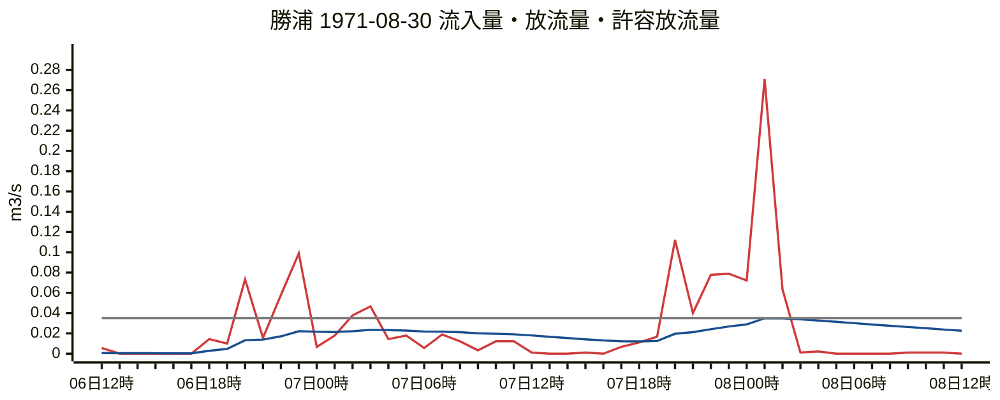

赤が流入量（1時間の平均）、青が放流量、灰が許容放流量。

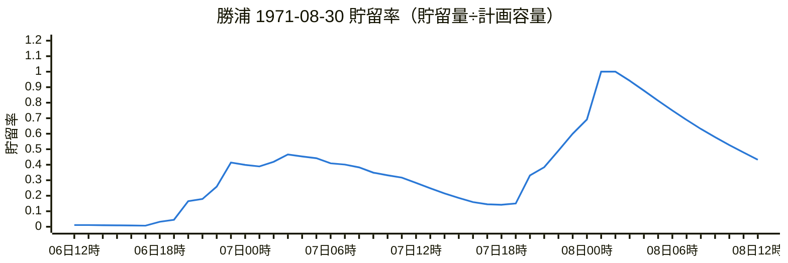

1.0 で満水。それを超えた分は溢れる（図では1.0で頭打ち）。

### 銚子 1971-08-30〜1971-09-08（溢水）

| 項目 | 値 |
| --- | ---: |
| 計画容量 | 1526 m3 |
| 最大流入量 | 0.1256 m3/s |
| 最大放流量 | 0.0250 m3/s |
| 最大貯留量 | 1526 m3（100.0%） |
| 溢水量 | 80 m3 |

降雨 1971-08-30〜1971-09-08、総量 585.5 mm、出所 時間値（1時間を6等分）。最大水位の時刻 09/08 03:00。

1時間ごとの雨量（mm）。最大水位の前36時間〜後12時間。

| 時間帯 | +0 | +1 | +2 | +3 | +4 | +5 |
| --- | ---: | ---: | ---: | ---: | ---: | ---: |
| 09/06 15時〜 | 0.0 | 0.0 | 0.0 | 3.5 | 4.0 | 1.5 |
| 09/06 21時〜 | 17.0 | 37.0 | 15.0 | 3.0 | 6.5 | 2.5 |
| 09/07 03時〜 | 1.5 | 1.5 | 0.0 | 4.0 | 1.5 | 2.0 |
| 09/07 09時〜 | 3.0 | 0.0 | 4.5 | 0.5 | 0.0 | 0.0 |
| 09/07 15時〜 | 0.0 | 1.5 | 3.5 | 0.5 | 2.0 | 10.0 |
| 09/07 21時〜 | 16.0 | 40.0 | 26.0 | 32.5 | 56.5 | 55.0 |
| 09/08 03時〜 | 3.5 | 12.5 | 1.0 | 0.0 | 0.0 | 0.0 |
| 09/08 09時〜 | 0.5 | 0.0 | 0.0 | 0.0 | 0.0 | 0.0 |

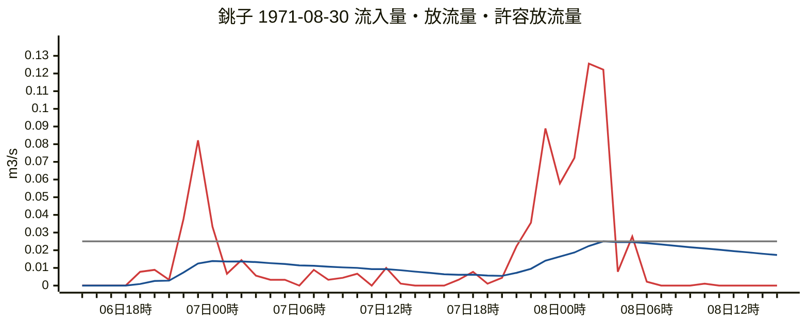

赤が流入量（1時間の平均）、青が放流量、灰が許容放流量。

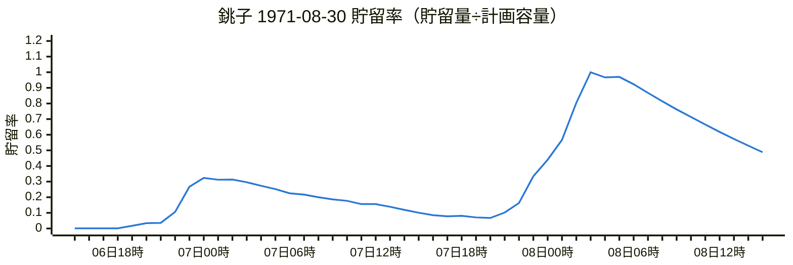

1.0 で満水。それを超えた分は溢れる（図では1.0で頭打ち）。

### 館山 1972-09-09〜1972-09-17（溢水）

| 項目 | 値 |
| --- | ---: |
| 計画容量 | 1500 m3 |
| 最大流入量 | 0.1556 m3/s |
| 最大放流量 | 0.0349 m3/s |
| 最大貯留量 | 1500 m3（100.0%） |
| 溢水量 | 66 m3 |

降雨 1972-09-09〜1972-09-17、総量 377.0 mm、出所 時間値（1時間を6等分）。最大水位の時刻 09/16 00:40。

1時間ごとの雨量（mm）。最大水位の前36時間〜後12時間。

| 時間帯 | +0 | +1 | +2 | +3 | +4 | +5 |
| --- | ---: | ---: | ---: | ---: | ---: | ---: |
| 09/14 12時〜 | 0.0 | 0.0 | 0.0 | 0.0 | 0.0 | 0.0 |
| 09/14 18時〜 | 0.5 | 0.0 | 0.0 | 0.5 | 0.5 | 1.0 |
| 09/15 00時〜 | 1.0 | 0.0 | 0.0 | 3.0 | 0.5 | 0.0 |
| 09/15 06時〜 | 0.0 | 0.0 | 0.5 | 0.0 | 0.5 | 0.0 |
| 09/15 12時〜 | 0.0 | 0.0 | 0.5 | 0.5 | 0.5 | 2.0 |
| 09/15 18時〜 | 22.5 | 31.0 | 31.5 | 47.0 | 24.5 | 70.0 |
| 09/16 00時〜 | 36.5 | 8.0 | 6.5 | 10.0 | 2.5 | 2.0 |
| 09/16 06時〜 | 0.5 | 0.5 | 0.5 | 0.0 | 0.0 | 0.0 |

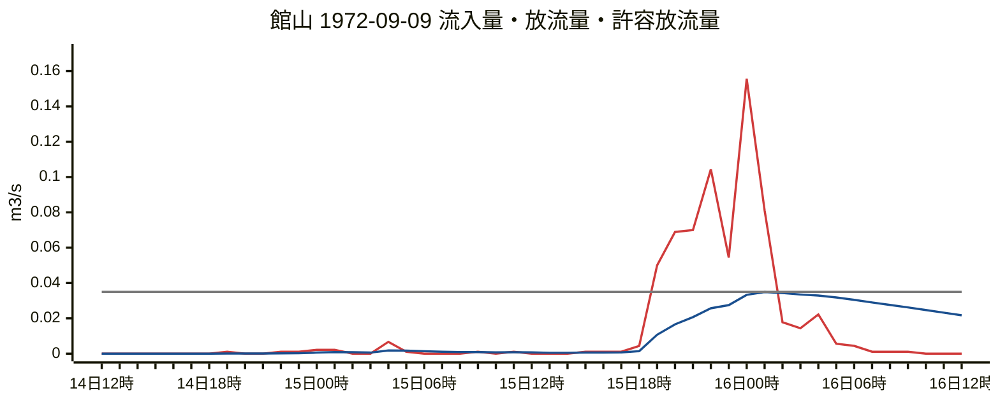

赤が流入量（1時間の平均）、青が放流量、灰が許容放流量。

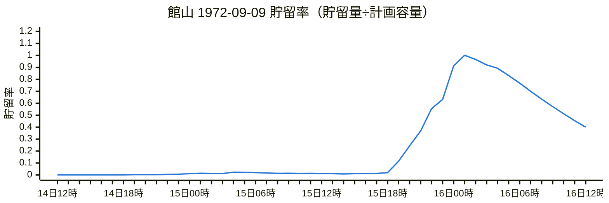

1.0 で満水。それを超えた分は溢れる（図では1.0で頭打ち）。

### 千葉 1996-09-20〜1996-09-22（溢水）

| 項目 | 値 |
| --- | ---: |
| 計画容量 | 1152 m3 |
| 最大流入量 | 0.0867 m3/s |
| 最大放流量 | 0.0250 m3/s |
| 最大貯留量 | 1152 m3（100.0%） |
| 溢水量 | 118 m3 |

降雨 1996-09-20〜1996-09-22、総量 271.0 mm、出所 時間値（1時間を6等分）。最大水位の時刻 09/22 14:00。

1時間ごとの雨量（mm）。最大水位の前36時間〜後12時間。

| 時間帯 | +0 | +1 | +2 | +3 | +4 | +5 |
| --- | ---: | ---: | ---: | ---: | ---: | ---: |
| 09/21 02時〜 | 0.0 | 0.0 | 0.0 | 0.0 | 0.0 | 0.0 |
| 09/21 08時〜 | 0.0 | 0.0 | 0.0 | 0.0 | 0.0 | 0.0 |
| 09/21 14時〜 | 0.0 | 0.0 | 0.0 | 0.0 | 0.0 | 0.0 |
| 09/21 20時〜 | 0.0 | 0.0 | 0.0 | 0.0 | 0.0 | 2.0 |
| 09/22 02時〜 | 3.5 | 3.5 | 7.0 | 12.0 | 11.0 | 10.0 |
| 09/22 08時〜 | 15.0 | 26.0 | 39.0 | 35.5 | 25.0 | 24.0 |
| 09/22 14時〜 | 18.5 | 18.0 | 5.5 | 3.5 | 0.5 | 0.0 |
| 09/22 20時〜 | 0.0 | 0.0 | 0.0 | 0.0 |  |  |

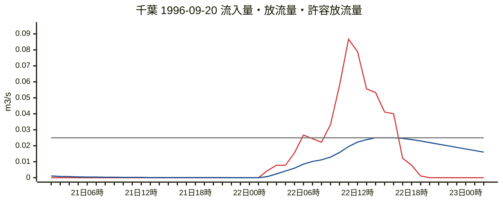

赤が流入量（1時間の平均）、青が放流量、灰が許容放流量。

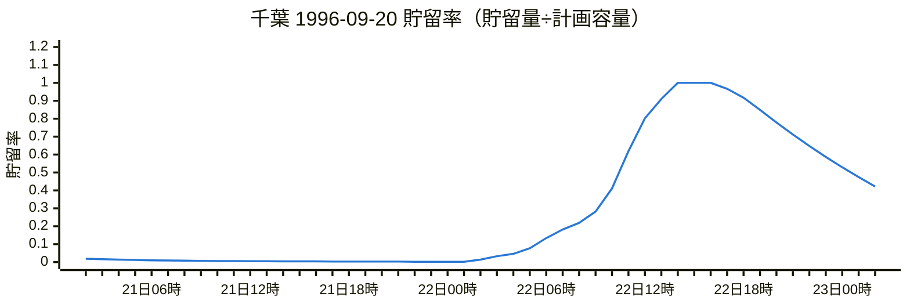

1.0 で満水。それを超えた分は溢れる（図では1.0で頭打ち）。

### 館山 1996-09-21〜1996-09-22（溢水）

| 項目 | 値 |
| --- | ---: |
| 計画容量 | 1500 m3 |
| 最大流入量 | 0.1233 m3/s |
| 最大放流量 | 0.0349 m3/s |
| 最大貯留量 | 1500 m3（100.0%） |
| 溢水量 | 75 m3 |

降雨 1996-09-21〜1996-09-22、総量 315.0 mm、出所 時間値（1時間を6等分）。最大水位の時刻 09/22 13:20。

1時間ごとの雨量（mm）。最大水位の前36時間〜後12時間。

| 時間帯 | +0 | +1 | +2 | +3 | +4 | +5 |
| --- | ---: | ---: | ---: | ---: | ---: | ---: |
| 09/21 01時〜 | 0.0 | 0.0 | 0.0 | 0.0 | 0.0 | 0.0 |
| 09/21 07時〜 | 0.0 | 0.0 | 0.0 | 0.0 | 0.0 | 0.0 |
| 09/21 13時〜 | 0.0 | 0.0 | 0.0 | 0.0 | 0.0 | 0.0 |
| 09/21 19時〜 | 0.0 | 0.0 | 0.0 | 0.0 | 1.0 | 1.0 |
| 09/22 01時〜 | 3.0 | 12.5 | 9.0 | 8.0 | 13.5 | 22.0 |
| 09/22 07時〜 | 18.5 | 34.5 | 22.5 | 38.5 | 37.5 | 55.5 |
| 09/22 13時〜 | 28.0 | 6.0 | 3.5 | 0.0 | 0.0 | 0.5 |
| 09/22 19時〜 | 0.0 | 0.0 | 0.0 | 0.0 | 0.0 |  |

```mermaid
%%{init: {"xyChart": {"width": 900, "height": 360}, "themeVariables": {"xyChart": {"plotColorPalette": "#d03b3b, #1a4f8f, #7a7a7a"}}}}%%
xychart-beta
    title "館山 1996-09-21 流入量・放流量・許容放流量"
    x-axis ["​", "​​", "​​​", "​​​​", "​​​​​", "21日06時", "​​​​​​​", "​​​​​​​​", "​​​​​​​​​", "​​​​​​​​​​", "​​​​​​​​​​​", "21日12時", "​​​​​​​​​​​​​", "​​​​​​​​​​​​​​", "​​​​​​​​​​​​​​​", "​​​​​​​​​​​​​​​​", "​​​​​​​​​​​​​​​​​", "21日18時", "​​​​​​​​​​​​​​​​​​​", "​​​​​​​​​​​​​​​​​​​​", "​​​​​​​​​​​​​​​​​​​​​", "​​​​​​​​​​​​​​​​​​​​​​", "​​​​​​​​​​​​​​​​​​​​​​​", "22日00時", "​​​​​​​​​​​​​​​​​​​​​​​​​", "​​​​​​​​​​​​​​​​​​​​​​​​​​", "​​​​​​​​​​​​​​​​​​​​​​​​​​​", "​​​​​​​​​​​​​​​​​​​​​​​​​​​​", "​​​​​​​​​​​​​​​​​​​​​​​​​​​​​", "22日06時", "​​​​​​​​​​​​​​​​​​​​​​​​​​​​​​​", "​​​​​​​​​​​​​​​​​​​​​​​​​​​​​​​​", "​​​​​​​​​​​​​​​​​​​​​​​​​​​​​​​​​", "​​​​​​​​​​​​​​​​​​​​​​​​​​​​​​​​​​", "​​​​​​​​​​​​​​​​​​​​​​​​​​​​​​​​​​​", "22日12時", "​​​​​​​​​​​​​​​​​​​​​​​​​​​​​​​​​​​​​", "​​​​​​​​​​​​​​​​​​​​​​​​​​​​​​​​​​​​​​", "​​​​​​​​​​​​​​​​​​​​​​​​​​​​​​​​​​​​​​​", "​​​​​​​​​​​​​​​​​​​​​​​​​​​​​​​​​​​​​​​​", "​​​​​​​​​​​​​​​​​​​​​​​​​​​​​​​​​​​​​​​​​", "22日18時", "​​​​​​​​​​​​​​​​​​​​​​​​​​​​​​​​​​​​​​​​​​​", "​​​​​​​​​​​​​​​​​​​​​​​​​​​​​​​​​​​​​​​​​​​​", "​​​​​​​​​​​​​​​​​​​​​​​​​​​​​​​​​​​​​​​​​​​​​", "​​​​​​​​​​​​​​​​​​​​​​​​​​​​​​​​​​​​​​​​​​​​​​", "​​​​​​​​​​​​​​​​​​​​​​​​​​​​​​​​​​​​​​​​​​​​​​​", "23日00時", "​​​​​​​​​​​​​​​​​​​​​​​​​​​​​​​​​​​​​​​​​​​​​​​​​"]
    y-axis "m3/s" 0 --> 0.136
    line [0.0000, 0.0000, 0.0000, 0.0000, 0.0000, 0.0000, 0.0000, 0.0000, 0.0000, 0.0000, 0.0000, 0.0000, 0.0000, 0.0000, 0.0000, 0.0000, 0.0000, 0.0000, 0.0000, 0.0000, 0.0000, 0.0000, 0.0000, 0.0022, 0.0022, 0.0067, 0.0278, 0.0200, 0.0178, 0.0300, 0.0489, 0.0411, 0.0767, 0.0500, 0.0856, 0.0833, 0.1233, 0.0622, 0.0133, 0.0078, 0.0000, 0.0000, 0.0011, 0.0000, 0.0000, 0.0000, 0.0000, 0.0000, 0.0000]
    line [0.0000, 0.0000, 0.0000, 0.0000, 0.0000, 0.0000, 0.0000, 0.0000, 0.0000, 0.0000, 0.0000, 0.0000, 0.0000, 0.0000, 0.0000, 0.0000, 0.0000, 0.0000, 0.0000, 0.0000, 0.0000, 0.0000, 0.0000, 0.0002, 0.0004, 0.0016, 0.0079, 0.0098, 0.0109, 0.0130, 0.0163, 0.0184, 0.0224, 0.0242, 0.0275, 0.0303, 0.0344, 0.0349, 0.0341, 0.0330, 0.0315, 0.0300, 0.0286, 0.0271, 0.0256, 0.0241, 0.0226, 0.0211, 0.0196]
    line [0.0350, 0.0350, 0.0350, 0.0350, 0.0350, 0.0350, 0.0350, 0.0350, 0.0350, 0.0350, 0.0350, 0.0350, 0.0350, 0.0350, 0.0350, 0.0350, 0.0350, 0.0350, 0.0350, 0.0350, 0.0350, 0.0350, 0.0350, 0.0350, 0.0350, 0.0350, 0.0350, 0.0350, 0.0350, 0.0350, 0.0350, 0.0350, 0.0350, 0.0350, 0.0350, 0.0350, 0.0350, 0.0350, 0.0350, 0.0350, 0.0350, 0.0350, 0.0350, 0.0350, 0.0350, 0.0350, 0.0350, 0.0350, 0.0350]
```

赤が流入量（1時間の平均）、青が放流量、灰が許容放流量。

```mermaid
%%{init: {"xyChart": {"width": 900, "height": 300}, "themeVariables": {"xyChart": {"plotColorPalette": "#2a78d6"}}}}%%
xychart-beta
    title "館山 1996-09-21 貯留率（貯留量÷計画容量）"
    x-axis ["​", "​​", "​​​", "​​​​", "​​​​​", "21日06時", "​​​​​​​", "​​​​​​​​", "​​​​​​​​​", "​​​​​​​​​​", "​​​​​​​​​​​", "21日12時", "​​​​​​​​​​​​​", "​​​​​​​​​​​​​​", "​​​​​​​​​​​​​​​", "​​​​​​​​​​​​​​​​", "​​​​​​​​​​​​​​​​​", "21日18時", "​​​​​​​​​​​​​​​​​​​", "​​​​​​​​​​​​​​​​​​​​", "​​​​​​​​​​​​​​​​​​​​​", "​​​​​​​​​​​​​​​​​​​​​​", "​​​​​​​​​​​​​​​​​​​​​​​", "22日00時", "​​​​​​​​​​​​​​​​​​​​​​​​​", "​​​​​​​​​​​​​​​​​​​​​​​​​​", "​​​​​​​​​​​​​​​​​​​​​​​​​​​", "​​​​​​​​​​​​​​​​​​​​​​​​​​​​", "​​​​​​​​​​​​​​​​​​​​​​​​​​​​​", "22日06時", "​​​​​​​​​​​​​​​​​​​​​​​​​​​​​​​", "​​​​​​​​​​​​​​​​​​​​​​​​​​​​​​​​", "​​​​​​​​​​​​​​​​​​​​​​​​​​​​​​​​​", "​​​​​​​​​​​​​​​​​​​​​​​​​​​​​​​​​​", "​​​​​​​​​​​​​​​​​​​​​​​​​​​​​​​​​​​", "22日12時", "​​​​​​​​​​​​​​​​​​​​​​​​​​​​​​​​​​​​​", "​​​​​​​​​​​​​​​​​​​​​​​​​​​​​​​​​​​​​​", "​​​​​​​​​​​​​​​​​​​​​​​​​​​​​​​​​​​​​​​", "​​​​​​​​​​​​​​​​​​​​​​​​​​​​​​​​​​​​​​​​", "​​​​​​​​​​​​​​​​​​​​​​​​​​​​​​​​​​​​​​​​​", "22日18時", "​​​​​​​​​​​​​​​​​​​​​​​​​​​​​​​​​​​​​​​​​​​", "​​​​​​​​​​​​​​​​​​​​​​​​​​​​​​​​​​​​​​​​​​​​", "​​​​​​​​​​​​​​​​​​​​​​​​​​​​​​​​​​​​​​​​​​​​​", "​​​​​​​​​​​​​​​​​​​​​​​​​​​​​​​​​​​​​​​​​​​​​​", "​​​​​​​​​​​​​​​​​​​​​​​​​​​​​​​​​​​​​​​​​​​​​​​", "23日00時", "​​​​​​​​​​​​​​​​​​​​​​​​​​​​​​​​​​​​​​​​​​​​​​​​​"]
    y-axis "貯留率" 0 --> 1.2
    line [0.000, 0.000, 0.000, 0.000, 0.000, 0.000, 0.000, 0.000, 0.000, 0.000, 0.000, 0.000, 0.000, 0.000, 0.000, 0.000, 0.000, 0.000, 0.000, 0.000, 0.000, 0.000, 0.000, 0.005, 0.009, 0.022, 0.073, 0.101, 0.119, 0.160, 0.238, 0.297, 0.424, 0.494, 0.630, 0.761, 0.971, 1.000, 0.958, 0.897, 0.821, 0.747, 0.679, 0.612, 0.549, 0.489, 0.433, 0.381, 0.332]
```

1.0 で満水。それを超えた分は溢れる（図では1.0で頭打ち）。

### 勝浦 1996-09-22〜1996-09-22（最大貯留率 93%）

| 項目 | 値 |
| --- | ---: |
| 計画容量 | 1752 m3 |
| 最大流入量 | 0.1111 m3/s |
| 最大放流量 | 0.0336 m3/s |
| 最大貯留量 | 1625 m3（93%） |
| 溢水量 | 0 m3 |

降雨 1996-09-22〜1996-09-22、総量 326.0 mm、出所 時間値（1時間を6等分）。最大水位の時刻 09/22 15:10。

1時間ごとの雨量（mm）。最大水位の前36時間〜後12時間。

| 時間帯 | +0 | +1 | +2 | +3 | +4 | +5 |
| --- | ---: | ---: | ---: | ---: | ---: | ---: |
| 09/22 00時〜 | 1.5 | 3.0 | 12.5 | 6.0 | 17.0 | 16.0 |
| 09/22 06時〜 | 18.5 | 14.5 | 16.0 | 18.0 | 27.0 | 25.5 |
| 09/22 12時〜 | 38.5 | 50.0 | 46.5 | 7.5 | 5.5 | 2.0 |
| 09/22 18時〜 | 0.0 | 0.0 | 0.5 | 0.0 | 0.0 | 0.0 |

```mermaid
%%{init: {"xyChart": {"width": 900, "height": 360}, "themeVariables": {"xyChart": {"plotColorPalette": "#d03b3b, #1a4f8f, #7a7a7a"}}}}%%
xychart-beta
    title "勝浦 1996-09-22 流入量・放流量・許容放流量"
    x-axis ["22日00時", "​​", "​​​", "​​​​", "​​​​​", "​​​​​​", "22日06時", "​​​​​​​​", "​​​​​​​​​", "​​​​​​​​​​", "​​​​​​​​​​​", "​​​​​​​​​​​​", "22日12時", "​​​​​​​​​​​​​​", "​​​​​​​​​​​​​​​", "​​​​​​​​​​​​​​​​", "​​​​​​​​​​​​​​​​​", "​​​​​​​​​​​​​​​​​​", "22日18時", "​​​​​​​​​​​​​​​​​​​​", "​​​​​​​​​​​​​​​​​​​​​", "​​​​​​​​​​​​​​​​​​​​​​", "​​​​​​​​​​​​​​​​​​​​​​​", "​​​​​​​​​​​​​​​​​​​​​​​​", "23日00時", "​​​​​​​​​​​​​​​​​​​​​​​​​​", "​​​​​​​​​​​​​​​​​​​​​​​​​​​", "​​​​​​​​​​​​​​​​​​​​​​​​​​​​", "​​​​​​​​​​​​​​​​​​​​​​​​​​​​​", "​​​​​​​​​​​​​​​​​​​​​​​​​​​​​​", "23日06時", "​​​​​​​​​​​​​​​​​​​​​​​​​​​​​​​​", "​​​​​​​​​​​​​​​​​​​​​​​​​​​​​​​​​", "​​​​​​​​​​​​​​​​​​​​​​​​​​​​​​​​​​", "​​​​​​​​​​​​​​​​​​​​​​​​​​​​​​​​​​​", "​​​​​​​​​​​​​​​​​​​​​​​​​​​​​​​​​​​​", "23日12時", "​​​​​​​​​​​​​​​​​​​​​​​​​​​​​​​​​​​​​​", "​​​​​​​​​​​​​​​​​​​​​​​​​​​​​​​​​​​​​​​", "​​​​​​​​​​​​​​​​​​​​​​​​​​​​​​​​​​​​​​​​", "​​​​​​​​​​​​​​​​​​​​​​​​​​​​​​​​​​​​​​​​​", "​​​​​​​​​​​​​​​​​​​​​​​​​​​​​​​​​​​​​​​​​​", "23日18時", "​​​​​​​​​​​​​​​​​​​​​​​​​​​​​​​​​​​​​​​​​​​​", "​​​​​​​​​​​​​​​​​​​​​​​​​​​​​​​​​​​​​​​​​​​​​", "​​​​​​​​​​​​​​​​​​​​​​​​​​​​​​​​​​​​​​​​​​​​​​", "​​​​​​​​​​​​​​​​​​​​​​​​​​​​​​​​​​​​​​​​​​​​​​​", "​​​​​​​​​​​​​​​​​​​​​​​​​​​​​​​​​​​​​​​​​​​​​​​​", "24日00時"]
    y-axis "m3/s" 0 --> 0.122
    line [0.0000, 0.0033, 0.0067, 0.0278, 0.0133, 0.0378, 0.0356, 0.0411, 0.0322, 0.0356, 0.0400, 0.0600, 0.0567, 0.0856, 0.1111, 0.1033, 0.0167, 0.0122, 0.0044, 0.0000, 0.0000, 0.0011, 0.0000, 0.0000, 0.0000, 0.0000, 0.0000, 0.0000, 0.0000, 0.0000, 0.0000, 0.0000, 0.0000, 0.0000, 0.0000, 0.0000, 0.0000, 0.0000, 0.0000, 0.0000, 0.0000, 0.0000, 0.0000, 0.0000, 0.0000, 0.0000, 0.0000, 0.0000, 0.0000]
    line [0.0000, 0.0002, 0.0012, 0.0072, 0.0082, 0.0115, 0.0138, 0.0160, 0.0173, 0.0185, 0.0199, 0.0222, 0.0241, 0.0270, 0.0305, 0.0334, 0.0331, 0.0323, 0.0312, 0.0299, 0.0286, 0.0274, 0.0261, 0.0248, 0.0236, 0.0223, 0.0210, 0.0197, 0.0184, 0.0171, 0.0159, 0.0146, 0.0133, 0.0120, 0.0107, 0.0094, 0.0082, 0.0072, 0.0053, 0.0039, 0.0029, 0.0022, 0.0017, 0.0014, 0.0011, 0.0009, 0.0008, 0.0007, 0.0006]
    line [0.0350, 0.0350, 0.0350, 0.0350, 0.0350, 0.0350, 0.0350, 0.0350, 0.0350, 0.0350, 0.0350, 0.0350, 0.0350, 0.0350, 0.0350, 0.0350, 0.0350, 0.0350, 0.0350, 0.0350, 0.0350, 0.0350, 0.0350, 0.0350, 0.0350, 0.0350, 0.0350, 0.0350, 0.0350, 0.0350, 0.0350, 0.0350, 0.0350, 0.0350, 0.0350, 0.0350, 0.0350, 0.0350, 0.0350, 0.0350, 0.0350, 0.0350, 0.0350, 0.0350, 0.0350, 0.0350, 0.0350, 0.0350, 0.0350]
```

赤が流入量（1時間の平均）、青が放流量、灰が許容放流量。

```mermaid
%%{init: {"xyChart": {"width": 900, "height": 300}, "themeVariables": {"xyChart": {"plotColorPalette": "#2a78d6"}}}}%%
xychart-beta
    title "勝浦 1996-09-22 貯留率（貯留量÷計画容量）"
    x-axis ["22日00時", "​​", "​​​", "​​​​", "​​​​​", "​​​​​​", "22日06時", "​​​​​​​​", "​​​​​​​​​", "​​​​​​​​​​", "​​​​​​​​​​​", "​​​​​​​​​​​​", "22日12時", "​​​​​​​​​​​​​​", "​​​​​​​​​​​​​​​", "​​​​​​​​​​​​​​​​", "​​​​​​​​​​​​​​​​​", "​​​​​​​​​​​​​​​​​​", "22日18時", "​​​​​​​​​​​​​​​​​​​​", "​​​​​​​​​​​​​​​​​​​​​", "​​​​​​​​​​​​​​​​​​​​​​", "​​​​​​​​​​​​​​​​​​​​​​​", "​​​​​​​​​​​​​​​​​​​​​​​​", "23日00時", "​​​​​​​​​​​​​​​​​​​​​​​​​​", "​​​​​​​​​​​​​​​​​​​​​​​​​​​", "​​​​​​​​​​​​​​​​​​​​​​​​​​​​", "​​​​​​​​​​​​​​​​​​​​​​​​​​​​​", "​​​​​​​​​​​​​​​​​​​​​​​​​​​​​​", "23日06時", "​​​​​​​​​​​​​​​​​​​​​​​​​​​​​​​​", "​​​​​​​​​​​​​​​​​​​​​​​​​​​​​​​​​", "​​​​​​​​​​​​​​​​​​​​​​​​​​​​​​​​​​", "​​​​​​​​​​​​​​​​​​​​​​​​​​​​​​​​​​​", "​​​​​​​​​​​​​​​​​​​​​​​​​​​​​​​​​​​​", "23日12時", "​​​​​​​​​​​​​​​​​​​​​​​​​​​​​​​​​​​​​​", "​​​​​​​​​​​​​​​​​​​​​​​​​​​​​​​​​​​​​​​", "​​​​​​​​​​​​​​​​​​​​​​​​​​​​​​​​​​​​​​​​", "​​​​​​​​​​​​​​​​​​​​​​​​​​​​​​​​​​​​​​​​​", "​​​​​​​​​​​​​​​​​​​​​​​​​​​​​​​​​​​​​​​​​​", "23日18時", "​​​​​​​​​​​​​​​​​​​​​​​​​​​​​​​​​​​​​​​​​​​​", "​​​​​​​​​​​​​​​​​​​​​​​​​​​​​​​​​​​​​​​​​​​​​", "​​​​​​​​​​​​​​​​​​​​​​​​​​​​​​​​​​​​​​​​​​​​​​", "​​​​​​​​​​​​​​​​​​​​​​​​​​​​​​​​​​​​​​​​​​​​​​​", "​​​​​​​​​​​​​​​​​​​​​​​​​​​​​​​​​​​​​​​​​​​​​​​​", "24日00時"]
    y-axis "貯留率" 0 --> 1.2
    line [0.000, 0.006, 0.018, 0.063, 0.077, 0.130, 0.177, 0.230, 0.264, 0.299, 0.341, 0.418, 0.487, 0.606, 0.771, 0.918, 0.899, 0.858, 0.803, 0.741, 0.681, 0.625, 0.570, 0.518, 0.468, 0.421, 0.377, 0.335, 0.296, 0.259, 0.225, 0.194, 0.166, 0.140, 0.116, 0.096, 0.077, 0.062, 0.049, 0.039, 0.033, 0.027, 0.023, 0.020, 0.017, 0.015, 0.014, 0.012, 0.011]
```

1.0 で満水。それを超えた分は溢れる（図では1.0で頭打ち）。

### 勝浦 2007-07-10〜2007-07-18（最大貯留率 99%）

| 項目 | 値 |
| --- | ---: |
| 計画容量 | 1752 m3 |
| 最大流入量 | 0.1511 m3/s |
| 最大放流量 | 0.0348 m3/s |
| 最大貯留量 | 1739 m3（99%） |
| 溢水量 | 0 m3 |

降雨 2007-07-10〜2007-07-18、総量 428.5 mm、出所 時間値（1時間を6等分）。最大水位の時刻 07/15 00:10。

1時間ごとの雨量（mm）。最大水位の前36時間〜後12時間。

| 時間帯 | +0 | +1 | +2 | +3 | +4 | +5 |
| --- | ---: | ---: | ---: | ---: | ---: | ---: |
| 07/13 12時〜 | 0.0 | 0.0 | 0.5 | 0.5 | 0.0 | 0.0 |
| 07/13 18時〜 | 0.0 | 0.0 | 0.5 | 1.0 | 0.5 | 0.0 |
| 07/14 00時〜 | 0.0 | 0.0 | 0.0 | 0.0 | 0.5 | 0.0 |
| 07/14 06時〜 | 0.5 | 0.5 | 1.5 | 4.0 | 2.0 | 1.0 |
| 07/14 12時〜 | 10.0 | 4.0 | 2.0 | 5.5 | 10.0 | 29.0 |
| 07/14 18時〜 | 37.0 | 16.0 | 31.5 | 20.0 | 68.0 | 66.0 |
| 07/15 00時〜 | 1.0 | 0.5 | 5.5 | 1.0 | 0.0 | 0.0 |
| 07/15 06時〜 | 4.0 | 1.0 | 5.0 | 16.5 | 2.5 | 1.0 |

```mermaid
%%{init: {"xyChart": {"width": 900, "height": 360}, "themeVariables": {"xyChart": {"plotColorPalette": "#d03b3b, #1a4f8f, #7a7a7a"}}}}%%
xychart-beta
    title "勝浦 2007-07-10 流入量・放流量・許容放流量"
    x-axis ["13日12時", "​​", "​​​", "​​​​", "​​​​​", "​​​​​​", "13日18時", "​​​​​​​​", "​​​​​​​​​", "​​​​​​​​​​", "​​​​​​​​​​​", "​​​​​​​​​​​​", "14日00時", "​​​​​​​​​​​​​​", "​​​​​​​​​​​​​​​", "​​​​​​​​​​​​​​​​", "​​​​​​​​​​​​​​​​​", "​​​​​​​​​​​​​​​​​​", "14日06時", "​​​​​​​​​​​​​​​​​​​​", "​​​​​​​​​​​​​​​​​​​​​", "​​​​​​​​​​​​​​​​​​​​​​", "​​​​​​​​​​​​​​​​​​​​​​​", "​​​​​​​​​​​​​​​​​​​​​​​​", "14日12時", "​​​​​​​​​​​​​​​​​​​​​​​​​​", "​​​​​​​​​​​​​​​​​​​​​​​​​​​", "​​​​​​​​​​​​​​​​​​​​​​​​​​​​", "​​​​​​​​​​​​​​​​​​​​​​​​​​​​​", "​​​​​​​​​​​​​​​​​​​​​​​​​​​​​​", "14日18時", "​​​​​​​​​​​​​​​​​​​​​​​​​​​​​​​​", "​​​​​​​​​​​​​​​​​​​​​​​​​​​​​​​​​", "​​​​​​​​​​​​​​​​​​​​​​​​​​​​​​​​​​", "​​​​​​​​​​​​​​​​​​​​​​​​​​​​​​​​​​​", "​​​​​​​​​​​​​​​​​​​​​​​​​​​​​​​​​​​​", "15日00時", "​​​​​​​​​​​​​​​​​​​​​​​​​​​​​​​​​​​​​​", "​​​​​​​​​​​​​​​​​​​​​​​​​​​​​​​​​​​​​​​", "​​​​​​​​​​​​​​​​​​​​​​​​​​​​​​​​​​​​​​​​", "​​​​​​​​​​​​​​​​​​​​​​​​​​​​​​​​​​​​​​​​​", "​​​​​​​​​​​​​​​​​​​​​​​​​​​​​​​​​​​​​​​​​​", "15日06時", "​​​​​​​​​​​​​​​​​​​​​​​​​​​​​​​​​​​​​​​​​​​​", "​​​​​​​​​​​​​​​​​​​​​​​​​​​​​​​​​​​​​​​​​​​​​", "​​​​​​​​​​​​​​​​​​​​​​​​​​​​​​​​​​​​​​​​​​​​​​", "​​​​​​​​​​​​​​​​​​​​​​​​​​​​​​​​​​​​​​​​​​​​​​​", "​​​​​​​​​​​​​​​​​​​​​​​​​​​​​​​​​​​​​​​​​​​​​​​​", "15日12時"]
    y-axis "m3/s" 0 --> 0.166
    line [0.0011, 0.0000, 0.0000, 0.0011, 0.0011, 0.0000, 0.0000, 0.0000, 0.0000, 0.0011, 0.0022, 0.0011, 0.0000, 0.0000, 0.0000, 0.0000, 0.0000, 0.0011, 0.0000, 0.0011, 0.0011, 0.0033, 0.0089, 0.0044, 0.0022, 0.0222, 0.0089, 0.0044, 0.0122, 0.0222, 0.0644, 0.0822, 0.0356, 0.0700, 0.0444, 0.1511, 0.1467, 0.0022, 0.0011, 0.0122, 0.0022, 0.0000, 0.0000, 0.0089, 0.0022, 0.0111, 0.0367, 0.0056, 0.0022]
    line [0.0003, 0.0002, 0.0002, 0.0003, 0.0004, 0.0004, 0.0003, 0.0003, 0.0003, 0.0003, 0.0006, 0.0007, 0.0006, 0.0005, 0.0004, 0.0004, 0.0003, 0.0004, 0.0004, 0.0005, 0.0006, 0.0010, 0.0025, 0.0030, 0.0029, 0.0073, 0.0077, 0.0073, 0.0078, 0.0096, 0.0147, 0.0195, 0.0207, 0.0234, 0.0246, 0.0300, 0.0345, 0.0338, 0.0325, 0.0317, 0.0306, 0.0293, 0.0280, 0.0271, 0.0259, 0.0252, 0.0256, 0.0248, 0.0236]
    line [0.0350, 0.0350, 0.0350, 0.0350, 0.0350, 0.0350, 0.0350, 0.0350, 0.0350, 0.0350, 0.0350, 0.0350, 0.0350, 0.0350, 0.0350, 0.0350, 0.0350, 0.0350, 0.0350, 0.0350, 0.0350, 0.0350, 0.0350, 0.0350, 0.0350, 0.0350, 0.0350, 0.0350, 0.0350, 0.0350, 0.0350, 0.0350, 0.0350, 0.0350, 0.0350, 0.0350, 0.0350, 0.0350, 0.0350, 0.0350, 0.0350, 0.0350, 0.0350, 0.0350, 0.0350, 0.0350, 0.0350, 0.0350, 0.0350]
```

赤が流入量（1時間の平均）、青が放流量、灰が許容放流量。

```mermaid
%%{init: {"xyChart": {"width": 900, "height": 300}, "themeVariables": {"xyChart": {"plotColorPalette": "#2a78d6"}}}}%%
xychart-beta
    title "勝浦 2007-07-10 貯留率（貯留量÷計画容量）"
    x-axis ["13日12時", "​​", "​​​", "​​​​", "​​​​​", "​​​​​​", "13日18時", "​​​​​​​​", "​​​​​​​​​", "​​​​​​​​​​", "​​​​​​​​​​​", "​​​​​​​​​​​​", "14日00時", "​​​​​​​​​​​​​​", "​​​​​​​​​​​​​​​", "​​​​​​​​​​​​​​​​", "​​​​​​​​​​​​​​​​​", "​​​​​​​​​​​​​​​​​​", "14日06時", "​​​​​​​​​​​​​​​​​​​​", "​​​​​​​​​​​​​​​​​​​​​", "​​​​​​​​​​​​​​​​​​​​​​", "​​​​​​​​​​​​​​​​​​​​​​​", "​​​​​​​​​​​​​​​​​​​​​​​​", "14日12時", "​​​​​​​​​​​​​​​​​​​​​​​​​​", "​​​​​​​​​​​​​​​​​​​​​​​​​​​", "​​​​​​​​​​​​​​​​​​​​​​​​​​​​", "​​​​​​​​​​​​​​​​​​​​​​​​​​​​​", "​​​​​​​​​​​​​​​​​​​​​​​​​​​​​​", "14日18時", "​​​​​​​​​​​​​​​​​​​​​​​​​​​​​​​​", "​​​​​​​​​​​​​​​​​​​​​​​​​​​​​​​​​", "​​​​​​​​​​​​​​​​​​​​​​​​​​​​​​​​​​", "​​​​​​​​​​​​​​​​​​​​​​​​​​​​​​​​​​​", "​​​​​​​​​​​​​​​​​​​​​​​​​​​​​​​​​​​​", "15日00時", "​​​​​​​​​​​​​​​​​​​​​​​​​​​​​​​​​​​​​​", "​​​​​​​​​​​​​​​​​​​​​​​​​​​​​​​​​​​​​​​", "​​​​​​​​​​​​​​​​​​​​​​​​​​​​​​​​​​​​​​​​", "​​​​​​​​​​​​​​​​​​​​​​​​​​​​​​​​​​​​​​​​​", "​​​​​​​​​​​​​​​​​​​​​​​​​​​​​​​​​​​​​​​​​​", "15日06時", "​​​​​​​​​​​​​​​​​​​​​​​​​​​​​​​​​​​​​​​​​​​​", "​​​​​​​​​​​​​​​​​​​​​​​​​​​​​​​​​​​​​​​​​​​​​", "​​​​​​​​​​​​​​​​​​​​​​​​​​​​​​​​​​​​​​​​​​​​​​", "​​​​​​​​​​​​​​​​​​​​​​​​​​​​​​​​​​​​​​​​​​​​​​​", "​​​​​​​​​​​​​​​​​​​​​​​​​​​​​​​​​​​​​​​​​​​​​​​​", "15日12時"]
    y-axis "貯留率" 0 --> 1.2
    line [0.007, 0.006, 0.006, 0.007, 0.009, 0.008, 0.008, 0.007, 0.006, 0.008, 0.011, 0.012, 0.011, 0.010, 0.009, 0.008, 0.008, 0.009, 0.008, 0.010, 0.011, 0.016, 0.030, 0.034, 0.032, 0.064, 0.069, 0.064, 0.072, 0.098, 0.198, 0.329, 0.368, 0.461, 0.507, 0.744, 0.979, 0.938, 0.872, 0.829, 0.772, 0.711, 0.652, 0.612, 0.563, 0.532, 0.551, 0.516, 0.471]
```

1.0 で満水。それを超えた分は溢れる（図では1.0で頭打ち）。

### 千葉 2013-10-15〜2013-10-16（溢水）

| 項目 | 値 |
| --- | ---: |
| 計画容量 | 1152 m3 |
| 最大流入量 | 0.1733 m3/s |
| 最大放流量 | 0.0250 m3/s |
| 最大貯留量 | 1152 m3（100.0%） |
| 溢水量 | 469 m3 |

降雨 2013-10-15〜2013-10-16、総量 309.0 mm、出所 10分値。最大水位の時刻 10/16 05:10。

1時間ごとの雨量（mm）。最大水位の前36時間〜後12時間。

| 時間帯 | +0 | +1 | +2 | +3 | +4 | +5 |
| --- | ---: | ---: | ---: | ---: | ---: | ---: |
| 10/15 00時〜 | 0.0 | 0.0 | 0.0 | 0.0 | 0.0 | 0.0 |
| 10/15 06時〜 | 0.0 | 0.0 | 0.0 | 0.0 | 0.0 | 0.0 |
| 10/15 12時〜 | 0.0 | 0.5 | 2.5 | 7.5 | 7.5 | 11.5 |
| 10/15 18時〜 | 7.5 | 11.0 | 9.0 | 3.5 | 3.5 | 7.0 |
| 10/16 00時〜 | 22.5 | 23.0 | 29.5 | 30.5 | 43.0 | 51.5 |
| 10/16 06時〜 | 29.5 | 8.0 | 0.5 | 0.0 | 0.0 | 0.0 |
| 10/16 12時〜 | 0.0 | 0.0 | 0.0 | 0.0 | 0.0 | 0.0 |
| 10/16 18時〜 | 0.0 | 0.0 | 0.0 | 0.0 | 0.0 | 0.0 |

```mermaid
%%{init: {"xyChart": {"width": 900, "height": 360}, "themeVariables": {"xyChart": {"plotColorPalette": "#d03b3b, #1a4f8f, #7a7a7a"}}}}%%
xychart-beta
    title "千葉 2013-10-15 流入量・放流量・許容放流量"
    x-axis ["15日00時", "​​", "​​​", "​​​​", "​​​​​", "​​​​​​", "15日06時", "​​​​​​​​", "​​​​​​​​​", "​​​​​​​​​​", "​​​​​​​​​​​", "​​​​​​​​​​​​", "15日12時", "​​​​​​​​​​​​​​", "​​​​​​​​​​​​​​​", "​​​​​​​​​​​​​​​​", "​​​​​​​​​​​​​​​​​", "​​​​​​​​​​​​​​​​​​", "15日18時", "​​​​​​​​​​​​​​​​​​​​", "​​​​​​​​​​​​​​​​​​​​​", "​​​​​​​​​​​​​​​​​​​​​​", "​​​​​​​​​​​​​​​​​​​​​​​", "​​​​​​​​​​​​​​​​​​​​​​​​", "16日00時", "​​​​​​​​​​​​​​​​​​​​​​​​​​", "​​​​​​​​​​​​​​​​​​​​​​​​​​​", "​​​​​​​​​​​​​​​​​​​​​​​​​​​​", "​​​​​​​​​​​​​​​​​​​​​​​​​​​​​", "​​​​​​​​​​​​​​​​​​​​​​​​​​​​​​", "16日06時", "​​​​​​​​​​​​​​​​​​​​​​​​​​​​​​​​", "​​​​​​​​​​​​​​​​​​​​​​​​​​​​​​​​​", "​​​​​​​​​​​​​​​​​​​​​​​​​​​​​​​​​​", "​​​​​​​​​​​​​​​​​​​​​​​​​​​​​​​​​​​", "​​​​​​​​​​​​​​​​​​​​​​​​​​​​​​​​​​​​", "16日12時", "​​​​​​​​​​​​​​​​​​​​​​​​​​​​​​​​​​​​​​", "​​​​​​​​​​​​​​​​​​​​​​​​​​​​​​​​​​​​​​​", "​​​​​​​​​​​​​​​​​​​​​​​​​​​​​​​​​​​​​​​​", "​​​​​​​​​​​​​​​​​​​​​​​​​​​​​​​​​​​​​​​​​", "​​​​​​​​​​​​​​​​​​​​​​​​​​​​​​​​​​​​​​​​​​", "16日18時", "​​​​​​​​​​​​​​​​​​​​​​​​​​​​​​​​​​​​​​​​​​​​", "​​​​​​​​​​​​​​​​​​​​​​​​​​​​​​​​​​​​​​​​​​​​​", "​​​​​​​​​​​​​​​​​​​​​​​​​​​​​​​​​​​​​​​​​​​​​​", "​​​​​​​​​​​​​​​​​​​​​​​​​​​​​​​​​​​​​​​​​​​​​​​", "​​​​​​​​​​​​​​​​​​​​​​​​​​​​​​​​​​​​​​​​​​​​​​​​", "17日00時"]
    y-axis "m3/s" 0 --> 0.126
    line [0.0000, 0.0000, 0.0000, 0.0000, 0.0000, 0.0000, 0.0000, 0.0000, 0.0000, 0.0000, 0.0000, 0.0000, 0.0000, 0.0000, 0.0011, 0.0056, 0.0167, 0.0167, 0.0256, 0.0167, 0.0244, 0.0200, 0.0078, 0.0078, 0.0156, 0.0500, 0.0511, 0.0656, 0.0678, 0.0956, 0.1144, 0.0656, 0.0178, 0.0011, 0.0000, 0.0000, 0.0000, 0.0000, 0.0000, 0.0000, 0.0000, 0.0000, 0.0000, 0.0000, 0.0000, 0.0000, 0.0000, 0.0000, 0.0000]
    line [0.0000, 0.0000, 0.0000, 0.0000, 0.0000, 0.0000, 0.0000, 0.0000, 0.0000, 0.0000, 0.0000, 0.0000, 0.0000, 0.0000, 0.0000, 0.0010, 0.0050, 0.0069, 0.0090, 0.0097, 0.0111, 0.0117, 0.0117, 0.0113, 0.0114, 0.0144, 0.0166, 0.0192, 0.0215, 0.0243, 0.0250, 0.0250, 0.0246, 0.0236, 0.0226, 0.0216, 0.0206, 0.0196, 0.0186, 0.0176, 0.0166, 0.0156, 0.0146, 0.0136, 0.0126, 0.0116, 0.0106, 0.0096, 0.0087]
    line [0.0250, 0.0250, 0.0250, 0.0250, 0.0250, 0.0250, 0.0250, 0.0250, 0.0250, 0.0250, 0.0250, 0.0250, 0.0250, 0.0250, 0.0250, 0.0250, 0.0250, 0.0250, 0.0250, 0.0250, 0.0250, 0.0250, 0.0250, 0.0250, 0.0250, 0.0250, 0.0250, 0.0250, 0.0250, 0.0250, 0.0250, 0.0250, 0.0250, 0.0250, 0.0250, 0.0250, 0.0250, 0.0250, 0.0250, 0.0250, 0.0250, 0.0250, 0.0250, 0.0250, 0.0250, 0.0250, 0.0250, 0.0250, 0.0250]
```

赤が流入量（1時間の平均）、青が放流量、灰が許容放流量。

```mermaid
%%{init: {"xyChart": {"width": 900, "height": 300}, "themeVariables": {"xyChart": {"plotColorPalette": "#2a78d6"}}}}%%
xychart-beta
    title "千葉 2013-10-15 貯留率（貯留量÷計画容量）"
    x-axis ["15日00時", "​​", "​​​", "​​​​", "​​​​​", "​​​​​​", "15日06時", "​​​​​​​​", "​​​​​​​​​", "​​​​​​​​​​", "​​​​​​​​​​​", "​​​​​​​​​​​​", "15日12時", "​​​​​​​​​​​​​​", "​​​​​​​​​​​​​​​", "​​​​​​​​​​​​​​​​", "​​​​​​​​​​​​​​​​​", "​​​​​​​​​​​​​​​​​​", "15日18時", "​​​​​​​​​​​​​​​​​​​​", "​​​​​​​​​​​​​​​​​​​​​", "​​​​​​​​​​​​​​​​​​​​​​", "​​​​​​​​​​​​​​​​​​​​​​​", "​​​​​​​​​​​​​​​​​​​​​​​​", "16日00時", "​​​​​​​​​​​​​​​​​​​​​​​​​​", "​​​​​​​​​​​​​​​​​​​​​​​​​​​", "​​​​​​​​​​​​​​​​​​​​​​​​​​​​", "​​​​​​​​​​​​​​​​​​​​​​​​​​​​​", "​​​​​​​​​​​​​​​​​​​​​​​​​​​​​​", "16日06時", "​​​​​​​​​​​​​​​​​​​​​​​​​​​​​​​​", "​​​​​​​​​​​​​​​​​​​​​​​​​​​​​​​​​", "​​​​​​​​​​​​​​​​​​​​​​​​​​​​​​​​​​", "​​​​​​​​​​​​​​​​​​​​​​​​​​​​​​​​​​​", "​​​​​​​​​​​​​​​​​​​​​​​​​​​​​​​​​​​​", "16日12時", "​​​​​​​​​​​​​​​​​​​​​​​​​​​​​​​​​​​​​​", "​​​​​​​​​​​​​​​​​​​​​​​​​​​​​​​​​​​​​​​", "​​​​​​​​​​​​​​​​​​​​​​​​​​​​​​​​​​​​​​​​", "​​​​​​​​​​​​​​​​​​​​​​​​​​​​​​​​​​​​​​​​​", "​​​​​​​​​​​​​​​​​​​​​​​​​​​​​​​​​​​​​​​​​​", "16日18時", "​​​​​​​​​​​​​​​​​​​​​​​​​​​​​​​​​​​​​​​​​​​​", "​​​​​​​​​​​​​​​​​​​​​​​​​​​​​​​​​​​​​​​​​​​​​", "​​​​​​​​​​​​​​​​​​​​​​​​​​​​​​​​​​​​​​​​​​​​​​", "​​​​​​​​​​​​​​​​​​​​​​​​​​​​​​​​​​​​​​​​​​​​​​​", "​​​​​​​​​​​​​​​​​​​​​​​​​​​​​​​​​​​​​​​​​​​​​​​​", "17日00時"]
    y-axis "貯留率" 0 --> 1.2
    line [0.000, 0.000, 0.000, 0.000, 0.000, 0.000, 0.000, 0.000, 0.000, 0.000, 0.000, 0.000, 0.000, 0.000, 0.002, 0.018, 0.058, 0.095, 0.147, 0.167, 0.213, 0.237, 0.234, 0.221, 0.224, 0.345, 0.453, 0.598, 0.743, 0.945, 1.000, 1.000, 0.966, 0.894, 0.822, 0.753, 0.687, 0.624, 0.564, 0.507, 0.454, 0.403, 0.356, 0.312, 0.271, 0.233, 0.198, 0.166, 0.138]
```

1.0 で満水。それを超えた分は溢れる（図では1.0で頭打ち）。

### 千葉 2023-09-03〜2023-09-09（溢水）

| 項目 | 値 |
| --- | ---: |
| 計画容量 | 1152 m3 |
| 最大流入量 | 0.2000 m3/s |
| 最大放流量 | 0.0250 m3/s |
| 最大貯留量 | 1152 m3（100.0%） |
| 溢水量 | 22 m3 |

降雨 2023-09-03〜2023-09-09、総量 261.0 mm、出所 10分値。最大水位の時刻 09/08 11:40。

1時間ごとの雨量（mm）。最大水位の前36時間〜後12時間。

| 時間帯 | +0 | +1 | +2 | +3 | +4 | +5 |
| --- | ---: | ---: | ---: | ---: | ---: | ---: |
| 09/06 23時〜 | 0.0 | 0.0 | 0.0 | 0.0 | 0.0 | 0.0 |
| 09/07 05時〜 | 0.0 | 0.0 | 0.0 | 0.0 | 0.0 | 0.0 |
| 09/07 11時〜 | 0.0 | 0.0 | 0.0 | 0.0 | 0.0 | 0.0 |
| 09/07 17時〜 | 0.0 | 0.0 | 0.0 | 0.0 | 0.0 | 0.0 |
| 09/07 23時〜 | 0.5 | 0.0 | 0.0 | 2.0 | 4.0 | 14.0 |
| 09/08 05時〜 | 20.0 | 12.0 | 29.5 | 23.0 | 16.5 | 36.5 |
| 09/08 11時〜 | 43.0 | 7.5 | 1.0 | 0.0 | 0.5 | 0.0 |
| 09/08 17時〜 | 0.0 | 0.0 | 0.5 | 0.5 | 1.5 | 0.0 |

```mermaid
%%{init: {"xyChart": {"width": 900, "height": 360}, "themeVariables": {"xyChart": {"plotColorPalette": "#d03b3b, #1a4f8f, #7a7a7a"}}}}%%
xychart-beta
    title "千葉 2023-09-03 流入量・放流量・許容放流量"
    x-axis ["​", "07日00時", "​​​", "​​​​", "​​​​​", "​​​​​​", "​​​​​​​", "07日06時", "​​​​​​​​​", "​​​​​​​​​​", "​​​​​​​​​​​", "​​​​​​​​​​​​", "​​​​​​​​​​​​​", "07日12時", "​​​​​​​​​​​​​​​", "​​​​​​​​​​​​​​​​", "​​​​​​​​​​​​​​​​​", "​​​​​​​​​​​​​​​​​​", "​​​​​​​​​​​​​​​​​​​", "07日18時", "​​​​​​​​​​​​​​​​​​​​​", "​​​​​​​​​​​​​​​​​​​​​​", "​​​​​​​​​​​​​​​​​​​​​​​", "​​​​​​​​​​​​​​​​​​​​​​​​", "​​​​​​​​​​​​​​​​​​​​​​​​​", "08日00時", "​​​​​​​​​​​​​​​​​​​​​​​​​​​", "​​​​​​​​​​​​​​​​​​​​​​​​​​​​", "​​​​​​​​​​​​​​​​​​​​​​​​​​​​​", "​​​​​​​​​​​​​​​​​​​​​​​​​​​​​​", "​​​​​​​​​​​​​​​​​​​​​​​​​​​​​​​", "08日06時", "​​​​​​​​​​​​​​​​​​​​​​​​​​​​​​​​​", "​​​​​​​​​​​​​​​​​​​​​​​​​​​​​​​​​​", "​​​​​​​​​​​​​​​​​​​​​​​​​​​​​​​​​​​", "​​​​​​​​​​​​​​​​​​​​​​​​​​​​​​​​​​​​", "​​​​​​​​​​​​​​​​​​​​​​​​​​​​​​​​​​​​​", "08日12時", "​​​​​​​​​​​​​​​​​​​​​​​​​​​​​​​​​​​​​​​", "​​​​​​​​​​​​​​​​​​​​​​​​​​​​​​​​​​​​​​​​", "​​​​​​​​​​​​​​​​​​​​​​​​​​​​​​​​​​​​​​​​​", "​​​​​​​​​​​​​​​​​​​​​​​​​​​​​​​​​​​​​​​​​​", "​​​​​​​​​​​​​​​​​​​​​​​​​​​​​​​​​​​​​​​​​​​", "08日18時", "​​​​​​​​​​​​​​​​​​​​​​​​​​​​​​​​​​​​​​​​​​​​​", "​​​​​​​​​​​​​​​​​​​​​​​​​​​​​​​​​​​​​​​​​​​​​​", "​​​​​​​​​​​​​​​​​​​​​​​​​​​​​​​​​​​​​​​​​​​​​​​", "​​​​​​​​​​​​​​​​​​​​​​​​​​​​​​​​​​​​​​​​​​​​​​​​", "​​​​​​​​​​​​​​​​​​​​​​​​​​​​​​​​​​​​​​​​​​​​​​​​​"]
    y-axis "m3/s" 0 --> 0.105
    line [0.0000, 0.0000, 0.0000, 0.0000, 0.0000, 0.0000, 0.0000, 0.0000, 0.0000, 0.0000, 0.0000, 0.0000, 0.0000, 0.0000, 0.0000, 0.0000, 0.0000, 0.0000, 0.0000, 0.0000, 0.0000, 0.0000, 0.0000, 0.0000, 0.0000, 0.0011, 0.0000, 0.0000, 0.0044, 0.0089, 0.0311, 0.0444, 0.0267, 0.0656, 0.0511, 0.0367, 0.0811, 0.0956, 0.0167, 0.0022, 0.0000, 0.0011, 0.0000, 0.0000, 0.0000, 0.0011, 0.0011, 0.0033, 0.0000]
    line [0.0060, 0.0051, 0.0040, 0.0027, 0.0019, 0.0014, 0.0011, 0.0008, 0.0006, 0.0005, 0.0004, 0.0004, 0.0003, 0.0002, 0.0002, 0.0002, 0.0002, 0.0001, 0.0001, 0.0001, 0.0001, 0.0001, 0.0001, 0.0001, 0.0001, 0.0002, 0.0002, 0.0001, 0.0009, 0.0027, 0.0075, 0.0113, 0.0125, 0.0158, 0.0181, 0.0191, 0.0215, 0.0249, 0.0245, 0.0237, 0.0227, 0.0217, 0.0208, 0.0198, 0.0188, 0.0178, 0.0169, 0.0161, 0.0151]
    line [0.0250, 0.0250, 0.0250, 0.0250, 0.0250, 0.0250, 0.0250, 0.0250, 0.0250, 0.0250, 0.0250, 0.0250, 0.0250, 0.0250, 0.0250, 0.0250, 0.0250, 0.0250, 0.0250, 0.0250, 0.0250, 0.0250, 0.0250, 0.0250, 0.0250, 0.0250, 0.0250, 0.0250, 0.0250, 0.0250, 0.0250, 0.0250, 0.0250, 0.0250, 0.0250, 0.0250, 0.0250, 0.0250, 0.0250, 0.0250, 0.0250, 0.0250, 0.0250, 0.0250, 0.0250, 0.0250, 0.0250, 0.0250, 0.0250]
```

赤が流入量（1時間の平均）、青が放流量、灰が許容放流量。

```mermaid
%%{init: {"xyChart": {"width": 900, "height": 300}, "themeVariables": {"xyChart": {"plotColorPalette": "#2a78d6"}}}}%%
xychart-beta
    title "千葉 2023-09-03 貯留率（貯留量÷計画容量）"
    x-axis ["​", "07日00時", "​​​", "​​​​", "​​​​​", "​​​​​​", "​​​​​​​", "07日06時", "​​​​​​​​​", "​​​​​​​​​​", "​​​​​​​​​​​", "​​​​​​​​​​​​", "​​​​​​​​​​​​​", "07日12時", "​​​​​​​​​​​​​​​", "​​​​​​​​​​​​​​​​", "​​​​​​​​​​​​​​​​​", "​​​​​​​​​​​​​​​​​​", "​​​​​​​​​​​​​​​​​​​", "07日18時", "​​​​​​​​​​​​​​​​​​​​​", "​​​​​​​​​​​​​​​​​​​​​​", "​​​​​​​​​​​​​​​​​​​​​​​", "​​​​​​​​​​​​​​​​​​​​​​​​", "​​​​​​​​​​​​​​​​​​​​​​​​​", "08日00時", "​​​​​​​​​​​​​​​​​​​​​​​​​​​", "​​​​​​​​​​​​​​​​​​​​​​​​​​​​", "​​​​​​​​​​​​​​​​​​​​​​​​​​​​​", "​​​​​​​​​​​​​​​​​​​​​​​​​​​​​​", "​​​​​​​​​​​​​​​​​​​​​​​​​​​​​​​", "08日06時", "​​​​​​​​​​​​​​​​​​​​​​​​​​​​​​​​​", "​​​​​​​​​​​​​​​​​​​​​​​​​​​​​​​​​​", "​​​​​​​​​​​​​​​​​​​​​​​​​​​​​​​​​​​", "​​​​​​​​​​​​​​​​​​​​​​​​​​​​​​​​​​​​", "​​​​​​​​​​​​​​​​​​​​​​​​​​​​​​​​​​​​​", "08日12時", "​​​​​​​​​​​​​​​​​​​​​​​​​​​​​​​​​​​​​​​", "​​​​​​​​​​​​​​​​​​​​​​​​​​​​​​​​​​​​​​​​", "​​​​​​​​​​​​​​​​​​​​​​​​​​​​​​​​​​​​​​​​​", "​​​​​​​​​​​​​​​​​​​​​​​​​​​​​​​​​​​​​​​​​​", "​​​​​​​​​​​​​​​​​​​​​​​​​​​​​​​​​​​​​​​​​​​", "08日18時", "​​​​​​​​​​​​​​​​​​​​​​​​​​​​​​​​​​​​​​​​​​​​​", "​​​​​​​​​​​​​​​​​​​​​​​​​​​​​​​​​​​​​​​​​​​​​​", "​​​​​​​​​​​​​​​​​​​​​​​​​​​​​​​​​​​​​​​​​​​​​​​", "​​​​​​​​​​​​​​​​​​​​​​​​​​​​​​​​​​​​​​​​​​​​​​​​", "​​​​​​​​​​​​​​​​​​​​​​​​​​​​​​​​​​​​​​​​​​​​​​​​​"]
    y-axis "貯留率" 0 --> 1.2
    line [0.076, 0.059, 0.045, 0.035, 0.027, 0.022, 0.019, 0.016, 0.013, 0.012, 0.010, 0.009, 0.008, 0.007, 0.006, 0.006, 0.005, 0.005, 0.004, 0.004, 0.004, 0.003, 0.003, 0.003, 0.003, 0.006, 0.005, 0.005, 0.017, 0.035, 0.108, 0.221, 0.267, 0.413, 0.533, 0.589, 0.744, 0.994, 0.964, 0.900, 0.828, 0.760, 0.696, 0.632, 0.572, 0.518, 0.468, 0.425, 0.378]
```

1.0 で満水。それを超えた分は溢れる（図では1.0で頭打ち）。

### 千葉 2026-08-11〜2026-08-16（溢水）

| 項目 | 値 |
| --- | ---: |
| 計画容量 | 1152 m3 |
| 最大流入量 | 0.3067 m3/s |
| 最大放流量 | 0.0250 m3/s |
| 最大貯留量 | 1152 m3（100.0%） |
| 溢水量 | 963 m3 |
| 欠測の時間 | 8/18 14:00〜15:00 |

降雨 2026-08-11〜2026-08-16、総量 446.5 mm、出所 10分値。最大水位の時刻 08/13 19:00。

1時間ごとの雨量（mm）。最大水位の前36時間〜後12時間。

| 時間帯 | +0 | +1 | +2 | +3 | +4 | +5 |
| --- | ---: | ---: | ---: | ---: | ---: | ---: |
| 08/12 07時〜 | 0.0 | 0.0 | 0.0 | 0.0 | 1.0 | 0.0 |
| 08/12 13時〜 | 0.5 | 12.5 | 2.5 | 0.0 | 0.0 | 0.0 |
| 08/12 19時〜 | 0.0 | 0.0 | 0.0 | 0.0 | 0.0 | 0.0 |
| 08/13 01時〜 | 0.0 | 0.0 | 0.0 | 2.0 | 0.5 | 0.0 |
| 08/13 07時〜 | 0.0 | 0.0 | 0.0 | 7.0 | 0.0 | 0.5 |
| 08/13 13時〜 | 2.5 | 4.0 | 11.0 | 18.0 | 41.5 | 107.5 |
| 08/13 19時〜 | 31.0 | 9.5 | 44.0 | 50.5 | 21.5 | 6.0 |
| 08/14 01時〜 | 2.0 | 1.5 | 3.5 | 5.0 | 0.5 | 0.0 |

```mermaid
%%{init: {"xyChart": {"width": 900, "height": 360}, "themeVariables": {"xyChart": {"plotColorPalette": "#d03b3b, #1a4f8f, #7a7a7a"}}}}%%
xychart-beta
    title "千葉 2026-08-11 流入量・放流量・許容放流量"
    x-axis ["​", "​​", "​​​", "​​​​", "​​​​​", "12日12時", "​​​​​​​", "​​​​​​​​", "​​​​​​​​​", "​​​​​​​​​​", "​​​​​​​​​​​", "12日18時", "​​​​​​​​​​​​​", "​​​​​​​​​​​​​​", "​​​​​​​​​​​​​​​", "​​​​​​​​​​​​​​​​", "​​​​​​​​​​​​​​​​​", "13日00時", "​​​​​​​​​​​​​​​​​​​", "​​​​​​​​​​​​​​​​​​​​", "​​​​​​​​​​​​​​​​​​​​​", "​​​​​​​​​​​​​​​​​​​​​​", "​​​​​​​​​​​​​​​​​​​​​​​", "13日06時", "​​​​​​​​​​​​​​​​​​​​​​​​​", "​​​​​​​​​​​​​​​​​​​​​​​​​​", "​​​​​​​​​​​​​​​​​​​​​​​​​​​", "​​​​​​​​​​​​​​​​​​​​​​​​​​​​", "​​​​​​​​​​​​​​​​​​​​​​​​​​​​​", "13日12時", "​​​​​​​​​​​​​​​​​​​​​​​​​​​​​​​", "​​​​​​​​​​​​​​​​​​​​​​​​​​​​​​​​", "​​​​​​​​​​​​​​​​​​​​​​​​​​​​​​​​​", "​​​​​​​​​​​​​​​​​​​​​​​​​​​​​​​​​​", "​​​​​​​​​​​​​​​​​​​​​​​​​​​​​​​​​​​", "13日18時", "​​​​​​​​​​​​​​​​​​​​​​​​​​​​​​​​​​​​​", "​​​​​​​​​​​​​​​​​​​​​​​​​​​​​​​​​​​​​​", "​​​​​​​​​​​​​​​​​​​​​​​​​​​​​​​​​​​​​​​", "​​​​​​​​​​​​​​​​​​​​​​​​​​​​​​​​​​​​​​​​", "​​​​​​​​​​​​​​​​​​​​​​​​​​​​​​​​​​​​​​​​​", "14日00時", "​​​​​​​​​​​​​​​​​​​​​​​​​​​​​​​​​​​​​​​​​​​", "​​​​​​​​​​​​​​​​​​​​​​​​​​​​​​​​​​​​​​​​​​​​", "​​​​​​​​​​​​​​​​​​​​​​​​​​​​​​​​​​​​​​​​​​​​​", "​​​​​​​​​​​​​​​​​​​​​​​​​​​​​​​​​​​​​​​​​​​​​​", "​​​​​​​​​​​​​​​​​​​​​​​​​​​​​​​​​​​​​​​​​​​​​​​", "14日06時", "​​​​​​​​​​​​​​​​​​​​​​​​​​​​​​​​​​​​​​​​​​​​​​​​​"]
    y-axis "m3/s" 0 --> 0.263
    line [0.0000, 0.0000, 0.0000, 0.0000, 0.0000, 0.0022, 0.0000, 0.0011, 0.0278, 0.0056, 0.0000, 0.0000, 0.0000, 0.0000, 0.0000, 0.0000, 0.0000, 0.0000, 0.0000, 0.0000, 0.0000, 0.0000, 0.0044, 0.0011, 0.0000, 0.0000, 0.0000, 0.0000, 0.0156, 0.0000, 0.0011, 0.0056, 0.0089, 0.0244, 0.0400, 0.0922, 0.2389, 0.0689, 0.0211, 0.0978, 0.1122, 0.0478, 0.0133, 0.0044, 0.0033, 0.0078, 0.0111, 0.0011, 0.0000]
    line [0.0020, 0.0014, 0.0011, 0.0008, 0.0007, 0.0010, 0.0008, 0.0009, 0.0066, 0.0064, 0.0054, 0.0046, 0.0031, 0.0022, 0.0016, 0.0012, 0.0009, 0.0007, 0.0006, 0.0005, 0.0004, 0.0003, 0.0011, 0.0012, 0.0009, 0.0007, 0.0006, 0.0005, 0.0045, 0.0030, 0.0025, 0.0032, 0.0047, 0.0076, 0.0107, 0.0154, 0.0250, 0.0250, 0.0249, 0.0250, 0.0250, 0.0250, 0.0246, 0.0238, 0.0229, 0.0222, 0.0217, 0.0208, 0.0198]
    line [0.0250, 0.0250, 0.0250, 0.0250, 0.0250, 0.0250, 0.0250, 0.0250, 0.0250, 0.0250, 0.0250, 0.0250, 0.0250, 0.0250, 0.0250, 0.0250, 0.0250, 0.0250, 0.0250, 0.0250, 0.0250, 0.0250, 0.0250, 0.0250, 0.0250, 0.0250, 0.0250, 0.0250, 0.0250, 0.0250, 0.0250, 0.0250, 0.0250, 0.0250, 0.0250, 0.0250, 0.0250, 0.0250, 0.0250, 0.0250, 0.0250, 0.0250, 0.0250, 0.0250, 0.0250, 0.0250, 0.0250, 0.0250, 0.0250]
```

赤が流入量（1時間の平均）、青が放流量、灰が許容放流量。

```mermaid
%%{init: {"xyChart": {"width": 900, "height": 300}, "themeVariables": {"xyChart": {"plotColorPalette": "#2a78d6"}}}}%%
xychart-beta
    title "千葉 2026-08-11 貯留率（貯留量÷計画容量）"
    x-axis ["​", "​​", "​​​", "​​​​", "​​​​​", "12日12時", "​​​​​​​", "​​​​​​​​", "​​​​​​​​​", "​​​​​​​​​​", "​​​​​​​​​​​", "12日18時", "​​​​​​​​​​​​​", "​​​​​​​​​​​​​​", "​​​​​​​​​​​​​​​", "​​​​​​​​​​​​​​​​", "​​​​​​​​​​​​​​​​​", "13日00時", "​​​​​​​​​​​​​​​​​​​", "​​​​​​​​​​​​​​​​​​​​", "​​​​​​​​​​​​​​​​​​​​​", "​​​​​​​​​​​​​​​​​​​​​​", "​​​​​​​​​​​​​​​​​​​​​​​", "13日06時", "​​​​​​​​​​​​​​​​​​​​​​​​​", "​​​​​​​​​​​​​​​​​​​​​​​​​​", "​​​​​​​​​​​​​​​​​​​​​​​​​​​", "​​​​​​​​​​​​​​​​​​​​​​​​​​​​", "​​​​​​​​​​​​​​​​​​​​​​​​​​​​​", "13日12時", "​​​​​​​​​​​​​​​​​​​​​​​​​​​​​​​", "​​​​​​​​​​​​​​​​​​​​​​​​​​​​​​​​", "​​​​​​​​​​​​​​​​​​​​​​​​​​​​​​​​​", "​​​​​​​​​​​​​​​​​​​​​​​​​​​​​​​​​​", "​​​​​​​​​​​​​​​​​​​​​​​​​​​​​​​​​​​", "13日18時", "​​​​​​​​​​​​​​​​​​​​​​​​​​​​​​​​​​​​​", "​​​​​​​​​​​​​​​​​​​​​​​​​​​​​​​​​​​​​​", "​​​​​​​​​​​​​​​​​​​​​​​​​​​​​​​​​​​​​​​", "​​​​​​​​​​​​​​​​​​​​​​​​​​​​​​​​​​​​​​​​", "​​​​​​​​​​​​​​​​​​​​​​​​​​​​​​​​​​​​​​​​​", "14日00時", "​​​​​​​​​​​​​​​​​​​​​​​​​​​​​​​​​​​​​​​​​​​", "​​​​​​​​​​​​​​​​​​​​​​​​​​​​​​​​​​​​​​​​​​​​", "​​​​​​​​​​​​​​​​​​​​​​​​​​​​​​​​​​​​​​​​​​​​​", "​​​​​​​​​​​​​​​​​​​​​​​​​​​​​​​​​​​​​​​​​​​​​​", "​​​​​​​​​​​​​​​​​​​​​​​​​​​​​​​​​​​​​​​​​​​​​​​", "14日06時", "​​​​​​​​​​​​​​​​​​​​​​​​​​​​​​​​​​​​​​​​​​​​​​​​​"]
    y-axis "貯留率" 0 --> 1.2
    line [0.028, 0.023, 0.019, 0.016, 0.014, 0.018, 0.015, 0.016, 0.088, 0.085, 0.066, 0.050, 0.038, 0.030, 0.024, 0.020, 0.017, 0.014, 0.012, 0.011, 0.009, 0.008, 0.019, 0.020, 0.017, 0.014, 0.012, 0.011, 0.049, 0.037, 0.033, 0.039, 0.052, 0.112, 0.200, 0.391, 1.000, 1.000, 0.990, 1.000, 1.000, 1.000, 0.967, 0.905, 0.842, 0.795, 0.761, 0.701, 0.637]
```

1.0 で満水。それを超えた分は溢れる（図では1.0で頭打ち）。

### 千葉 2026-09-03〜2026-09-21（溢水）

| 項目 | 値 |
| --- | ---: |
| 計画容量 | 1152 m3 |
| 最大流入量 | 0.1533 m3/s |
| 最大放流量 | 0.0250 m3/s |
| 最大貯留量 | 1152 m3（100.0%） |
| 溢水量 | 285 m3 |

降雨 2026-09-03〜2026-09-21、総量 704.0 mm、出所 10分値。最大水位の時刻 09/21 17:10。

1時間ごとの雨量（mm）。最大水位の前36時間〜後12時間。

| 時間帯 | +0 | +1 | +2 | +3 | +4 | +5 |
| --- | ---: | ---: | ---: | ---: | ---: | ---: |
| 09/20 05時〜 | 1.5 | 0.5 | 4.0 | 7.0 | 9.5 | 5.5 |
| 09/20 11時〜 | 2.0 | 0.0 | 5.5 | 1.0 | 2.5 | 2.5 |
| 09/20 17時〜 | 4.0 | 6.0 | 9.5 | 6.5 | 6.0 | 18.0 |
| 09/20 23時〜 | 18.0 | 35.0 | 19.5 | 5.5 | 1.5 | 3.0 |
| 09/21 05時〜 | 3.5 | 22.0 | 8.5 | 9.0 | 0.0 | 0.5 |
| 09/21 11時〜 | 0.0 | 3.0 | 15.5 | 41.0 | 27.0 | 36.0 |
| 09/21 17時〜 | 26.5 | 25.0 | 21.0 | 6.5 | 0.0 | 0.0 |
| 09/21 23時〜 | 0.0 |  |  |  |  |  |

```mermaid
%%{init: {"xyChart": {"width": 900, "height": 360}, "themeVariables": {"xyChart": {"plotColorPalette": "#d03b3b, #1a4f8f, #7a7a7a"}}}}%%
xychart-beta
    title "千葉 2026-09-03 流入量・放流量・許容放流量"
    x-axis ["​", "20日06時", "​​​", "​​​​", "​​​​​", "​​​​​​", "​​​​​​​", "20日12時", "​​​​​​​​​", "​​​​​​​​​​", "​​​​​​​​​​​", "​​​​​​​​​​​​", "​​​​​​​​​​​​​", "20日18時", "​​​​​​​​​​​​​​​", "​​​​​​​​​​​​​​​​", "​​​​​​​​​​​​​​​​​", "​​​​​​​​​​​​​​​​​​", "​​​​​​​​​​​​​​​​​​​", "21日00時", "​​​​​​​​​​​​​​​​​​​​​", "​​​​​​​​​​​​​​​​​​​​​​", "​​​​​​​​​​​​​​​​​​​​​​​", "​​​​​​​​​​​​​​​​​​​​​​​​", "​​​​​​​​​​​​​​​​​​​​​​​​​", "21日06時", "​​​​​​​​​​​​​​​​​​​​​​​​​​​", "​​​​​​​​​​​​​​​​​​​​​​​​​​​​", "​​​​​​​​​​​​​​​​​​​​​​​​​​​​​", "​​​​​​​​​​​​​​​​​​​​​​​​​​​​​​", "​​​​​​​​​​​​​​​​​​​​​​​​​​​​​​​", "21日12時", "​​​​​​​​​​​​​​​​​​​​​​​​​​​​​​​​​", "​​​​​​​​​​​​​​​​​​​​​​​​​​​​​​​​​​", "​​​​​​​​​​​​​​​​​​​​​​​​​​​​​​​​​​​", "​​​​​​​​​​​​​​​​​​​​​​​​​​​​​​​​​​​​", "​​​​​​​​​​​​​​​​​​​​​​​​​​​​​​​​​​​​​", "21日18時", "​​​​​​​​​​​​​​​​​​​​​​​​​​​​​​​​​​​​​​​", "​​​​​​​​​​​​​​​​​​​​​​​​​​​​​​​​​​​​​​​​", "​​​​​​​​​​​​​​​​​​​​​​​​​​​​​​​​​​​​​​​​​", "​​​​​​​​​​​​​​​​​​​​​​​​​​​​​​​​​​​​​​​​​​", "​​​​​​​​​​​​​​​​​​​​​​​​​​​​​​​​​​​​​​​​​​​", "22日00時", "​​​​​​​​​​​​​​​​​​​​​​​​​​​​​​​​​​​​​​​​​​​​​", "​​​​​​​​​​​​​​​​​​​​​​​​​​​​​​​​​​​​​​​​​​​​​​", "​​​​​​​​​​​​​​​​​​​​​​​​​​​​​​​​​​​​​​​​​​​​​​​", "​​​​​​​​​​​​​​​​​​​​​​​​​​​​​​​​​​​​​​​​​​​​​​​​", "​​​​​​​​​​​​​​​​​​​​​​​​​​​​​​​​​​​​​​​​​​​​​​​​​"]
    y-axis "m3/s" 0 --> 0.100
    line [0.0000, 0.0033, 0.0011, 0.0089, 0.0156, 0.0211, 0.0122, 0.0044, 0.0000, 0.0122, 0.0022, 0.0056, 0.0056, 0.0089, 0.0133, 0.0211, 0.0144, 0.0133, 0.0400, 0.0400, 0.0778, 0.0433, 0.0122, 0.0033, 0.0067, 0.0078, 0.0489, 0.0189, 0.0200, 0.0000, 0.0011, 0.0000, 0.0067, 0.0344, 0.0911, 0.0600, 0.0800, 0.0589, 0.0556, 0.0467, 0.0144, 0.0000, 0.0000, 0.0000, 0.0000, 0.0000, 0.0000, 0.0000, 0.0000]
    line [0.0000, 0.0004, 0.0007, 0.0024, 0.0055, 0.0077, 0.0082, 0.0078, 0.0069, 0.0075, 0.0069, 0.0067, 0.0065, 0.0069, 0.0075, 0.0092, 0.0097, 0.0099, 0.0123, 0.0142, 0.0178, 0.0196, 0.0193, 0.0185, 0.0178, 0.0172, 0.0187, 0.0189, 0.0190, 0.0180, 0.0171, 0.0161, 0.0155, 0.0162, 0.0203, 0.0222, 0.0244, 0.0250, 0.0250, 0.0250, 0.0246, 0.0237, 0.0227, 0.0217, 0.0207, 0.0197, 0.0187, 0.0177, 0.0167]
    line [0.0250, 0.0250, 0.0250, 0.0250, 0.0250, 0.0250, 0.0250, 0.0250, 0.0250, 0.0250, 0.0250, 0.0250, 0.0250, 0.0250, 0.0250, 0.0250, 0.0250, 0.0250, 0.0250, 0.0250, 0.0250, 0.0250, 0.0250, 0.0250, 0.0250, 0.0250, 0.0250, 0.0250, 0.0250, 0.0250, 0.0250, 0.0250, 0.0250, 0.0250, 0.0250, 0.0250, 0.0250, 0.0250, 0.0250, 0.0250, 0.0250, 0.0250, 0.0250, 0.0250, 0.0250, 0.0250, 0.0250, 0.0250, 0.0250]
```

赤が流入量（1時間の平均）、青が放流量、灰が許容放流量。

```mermaid
%%{init: {"xyChart": {"width": 900, "height": 300}, "themeVariables": {"xyChart": {"plotColorPalette": "#2a78d6"}}}}%%
xychart-beta
    title "千葉 2026-09-03 貯留率（貯留量÷計画容量）"
    x-axis ["​", "20日06時", "​​​", "​​​​", "​​​​​", "​​​​​​", "​​​​​​​", "20日12時", "​​​​​​​​​", "​​​​​​​​​​", "​​​​​​​​​​​", "​​​​​​​​​​​​", "​​​​​​​​​​​​​", "20日18時", "​​​​​​​​​​​​​​​", "​​​​​​​​​​​​​​​​", "​​​​​​​​​​​​​​​​​", "​​​​​​​​​​​​​​​​​​", "​​​​​​​​​​​​​​​​​​​", "21日00時", "​​​​​​​​​​​​​​​​​​​​​", "​​​​​​​​​​​​​​​​​​​​​​", "​​​​​​​​​​​​​​​​​​​​​​​", "​​​​​​​​​​​​​​​​​​​​​​​​", "​​​​​​​​​​​​​​​​​​​​​​​​​", "21日06時", "​​​​​​​​​​​​​​​​​​​​​​​​​​​", "​​​​​​​​​​​​​​​​​​​​​​​​​​​​", "​​​​​​​​​​​​​​​​​​​​​​​​​​​​​", "​​​​​​​​​​​​​​​​​​​​​​​​​​​​​​", "​​​​​​​​​​​​​​​​​​​​​​​​​​​​​​​", "21日12時", "​​​​​​​​​​​​​​​​​​​​​​​​​​​​​​​​​", "​​​​​​​​​​​​​​​​​​​​​​​​​​​​​​​​​​", "​​​​​​​​​​​​​​​​​​​​​​​​​​​​​​​​​​​", "​​​​​​​​​​​​​​​​​​​​​​​​​​​​​​​​​​​​", "​​​​​​​​​​​​​​​​​​​​​​​​​​​​​​​​​​​​​", "21日18時", "​​​​​​​​​​​​​​​​​​​​​​​​​​​​​​​​​​​​​​​", "​​​​​​​​​​​​​​​​​​​​​​​​​​​​​​​​​​​​​​​​", "​​​​​​​​​​​​​​​​​​​​​​​​​​​​​​​​​​​​​​​​​", "​​​​​​​​​​​​​​​​​​​​​​​​​​​​​​​​​​​​​​​​​​", "​​​​​​​​​​​​​​​​​​​​​​​​​​​​​​​​​​​​​​​​​​​", "22日00時", "​​​​​​​​​​​​​​​​​​​​​​​​​​​​​​​​​​​​​​​​​​​​​", "​​​​​​​​​​​​​​​​​​​​​​​​​​​​​​​​​​​​​​​​​​​​​​", "​​​​​​​​​​​​​​​​​​​​​​​​​​​​​​​​​​​​​​​​​​​​​​​", "​​​​​​​​​​​​​​​​​​​​​​​​​​​​​​​​​​​​​​​​​​​​​​​​", "​​​​​​​​​​​​​​​​​​​​​​​​​​​​​​​​​​​​​​​​​​​​​​​​​"]
    y-axis "貯留率" 0 --> 1.2
    line [0.002, 0.010, 0.014, 0.032, 0.068, 0.113, 0.126, 0.117, 0.095, 0.110, 0.096, 0.090, 0.087, 0.095, 0.108, 0.154, 0.169, 0.175, 0.258, 0.337, 0.519, 0.620, 0.603, 0.554, 0.515, 0.487, 0.570, 0.579, 0.585, 0.531, 0.479, 0.428, 0.396, 0.434, 0.667, 0.793, 0.950, 1.000, 1.000, 1.000, 0.973, 0.899, 0.826, 0.757, 0.691, 0.628, 0.568, 0.511, 0.457]
```

1.0 で満水。それを超えた分は溢れる（図では1.0で頭打ち）。

## 8 欠測のある降雨

期間内か前後2日に欠測がある降雨を、最大貯留率によらず示す。
欠測は0mmとするが、日別値を欠測の日では区切らず、連続するものとした。

### 千葉

計算した降雨。

| 開始 | 終了 | 総量 mm | 最大貯留率 | 出所 | 欠測の時間 |
| --- | --- | ---: | ---: | --- | --- |
| 2008-08-20 | 2008-09-02 | 152.0 | 26% | 時間値 | 8/29 17:00〜18:00 |
| 2010-10-24 | 2010-11-01 | 151.5 | 26% | 時間値 | 10/30 15:00〜24:00、10/31 4:00〜10:00 |
| 2026-08-11 | 2026-08-16 | 446.5 | **溢水** | 10分値 | 8/18 14:00〜15:00 |

計算しなかった降雨（観測できた総量が基準雨量 72.0 mm 未満）で、期間内か前後2日に日別値が欠測の日があるもの。

| 開始 | 終了 | 観測できた総量 mm | 日別値が欠測の日 |
| --- | --- | ---: | --- |
| 2022-07-04 | 2022-07-07 | 2.0 | 2022-07-02 |

### 館山

計算した降雨。

| 開始 | 終了 | 総量 mm | 最大貯留率 | 出所 | 欠測の時間 |
| --- | --- | ---: | ---: | --- | --- |
| 2010-07-07 | 2010-07-14 | 95.0 | 11% | 時間値 | 7/8 15:00〜21:00、7/9 1:00〜5:00、7/9 6:00〜15:00 |
| 2016-08-16 | 2016-08-22 | 168.0 | 39% | 時間値 | 8/18 5:00〜8/21 17:00 |
| 2021-08-07 | 2021-08-08 | 102.0 | 17% | 時間値 | 8/8 21:00〜24:00 |
| 2024-03-23 | 2024-03-29 | 111.5 | 12% | 時間値 | 3/23 22:00〜23:00 |
| 2024-05-07 | 2024-05-16 | 101.0 | 9% | 時間値 | 5/10 4:00〜6:00 |
| 2024-07-11 | 2024-07-17 | 95.5 | 14% | 時間値 | 7/9 9:00〜17:00 |
| 2025-03-28 | 2025-04-15 | 167.5 | 17% | 時間値 | 4/8 0:00〜2:00 |

計算しなかった降雨（観測できた総量が基準雨量 93.8 mm 未満）で、期間内か前後2日に日別値が欠測の日があるもの。

| 開始 | 終了 | 観測できた総量 mm | 日別値が欠測の日 |
| --- | --- | ---: | --- |
| 2010-09-15 | 2010-09-16 | 28.0 | 2010-09-13 |
| 2011-01-31 | 2011-02-02 | 1.0 | 2011-01-29 |
| 2011-02-06 | 2011-02-11 | 31.5 | 2011-02-05、2011-02-07 |
| 2023-12-11 | 2023-12-15 | 33.5 | 2023-12-09、2023-12-10 |
| 2024-11-20 | 2024-11-20 | 9.5 | 2024-11-22 |
| 2025-03-03 | 2025-03-05 | 54.0 | 2025-03-01 |
| 2025-11-28 | 2025-12-03 | 1.5 | 2025-11-30、2025-12-01 |

### 勝浦

計算しなかった降雨（観測できた総量が基準雨量 109.5 mm 未満）で、期間内か前後2日に日別値が欠測の日があるもの。

| 開始 | 終了 | 観測できた総量 mm | 日別値が欠測の日 |
| --- | --- | ---: | --- |
| 2013-12-03 | 2013-12-03 | 2.0 | 2013-12-05 |
| 2018-07-05 | 2018-07-09 | 12.0 | 2018-07-04、2018-07-07、2018-07-08、2018-07-11 |
| 2022-08-04 | 2022-08-05 | 68.0 | 2022-08-06、2022-08-07 |
| 2023-12-05 | 2023-12-06 | 2.0 | 2023-12-07 |
| 2025-08-10 | 2025-08-10 | 11.0 | 2025-08-12 |

### 銚子

計算した降雨。

| 開始 | 終了 | 総量 mm | 最大貯留率 | 出所 | 欠測の時間 |
| --- | --- | ---: | ---: | --- | --- |
| 2026-09-03 | 2026-09-21 | 593.0 | 59% | 10分値 | 9/9 10:30〜11:10 |

